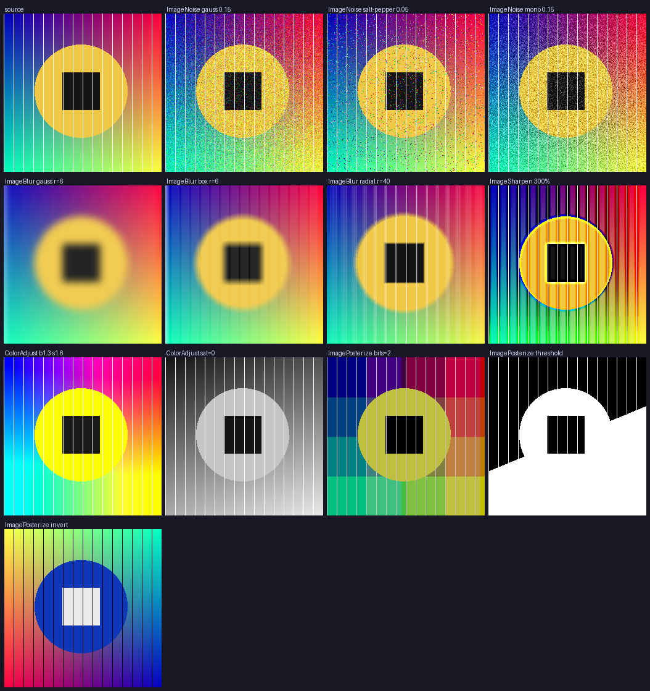
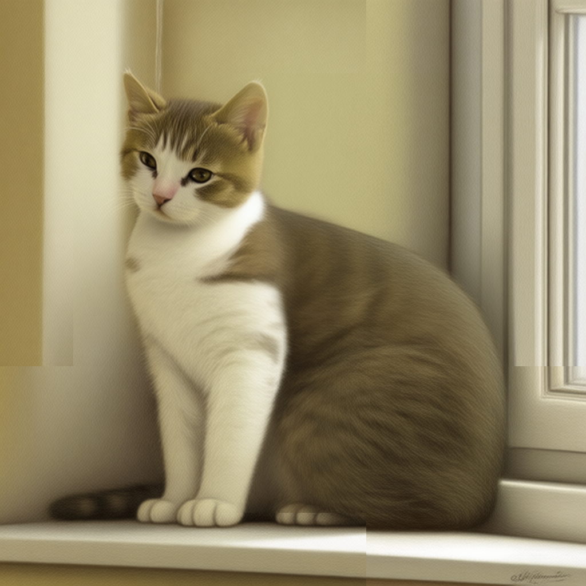
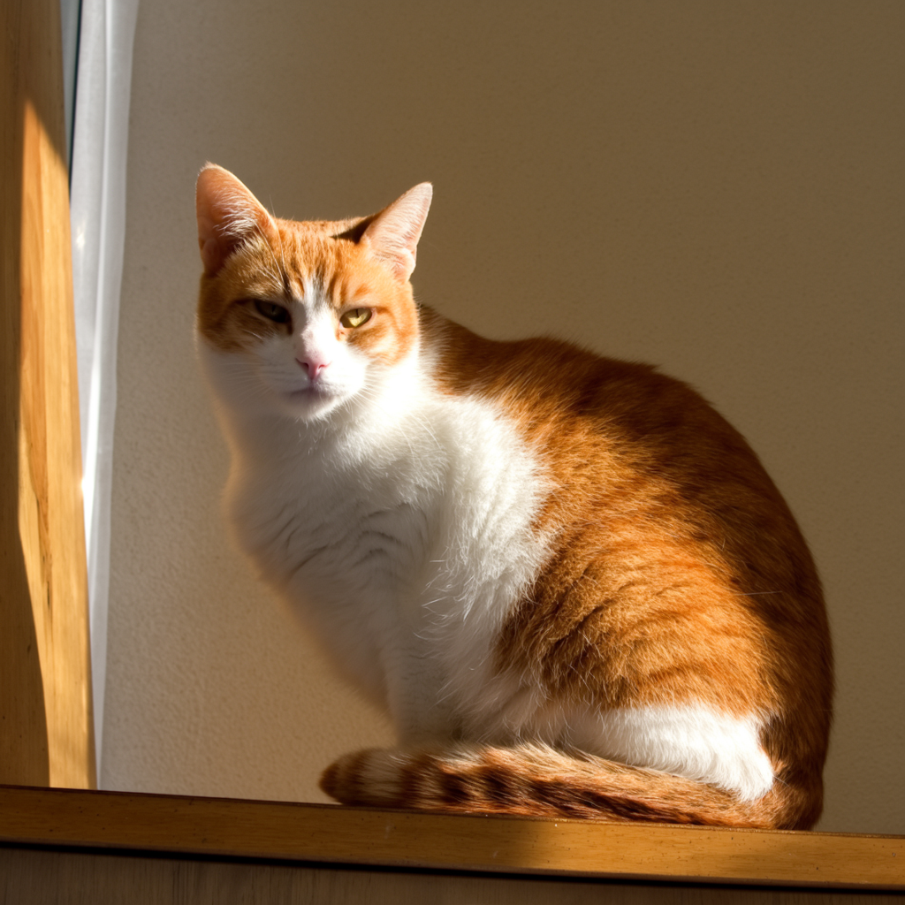

# **AI 绘画工作站 v6.0**

---

## 一、项目概述

**项目名称**：AI 绘画工作站 v6.0

**项目定位**：基于 Stable Diffusion 的专业级 AI 图像与视频生成工具，提供一站式 AI 创作体验。

**核心目标**：为用户提供直观、高效的 AI 图像和视频生成工具，支持文生图、图生图、局部重绘、人脸修复、视频生成等多种功能。

---

## 二、功能特性

### 2.1 核心功能

| 功能模块 | 功能描述 | 技术实现 |
|---------|---------|---------|
| **文生图 (Text2Img)** | 通过提示词生成图像 | StableDiffusionPipeline |
| **图生图 (Img2Img)** | 基于参考图生成新图像 | StableDiffusionImg2ImgPipeline |
| **局部重绘 (Inpaint)** | 对图像指定区域进行修复 | StableDiffusionInpaintPipeline |
| **视频生成 (AnimateDiff)** | 文生视频、图生视频、视频转绘 | AnimateDiff + Motion LoRA |
| **ControlNet** | 姿态/边缘/深度控制生成 | ControlNetModel + OpenPose/Canny/Depth |
| **IP-Adapter** | 角色一致性锁定 | IP-Adapter 模型 |
| **修图编辑器** | 图像调整、滤镜、画笔、裁剪 | PyQt6 绘图引擎 |
| **人脸修复 (ADetailer)** | 自动人脸检测与修复 | OpenCV + YOLO |
| **手部修复** | 自动手部检测与修复 | YOLOv8 手部检测 |

### 2.2 视频生成功能

| 生成模式 | 描述 |
|---------|------|
| **文生视频** | 直接用提示词生成视频，无需输入文件 |
| **图生视频** | 选择一张图片作为首帧，AI 延续动画 |
| **视频转绘** | 选择视频文件，AI 改变画风 |
| **提示词旅行** | 在不同帧使用不同提示词，制作剧情视频 |

### 2.3 扩展功能

- **多模型支持**：支持 SD 1.5 和 SDXL 模型，可识别加载 SD3 / Flux（部分功能）
- **多 LoRA 挂载**：支持同时加载多个 LoRA 插件，独立权重控制
- **Motion LoRA**：支持缩放、平移、旋转等运镜特效
- **采样器切换**：16 种采样器 × 4 种 sigma 风格（默认 / Karras / Exponential / Beta），
  界面下拉、节点参数、设置页、配置项、队列快照全部取自 `core/samplers.py` 一份实现，见 2.5
- **提示词模板**：内置多种风格提示词预设
- **AI 提示词改写**：自动将自然语言转换为专业提示词
- **X/Y 矩阵生成**：批量参数对比测试
- **Hires.fix**：高清修复放大
- **完整出图元数据**：每张图都写入 40+ 项生成参数（含模型 SHA256、LoRA、ControlNet、Hires、ADetailer、依赖版本），并附带 A1111 兼容参数串，见 2.4
- **水印**：支持文字 / 自定义图片水印，位置、透明度、大小可调，见 2.6
- **工作流引擎 + 节点编辑器**：简易模式的操作会自动编译成一张工作流图，
  高级用户可在画布上增删节点、连线、改参数并直接运行；34 个内置节点，
  见 2.5（菜单栏 → 🧩 工作流）
- **图像管理**：自动保存、历史记录、图片预览
- **视频管理**：视频预览、历史画廊、双击播放
- **v6.0 工作台**：统一媒体画廊（图片/视频切换）、底部胶片条单击回填参数、修前/修后对比滑条（文生图+图生图）、显存/内存常驻监控、设置中心（可改快捷键与默认值）、AI 回译对比（翻译→回译校验防幻觉）

#### 推理性能与素材管理增强

- **Flux / SD3 低显存推理**：在「设置 → 推理性能」中可选 DiT 权重量化与分块 CPU offload。
  FP8 使用 `torchao`，NVFP4 使用 NVIDIA ModelOpt；两者都只作用于 `transformer`，
  缺少后端、兼容 GPU 或内核时会明确报错。分块 offload 仅用于 CUDA，每组 block 数可调。
  量化默认关闭，修改推理配置后下次生成会按新配置重载模型。
- **TeaCache 风格步间缓存**：可按相邻步输入的相对 L1 距离复用上次输出，支持复用阈值
  和最多连续复用次数；每张图都会复位缓存。**任何有 `unet` 或 `transformer` 的架构都能用**
  （早期版本只对 Flux / SDXL 生效，SD1.5 / SD2 / SD3 勾了等于没开——已修）。默认关闭，
  可能改变结果，建议用固定种子对比画质和耗时，不预设固定加速比例。
  实测（SD1.5 `meinamix_v12Final`，512²，CFG 6.0，20 步）：阈值 0.18 时 21 次前向里复用
  12 步（57%），1.3s；阈值 0.6 时复用 14 步（67%），1.1s；不开缓存 2.8s。每张图生成完
  日志会打出 `步间缓存：21 步里复用 12 步（57%）`，命中 0 步时会直接提示"把阈值调大"。
  **命中率不用猜**：「设置 → 推理性能 → 当前命中率」会直接显示 `复用 r / c 步（p%）`，
  0 步命中会红字写"已启用但 0 步命中…… 把阈值调大才会真的省时间"。有些管线（如 SD3）
  每步会调两次前向（uncond / cond），单条缓存通道永远比不出相似度，程序在连续 6 步
  0 命中后会自动改成"按调用序号奇偶分道缓存"，命中后日志与界面都会带"分道模式"字样；
  分道后仍然 0 命中，下一张图会退回单通道，不会一直背着这个判断。
- **FIFO 生成队列**：普通生成会保存完整参数快照并依次执行；等待项可编辑、置顶、
  上移/下移或移除。暂停在采样步边界生效，运行中任务仍用「中断生成」取消；
  角色批量继续使用原有专用调度，不会重复进入普通队列。
  **队列跑完会把界面还原成你排队前那套参数**（排 2 张以上会提示一句）。如果你在排队
  期间自己改了滑杆，就不还原、保留你的新设置——不会拿旧快照盖掉你正在调的东西。
- **模型示例图**：在模型同目录放置同名图片即可显示下拉图标和当前模型预览。
  以 `hero.safetensors` 为例，优先读取 `hero.preview.png`，随后尝试
  `hero.preview.jpg/.jpeg/.webp`、`hero.png/.jpg/.jpeg/.webp`；不会使用其他模型的图片。
- **画廊全文与相似检索**：搜索框默认按文件名和内嵌 prompt 做多词 AND 过滤。
  点击「语义」可按文本检索，图片右键「查找相似图」可按图检索；向量缓存位于
  `data/gallery_clip_index.json`，图片大小或修改时间变化后自动重算。
  CLIP 只读取「设置 → 推理性能」填写的本地目录、`models/clip/` 或已有 Hugging Face 缓存，
  **不会自动下载模型**。可使用的默认目录为 `models/clip/clip-vit-base-patch32/`。

> 验证边界：上述能力已做不加载真实权重的自动化测试。当前环境没有 Flux/SD3 待测权重，
> 也未安装 ModelOpt，因此 8GB 显存可用性、FP8/NVFP4 实际画质与速度、真实 CLIP 检索效果
> 仍需用目标模型验收。

### 2.4 出图元数据

每张输出图都会在 PNG 里写入完整元数据，方便复现、归档与排查。
实现集中在 `utils/image_metadata.py`（全项目唯一入口）。

| 类别 | 字段 |
|------|------|
| 提示词 | `prompt`（原始，含中文）、`prompt_final`（实际送模型的最终提示词）、`negative`、`negative_final`、`prompt_mode`、`clip_skip` |
| 模型 | `model`、`model_path`（真实磁盘路径）、`model_hash`（SHA256）、`architecture`、`vpred`、`zero_snr` |
| LoRA | `loras`（名称+权重）、`lora_count`、`lora_tags` |
| 条件控制 | `controlnet_type`、`controlnet_weight`、`pose_transfer_used`、`ip_adapter_variant`、`ip_adapter_weight` |
| 采样 | `sampler`、`scheduler`（调度器类名）、`steps`、`cfg`、`seed`、`width`、`height`、`size`、`batch_index`、`batch_total` |
| Hires.fix | `hires_enabled`、`hires_scale`、`hires_denoise`、`hires_upscaler`、`hires_size`、`hires_mode` |
| Hires.fix 分块 | `tile_size`、`tile_overlap`、`tile_overlap_effective`、`tile_count`、`tile_blend`、`tile_method`、`tile_seed`、`tile_denoise`、`tile_denoise_requested`、`tile_steps`、`tile_effective_steps` |
| ADetailer | `adetailer_enabled`、`adetailer_face_strength`、`adetailer_hand`、`adetailer_hand_strength`、`adetailer_hand_blend` |
| 版本 | `version_app`、`version_diffusers`、`version_torch`、`version_transformers`、`version_python`、`version_cuda`、`version_gpu` |
| 其它 | `watermark`、`workflow`、`timestamp` |

- **模型哈希**按「路径+大小+修改时间」缓存到 `models_cache/file_hashes.json`，
  同一个底模只算一次（否则每张图都要重读 2~7GB，保存会卡好几秒）。
- 同时写入 A1111 兼容的 `parameters` 文本块，WebUI / Civitai 可直接识别。
- 任何一个字段取不到都会写成 `unknown`，**元数据采集失败绝不影响出图**。

### 2.5 工作流引擎与节点编辑器

简易模式与高级模式**共享同一个执行引擎**：你在界面上点的每一步，
都会被编译成一张工作流图；高级用户看到的、能改的就是这张图。

#### 两种模式的关系

```
界面操作                          自动生成的工作流图
文生图 → 选模型 → 提示词                  LoadCheckpoint
   → 开 LoRA            ──编译──▶        → LoadLoRA
   → 开 ControlNet                       → TextEncode / NegativeTextEncode
   → 开高清修复                           → Sampler → VAEDecode
   → 开 ADetailer                        → HiresFix → ADetailer → SaveImage
```

编译逻辑在 `workflow/builder.py`，它**复用 `_gt_prepare_context()`**——
也就是界面上那套参数解析规则（提示词解析/翻译、LoRA 标签、ControlNet 力度、
尺寸、种子…）只有一份。否则又是"两套规则、迟早不一致"。

#### 入口在哪（菜单栏 → 🧩 工作流）

| 菜单项 | 快捷键 | 作用 |
|--------|--------|------|
| 🧩 打开工作流编辑器… | `Ctrl+W` | 打开空的节点编辑器 |
| ✨ 用当前界面设置生成流程图 | — | 把当前设置编译成图并打开编辑器 |
| ▶️ **用工作流引擎生成** | `Ctrl+Shift+W` | 编译并**立即执行**（走 workflow 引擎） |
| 🩺 预检当前工作流 | — | 运行前预检：模型 / LoRA / VAE / ControlNet / 显存 / 输出目录 / 依赖 |
| 📂 从模板新建… | — | 五个能直接跑的示例：文生图 / 文生图+高清 / 局部重绘 / 参考图 / 放大 |
| 📂 打开工作流目录 | — | 打开 `workflows/`（保存的 JSON 都在这里） |

编辑器内工具栏：新建 / 打开 / 保存 / 另存为 · 从当前界面生成 / 载入界面设置 ·
校验 / **预检** (`Ctrl+P`) / 资源清单 / **运行** (`Ctrl+R`) /
**只跑选中节点** (`Ctrl+Shift+R`) / 取消 / 清空状态 / 删除选中 / 适应窗口 ·
显存策略下拉。

#### 编辑快捷键（参考 ComfyUI，少记几个坑）

| 操作 | 怎么做 | 说明 |
|------|--------|------|
| 加节点 | **双击空白** 或 `Ctrl+F` | 输入关键字过滤（类型 / 分类 / 说明都能搜），回车即加 |
| 拖线找节点 | 从输出口拖到**空白处松手** | 只列"输入口接得住这个类型"的节点，选中后自动连上 |
| 撤销 / 重做 | `Ctrl+Z` / `Ctrl+Shift+Z` | 快照式：加删节点、连线、**拖动位置**都能撤 |
| 复制 / 粘贴 / 再制 | `Ctrl+C` / `Ctrl+V` / `Ctrl+D` | 只复制选中节点，**它们之间的连线一起复制** |
| 全选 / 删除 | `Ctrl+A` / `Del` | |
| 拖文件进来 | 直接把图片拖进画布 | 自动建 `LoadImage` 节点并把路径填好（带预览） |
| 拖工作流进来 | 把 `.json` 拖进画布 | 直接打开那工作流 |
| 右键 | 画布空白处 | 添加节点 / 粘贴 / 全选 / 删除 / 从当前界面生成 / 适应窗口 / 校验 |
| 模板 | 工具栏「模板 ▾」或主菜单「工作流 → 从模板新建…」 | 不知道节点怎么连就先挑一个能跑的 |

#### 参数直接在节点卡片上改

参数**内嵌在节点卡片里**（不用来回看右侧面板），用户视线不用移动：

```
┌─────────────────────────────┐
│ Sampler                     │
├─────────────────────────────┤
│ 步数      [ 28          ]   │
│ CFG       [ 7.000       ]   │
│ 种子      [ 随机        ]   │
│ 宽        [ 512         ]   │
│ 高        [ 768         ]   │
│ 采样器    [ Euler a   ▾ ]   │
└─────────────────────────────┘
```

- 短参数（数字 / 开关 / 下拉）在卡片内直接编辑，改完立即写回工作流数据。
- **长文本参数**（提示词）卡片内是单行框，完整多行编辑仍在右侧面板；
  两边**双向同步**，不会出现"改了这边那边没变"。
- 右侧面板保留：节点说明、**输入端口连到了哪里**、**资源声明**
  （显存峰值 / 是否支持 offload / 分块 / 依赖）。

#### 本地文件用下拉框选，不用手打文件名

模型 / LoRA / VAE / 参考图这类参数会**扫描本地已下载的文件**做成可编辑下拉框
（`ui/workflow_editor/param_sources.py`），从列表里选即可；也仍可直接粘贴绝对路径。

| 参数 | 下拉内容 | 本机实测 |
|------|---------|---------|
| `LoadCheckpoint.path` | 本地底模（各架构汇总） | 10 个 |
| `LoadLoRA.lora_1~3` | 本地 LoRA（含子目录） | 14 个 |
| `LoadVAE.path` | 本地 VAE | 3 个 |
| `LoadImage.path` | 最近生成的图片（最新优先） | 40 个 |

节点作者只需在 `ParamSpec` 上声明 `source="checkpoints"|"loras"|"vae"|"images"`，
界面自动出现下拉框。

#### 参考图/产出图直接在卡片里渲染

图生图、ControlNet、IP-Adapter 这类节点，选了参考图后**卡片里立刻显示缩略图**，
不用去猜路径填对没有；运行结束后每个节点还会把**自己产出的图**渲染回卡片，
一眼能看出哪一步出了问题（哪一步图糊了、哪一步颜色跑了）。

- 参考图：由 `LoadImage` 的路径参数驱动，选完立即出图；路径无效时卡片里显示原因
  （"文件不存在"），而不是静默空白。
- 产出图：执行器把每个节点的 IMAGE 输出一并返回（`res["images"]`），
  编辑器转成缩略图塞进对应节点。
- 缩略图一律压到 104px 并带 LRU 缓存，不会因为画布频繁重绘而反复解码大图。

#### 后处理节点（加噪 / 模糊 / 锐化 / 调色 / 色调分离）

`nodes/postprocess_nodes.py`，5 个纯 CPU/PIL 节点，显存占用为 0
（`ResourceRequirement(requires=())`），可以直接串在出图后面：

| 节点 | 参数 |
|------|------|
| `ImageNoise` | 噪点强度、类型（高斯/均匀/盐椒）、种子、单色噪点 |
| `ImageBlur` | 半径、类型（高斯/方框/径向） |
| `ImageSharpen` | 强度、半径、锐化百分比、阈值（USM） |
| `ColorAdjust` | 亮度、对比度、饱和度、锐度 |
| `ImagePosterize` | 保留位数、模式（色调分离/阈值/反相） |

实测效果对比（每个节点真的有效果，含径向模糊与阈值）：



保证：不改动上游图（返回新对象，`amount=0` / 全默认参数时与原图逐字节一致）、
尺寸不变、`ImageNoise` 固定种子可复现（`seed=-1` 为随机）。

#### 分块高清修复（TiledHiresFix）— 8GB 卡也能出 2K/4K

整图高清（`HiresFix`）是"latent 放大 → 一次性重绘"，显存吃紧；
放大到 2K 在 8GB 卡上非常容易爆显存或疯狂换页。
`TiledHiresFix` 走分块路线：

```
基础生成 → 放大图像 → 切成小块 → 逐块重绘细节 → 加权融合拼接 → （可选）ADetailer
```

参数（**你要求的 6 项全都有**）：

| 参数 | 说明 | 8GB 建议 |
|------|------|---------|
| `scale` | 放大倍率 1.0~4.0 | 2.0 |
| `tile_size` | 分块尺寸 | **640**（或 512） |
| `overlap` | 重叠像素 | **48**（32~64） |
| `denoise` | 重绘强度 | **0.25**（上限 0.35，见下） |
| `upscale_method` | 放大方式 Lanczos / Bicubic / Nearest | Lanczos |
| `blend` | 边缘融合：羽化 / 线性 / 硬切 | 羽化 |
| `color_correct` | 块间色彩对齐（消除色差接缝） | 开 |
| `vram_mode` | 显存模式：自动 / 省显存 / 平衡 / 高性能 | 自动 |
| `max_tiles` | 安全阀：预计块数超限直接报错，不跑到一半 OOM | 0 |

**铺块几何是严格保证的**（我自己重算复核过，8 种尺寸全过）：

| 图尺寸 | 块/重叠 | 块数 | 漏像素 | 越界 |
|--------|--------|-----|-------|------|
| 1024×1024 | 512 / 64 | 9 | 0 | 无 |
| 1920×1080 | 640 / 64 | 8 | 0 | 无 |
| 2048×2048 | 512 / 64 | 25 | 0 | 无 |
| 500×500 | 640 / 48 | 1 | 0 | 无 |
| 733×457 | 512 / 32 | 2 | 0 | 无 |

- **全覆盖**：每个像素至少被一块覆盖（`plan_tiles` + `verify_coverage` 双重校验，
  并对宽度 8~2999 做了穷举扫描，零失败）。
- **不出碎片**：块尺寸恒为 `min(tile, 图宽, 图高)`，最后一块**贴边**而不是留一条细缝。
- **融合是归一化的**：加权累加后除以权重和，所以"把原图切片再拼回来"能**逐像素还原**
  （实测三种融合模式 `maxdiff = 0`）；不存在没写到的黑边。
- **色彩对齐**有效：块间人为加 18 级亮度差时，平均偏差从 **45 → 17**。

> ⚠️ **`overlap` 是下界，不是精确值** —— 这一点必须知道，否则会算错块数和耗时。
> 为了让覆盖完整、又不产生"几乎完全重合的最后一块"，间距会被**均摊**，
> 实际重叠常常大于请求值：
>
> | 图尺寸 | tile / 请求 overlap | 实际采用的 overlap |
> |--------|--------------------|-------------------|
> | 1024×1024 | 512 / 64 | **256** |
> | 2048×2048 | 512 / 64 | **128** |
> | 1536×1536 | 512 / 64 | **171** |
>
> 也就是说在 1024² 这个尺寸下，把 overlap 从 64 调到 128 **不会有任何变化**。
> 出图元数据里同时写入 `tile_overlap`（请求值）和 `tile_overlap_effective`（实际值）
> 以便复现。

**实测显存与耗时**（RTX 5060 Laptop 8GB，真机跑，不是估算）：

| 场景 | 结果 |
|------|------|
| 512 底图 → `TiledHiresFix` **4x → 2048×2048**（tile 512 / overlap 64 / denoise 0.35 / 4 步） | ✅ 成功，13.3s，**25 块**，**峰值 2677 MB（占 8123 MB 的 33%）** |
| 同上 2x → 1024×1024 | ✅ 成功，6.5s，9 块，峰值 2676.8 MB |
| `TiledUpscale` 2x（纯放大，不用模型） | 与 Lanczos **完全一致**（maxdiff 0） |
| `denoise=0` 的 `TiledHiresFix` | 与 Lanczos **逐像素一致**（maxdiff 0），且完全不加载模型 |

> **一个必须说清的诚实结论**：分块在**低分辨率下并不是显存优化**。
> 1024² 时节点的激活值增量是 +610.6 MB（分块）vs +616.5 MB（整图），基本没差别；
> 上面那个 2677 MB 的峰值主要是 **CPU offload 下常驻显存里的权重**。
> 分块的收益随分辨率增长才体现出来：**2048² 时 +610.6 MB vs +1171.2 MB，且快一倍**。
> 所以：1024² 用整图或分块都行（分块更慢），**2048² 以上分块才真正划算**。

**v6.0 修掉的三个节点级问题**（都能在真机上复现，已写成回归测试）：

| 问题 | 现象 | 现在 |
|------|------|------|
| 提示词被丢掉 | 节点无条件 `kw.pop("prompt")`，而只有 Compel 架构才有 `prompt_embeds`；Anima / SD3 这类只会用文本提示词的架构等于**空提示词重绘** | 只在确实带了 `prompt_embeds` 时才丢文本形式 |
| 每块尺寸没传 | Anima 的 `ModularPipeline` 不传 `height/width` 就按默认 1024 出图 → 每块都在跑整图（慢 7 倍、峰值 9679MB） | 按管线签名自动判断；Anima 强制传，SD1.5/SDXL 不传（它们没有这两个形参，传了只会被静默忽略） |
| 强度过大 / 生效步数不足 | `denoise=0.35` + `4 步` → 只 1 步生效，一只猫画成**三只**、块边界显形 | 强度上限 0.35、默认 0.25，**可在「分块强度」滑杆里自己调**；总步数自动抬到 `3 / strength`（强度不变） |

羽化宽度也从"请求 overlap 的一半"改成"**实际** overlap 的一半" —— 请求 48 时实际
重叠常见 256，只羽化 24px 会在平色区留下色阶台阶（实测 y 方向可见横带）。

#### 高清与修脸的顺序由你决定

两种顺序对人脸效果不同，界面里可以直接选（`先高清后修脸` / `先修脸后高清`）：

| 顺序 | 链路 | 效果 |
|------|------|------|
| 先高清后修脸 | 基础图 → 高清 → ADetailer | 放大后再修脸，**脸更锐利清晰** |
| 先修脸后高清 | 基础图 → ADetailer → 高清 | 先修好脸再放大，**脸更自然**（放大时可能被二次柔化） |

实测两条链都能生成并通过校验：

```
先高清后修脸: … → VAEDecode → TiledHiresFix → ADetailer → SaveImage
先修脸后高清: … → VAEDecode → ADetailer → TiledHiresFix → SaveImage
```

#### 修脸 / 修手在没有 inpaint 的架构上也能用（图生图兜底）

以前 `ADetailer` 只走蒙版 inpaint 一条路：`inpaint_pipe` 为 `None` 就
`logger.warning("⚠️ inpaint_pipe 不存在，跳过 ADetailer")` 然后**什么都不做**。
Anima 这类只有一条模块化管线的架构因此脸和手**根本没被修**，日志里还是
`耗时: 0.00秒`（用户实测踩到）。

现在会退一步：没有 inpaint 就用 **「裁切 → 图生图精修 → 贴回」**：

| 情况 | 行为 | 日志 |
|------|------|------|
| 有 inpaint（SD1.5/SDXL） | 原样：裁切 + 蒙版重绘 | `🩹 [ADetailer] 局部重绘 1/1，尺寸 512x512` |
| 只有 img2img（Anima） | 裁切后整块图生图（不传 mask） | `🩹 [ADetailer] 局部图生图精修 1/1，尺寸 480x512` |
| 两个都没有 | 明确跳过并说明原因 | `⚠️ 当前架构既没有 inpaint 也没有 img2img 管线，跳过 ADetailer` |

要点：
- **不传 `mask_image`**（img2img 管线不认识它，传了只是噪音）；
- 裁剪尺寸按 **16** 对齐（原因见上一节的坑 2，实测 472 会让 Anima 崩在 `patch_embed`）；
- Anima 的参数要搬进 `PipelineState` 才能调，所以走 `GenerationMixin._adetailer_call()`
  统一适配（modular 转 state，非 modular 原样直连，**不走 Compel**，SD 行为不变）；
- 能力表同步：`AnimaAdapter` 的 `adetailer` 改成 `True`、`inpaint` 仍是 `False` ——
  能力表说什么，代码就真的能做到什么。

**高清方式**可选 `自动 / 整图(快) / 分块(省显存)`：自动档在显存 <10GB **且当前架构
不能 CPU offload**（如 Anima，权重必须常驻）时选分块；能 offload 的 SD1.5/SDXL 在
1024² 走整图——更快，也没有块边界。要 2K/4K 请手动选「分块 (省显存)」。

> **主界面同样吃这个下拉**（v6.0 修正）：以前这个选项只被工作流生成器读，主界面
> 生成流程里根本没看它 —— 选「分块」也照样整图 img2img。现在阶段 2 会先调用
> `_hires_mode_resolved()` 再决定走哪条路，选「分块」就真的分块。

#### 主界面 Hires.fix（分块）—— 8GB 也能出 1024 以上

阶段 2 走分块时不再需要工作流，直接在主界面勾「启用高清修复」+ 把「高清方式」设为
`分块 (省显存)` 即可。实测（本机 8GB / Anima 3.9GB 底模，512² → 1024²，2 倍、4 块 640²）：

| 项 | 实测值 |
|------|------|
| 耗时 | **12.7s**（4 块 × 3.8s + 融合） |
| 输出 | 1024×1024，`tile_overlap_effective=(256,256)`、羽化 128px |
| 画面 | 单主体、构图与底图一致，无重复主体 |
| 直接整图 1024² 对照 | 单块 28~30s、峰值 9679MB（超 8GB → WDDM 换页） |



三个刻在代码里的坑（`utils/tiled_hires.py`、`utils/app_generation.py` 注释里都有）：

1. **每块必须显式传 `height/width`**。Anima 的 `ModularPipeline` 不传就按默认 1024
   出图 —— 等于每块都在跑整图，慢 7 倍还爆显存。而 SD1.5/SDXL 的 img2img
   `__call__` **没有** `width/height` 形参（尺寸跟着 `image` 走），传了只会被静默忽略。
   所以现在按管线签名自动判断（`pass_size`），Anima 强制传。
2. **尺寸必须是 16 的倍数**。Anima 是 `VAE /8 × transformer patch /2`，给 472 这种
   只在 8 对齐的尺寸会直接崩在 `patch_embed`（`shape '[1, 17, 1, 1, 32, 2, 29, 2]'
   is invalid`）。分块铺排与局部精修的裁剪尺寸现在统一按 16 对齐
   （`tiled_hires.SIZE_MULTIPLE = 16`）。
3. **生效步数不足等于整块重画**。img2img 的生效步数 = `steps × strength`，
   `4 步 × 0.35` 只有 1 步生效（实测偏离底图 MAD 23.7）；总步数会被自动抬到
   `3 / strength`（同样强度 → 12 步、生效 3 步，MAD 降到 ~10），**强度本身不动**。

**分块强度是你自己调的**：高清分组里新增「分块强度」滑杆
（`scale_hires_tile_denoise`，范围 0.10~0.35，默认 **0.25**），只影响分块模式，
和整图的「降噪强度」互不干扰 —— 想要"只加细节"就往 0.15 调，想要"明显重画"往上调。
超过 0.35 才会被夹（那是"各块各画各的"的边界，实测 0.35 就出问题），
所以正常使用不会再看到那条长篇劝告。

元数据里会多出 `hires_mode=tiled`、`tile_size`、`tile_overlap`、
`tile_overlap_effective`、`tile_count`、`tile_denoise`、`tile_denoise_requested`、
`tile_steps` 等字段。

#### 区域提示词与局部重绘（主界面就能用）

复杂画面想分别控制"脸 / 衣服 / 背景"时用。**不需要懂工作流** ——
主界面「🎯 区域提示词」分组 → 点「🎯 编辑区域…」→ 在画布上**拖框** →
每个框写自己的提示词：

```
全局提示词：portrait, detailed clothing
├─ 脸部区域：detailed face, sharp eyes
├─ 衣服区域：intricate fabric, embroidery
└─ 背景区域：forest, soft light
```

支持的能力（逐条状态，不美化）：

| 能力 | 状态 |
|------|------|
| 矩形区域提示词 | ✅ 归一化坐标，越界自动夹取，反向坐标自动交换 |
| 蒙版区域提示词 | ✅ 导入黑白图（**白=生效**），任意尺寸自动缩放 |
| 区域权重 | ✅ 直接作为该区域重绘的 `strength` |
| 局部负面提示词 | ✅ 留空则用全局负面词 |
| 局部 ControlNet | ⚠️ **能跑，但语义是近似的**（见下） |
| 局部 ADetailer | ✅ 真的局部（只在区域包围盒内检测） |

**编辑器**：拖框新增 / 导入蒙版 / 每个区域独立设置提示词·负面词·权重·羽化 /
可选的局部 ControlNet·局部 ADetailer / 区域集存成 JSON 复用。

**实测证据**（`docs/images/regional_preview.png`，自左至右）：


1. 底图 `empty room, white walls`
2. 左右两半两个区域（`a red apple` / `a blue banana`）→ **左右互不相同**
   （MAD 37.03），且各自与底图都不同（12.57 / 20.62）
3. 只开左上象限一个区域 → **右下象限 MAD = 0.00（逐像素完全没变）**
4. 经工作流执行器输出

**峰值显存 2678 MB / 8123 MB（33%）且与区域数量无关** —— 区域是逐个跑的，
任何时刻只有一次 inpaint 在飞。所以 `RegionalRedraw` 的显存声明是 2600 MB 量级，
而不是 2600×区域数（否则 8GB 卡会被显存策略直接判死）。

**工作流侧**：`RegionalPrompt`（定义区域）→ `RegionalRedraw`（逐个应用），
端口类型是新加的强类型 `REGIONS`（连错端口会在**运行前**报类型不匹配）。
简易模式里设了区域，编译出的工作流也会带上这两个节点，所以
"简易模式出的图"和"高级模式看到的图"仍然是同一件事。

```python
from core.regional import Region, apply_regions, validate_regions

regs = [Region(name="脸部", prompt="detailed face, sharp eyes", weight=0.55,
               shape="rect", rect=(0.3, 0.1, 0.7, 0.45)),
        Region(name="衣服", prompt="intricate fabric, embroidery", weight=0.45,
               shape="mask", mask_path="masks/clothes.png")]
print(validate_regions(regs, 512, 768))      # 运行前的中文问题清单
img, meta = apply_regions(ai, model, base, regs, steps=24, cfg=7.0, seed=-1)
print(meta["regions_applied"], meta["region_errors"])
```

**实现方式是"顺序蒙版重绘"**（区域精修），不是逐步注意力耦合
（A1111 Regional Prompter / Latent Couple 那种）。

- 好处：复用既有 inpaint 管线、可预测、8GB 上跑得动、能覆盖上面全部六项能力。
- 代价（**必须说清**）：区域是在底图**之后**逐个精修的，不是每一步去噪都参与，
  所以区域之间的全局协调性（光照/风格统一度）比注意力耦合法略低。
  接口留好了替换位置（换 `_region_sampler` 内核即可，签名不用动）。

**两处诚实的折扣**：

1. **局部 ControlNet 是近似语义**。仓库里只有 **txt2img** 的 ControlNet 管线
   （`StableDiffusionControlNetPipeline`，没有 `mask_image` 入参），没有
   ControlNet+Inpaint 的装配。所以现在走的是"CN 引导生成 + 按蒙版贴回"，
   **底图不参与该次采样**，区域内的承袭性比 inpaint 低。
   要变成"CN 引导的 inpaint"需要新写一个 `StableDiffusionControlNetInpaintPipeline`
   装配 —— 这是目前唯一没做的东西。取不到权重/类型不认识时**只警告并退回普通蒙版重绘**。
2. **局部 ADetailer 的检测范围限制在区域包围盒内**（裁框检测）。
   YOLO 检测器没有"只看蒙版形状"的入参，所以区域外的脸不会被本区域修到
   （符合预期），但"框内非蒙版区的脸不修"做不到。

> ⚠️ 修过一个**静默失效**的真 bug：区域配了局部 ADetailer 时，曾把**重绘前**的图
> 裁给 ADetailer 再贴回，导致该区域的提示词重绘被整体覆盖（区域差异从 43.6 掉到 1.1）。
> 现在 `tests/test_regional.py` 把调用点钉死了。

#### 界面设置 → 工作流：不能有静默降级

简易模式的设置要编译成工作流图，而"辅助项"（LoRA / ControlNet / IP-Adapter）
的真实值原本由 `_gt_setup_ipa` / `_gt_apply_loras` / `_gt_run_pose_transfer`
写进 ctx，那三个函数**只在 `start_generation` 主流程里被调用**，
而 `_gt_prepare_context()` 返回的是**硬编码初值**：

```python
'use_ipa': False    'use_pose': False    'lora_meta_info': []
```

于是 `builder.build_from_ui()` 拿到的永远是"什么都没开" ——
**界面勾了 LoRA / ControlNet / IP-Adapter，生成的工作流图里一个对应节点都没有，
而且不报错不警告**（最危险的一类故障：用户以为用了，实际根本没跑）。

修法是加一个 `_gt_aux_state()`：**纯读、无副作用**地把"用户想要什么"读出来
（不加载权重、不跑推理），builder 与那三个 setup 函数**共用同一套读数**，
两边不会再对不上。实测三项齐全时的节点链：

```
LoadCheckpoint → LoadLoRA → LoadImage → ControlNetPreprocess → ControlNetApply
  → LoadImage → IPAdapterApply → TextEncode → NegativeTextEncode
  → Sampler → VAEDecode → TiledHiresFix → ADetailer → SaveImage
```

**并且不再静默**：builder 把"界面上开着但没能进图"的项（通常是缺参考图）
记进 `wf.metadata["warnings"]`，编辑器和主界面都会**红字列出 + 弹窗提示**：

```
⚠️ 界面上的设置没能进工作流：ControlNet「openpose」已启用，但找不到参考图/姿势图…
```

顺带修掉一个同源的 bug：`_gt_run_pose_transfer` 读的是 `self.pose_image`，
而这个属性**在整个项目里从未被赋值** → `prepare_controlnet("openpose")`
永不执行，用户上传的骨架图被静默忽略（**连老的手动 ControlNet 路径也是坏的**）。
真正被赋值的是 `self.pose_image_path`，现在通过 `_gt_pose_pil_image()` 读。

这两条都由 `tests/test_builder_aux.py`（6 项）锁住。

**还有两个更深一层的静默失效**（顺着这条线挖出来的）：

1. **LoRA 挂载被静默跳过**。`LoadLoRA` 节点传的是 `[{"name":..,"weight":..}]`，
   而 `apply_multiple_loras` 内部是 `for (lora_name, weight) in lora_list` ——
   对字典解包拿到的是**键**（`"name"`/`"weight"`），于是它去找一个名叫 `name`
   的文件、找不到就 `continue`：**LoRA 完全没挂上，出图和不挂 LoRA 逐像素相同**
   （实测 mean = 0.0），而节点里那个 `except TypeError` 兜底也救不了
   （2 键字典解包根本不抛 TypeError）。修复后 `active_adapters` 从 `[]`
   变成 `['lora_slot_0']`，出图差异从 **0.0 → 33.3**。
2. **LoRA 会泄漏到下一个工作流**。`load_model()` 对同一模型会短路跳过，
   而 LoRA 是挂在管线上的副作用状态 —— 于是"没有 `LoadLoRA` 节点的工作流"
   **继承**上一个工作流挂的 LoRA（实测两张图差异 0.0，本该 33.3）。
   现在 `LoadCheckpoint` 会先清空残留 LoRA，建立干净基线：
   带 LoRA 的图 vs 之后不带 LoRA 的图 = 33.3，而无 LoRA 的图前后两次 = 0.0（可复现）。

三条链路由 `tests/test_lora_plumbing.py`（6 项）锁住。

3. **IP-Adapter 装载失败会把整个会话的管线弄坏**（最致命的一个）。
   `unload_ip_adapter()` 曾把 `image_processor` 和 `image_encoder` /
   `feature_extractor` 一起置 `None` —— 但 `image_processor`
   （`VaeImageProcessor`）是**基础管线的核心组件**，每次出图都要用它把 latent
   转成 PIL。而 `prepare_ip_adapter()` 的失败分支会调用 `unload_ip_adapter()`，
   于是"选了一个本机没装的档位"这种小事，会让**之后所有出图全部失败**，
   报的还是与 IP-Adapter 毫无关系的：

   ```
   AttributeError: 'NoneType' object has no attribute 'postprocess'
   ```

   实测：装载失败的 `plus` 档位后，**连不带 IP-Adapter 的普通文生图也立刻失败**。

   根因还有两层：界面下拉默认 `plus (推荐)`，而扩展市场里的 `ip_adapter_sd15`
   装下来的是 **`base`**（`ip-adapter_sd15.safetensors`）——**自家安装器和自家默认值
   对不上**；档位查不到时旧代码会去**在线拉取**，离线时一挂就是 **669 秒**才失败。

   修法：`unload_ip_adapter` 不再碰 `image_processor`（改为备份/恢复）；
   `resolve_ipa_weights` 优先用**本机已装的档位**并明确告知，否则**立刻**报出
   "缺哪个文件、去哪里装"；补上 `standard → base` 的档位别名。
   由 `tests/test_ipa_plumbing.py`（7 项）锁住。

   **慢失败的两层来源（实测）**：修完"不联网"之后仍然慢，是因为
   `resolve_ipa_weights` 里还有一处 `hf_hub_download(..., local_files_only=True)`
   —— 它在**缓存未命中**时要把整个 HF 缓存目录扫一遍才能确定"真的没有"，
   本机实测 **6.216 秒/次**（缓存里有好几个 GB 的仓库）。现在改成按 HF 的
   目录布局直接 `os.path.isfile` 拼路径查找（`_ipa_hf_cache_hit`），
   **0.000 秒**。加上"不许返回在线仓库"的源码断言，这条路径总耗时
   从 **126s / 669s / 6.2s → < 5ms**（`tests/test_ipa_multi.py` 锁住）。

#### 多参考图 IP-Adapter（角色 + 每图权重 + 独立区域）

从"一张参考图一个强度"升级为：

```
参考图 A：人物身份  →  IPAdapterIdentity     （ideal: plus-face）
参考图 B：服装风格  →  IPAdapterStyle        （ideal: plus）
参考图 C：画面构图  →  IPAdapterComposition  （ideal: base）
```

两个入口都能用：**主界面**「🎭 多参考图 (IP-Adapter)」分组（勾选启用 → 编辑
参考图 → 生成时自动生效），以及**工作流编辑器**「适配」分类下的三个角色节点。
两边都调**同一个函数** `core/ipa_multi.build_runtime(refs, ai)`：它一次返回
`{images, scales, masks, info}`（收图 / 解析角色降级 / 安装 N 个适配器 / 算注意力掩码），
主界面与工作流各只留一个薄封装。以前两边各写一套七步流程，改一处忘一处就会漂移
（这个项目在 output_dir、LoRA/CN/IPA 读数、超分签名上都已经这样吃过亏），
`tests/test_ipa_multi.py` 会检查两边源码里只出现 `build_runtime(`、不许再出现
`prepare_ip_adapter_multi(` / `collect_reference_images(` / `plan_masks(`。

角色 → 权重文件是**真的**（h94/IP-Adapter 里三个训练目标不同的文件）：

| 角色 | 档位 | 文件 |
| --- | --- | --- |
| 身份 identity | `plus-face` | `ip-adapter-plus-face_sd15.safetensors` |
| 风格 style | `plus` | `ip-adapter-plus_sd15.safetensors` |
| 构图 composition | `base` | `ip-adapter_sd15.safetensors` |

**累加语义**：三个节点串联只产生**一次** IP-Adapter 应用 ——
节点本身只把参考图登记进 `model.meta["ipa_refs"]`，真正的安装在采样前一刻
由 `ModelManager.prepare_ip_adapter_multi()` 一次完成（N 个权重一起传给
`load_ip_adapter()`，每适配器一个 scale）。这与 LoRA 的做法一致
（`LoadLoRA` 只登记、`apply_multiple_loras` 一次挂上）。

**优雅降级**：本机只装了 `base` 时，身份/风格会退用 `base`、保留各自权重，
并把中文说明写进 `ctx.metadata["warnings"]`（同一条降级只报一次）。
一个档位都没装才抛错，且**秒级**。

**独立参考图区域**：区域功能（`core/regional.py`）新增 `ip_adapter` 钩子。
"这张参考图只影响这块区域"是两步一起做的：
① 参考图先按区域蒙版抠图（区域外内容不进 CLIP）；
② 区域蒙版作为 `cross_attention_kwargs["ip_adapter_masks"]` 限制注意力。
采样结束后会把 IPA 强度恢复成全局值（否则后一个区域会继承前一个的强度）。

实测（8GB RTX 5060，512×512，12 步，seed 固定）：

| 场景 | 与基线 mean abs diff | 峰值显存 |
| --- | --- | --- |
| 基线（不带 IP-Adapter） | — | 2676 MB |
| Style + Identity 两张参考 | **71.6** | 3973 MB / 8123 MB |
| 只 Style | 81.5 | 3926 MB |
| 只 Identity | 70.1 | 3926 MB |
| 区域独立参考图（左下半区） | 区域内 **23.5** / 区域外 **0.007** | 3927 MB |

（多参考图结果与"只有 Style"差 80.3、与"只有 Identity"差 84.2 ——
说明两张参考真的共同参与了，而不是只生效最后一张。）

**不会再静默跳过**：以前勾了「启用 IP-Adapter」却没选参考图时，代码先把
`use_ipa` 置 False，紧接着那段"已开启但未加载参考图，自动跳过"的提示永远
走不到（判断恒假），于是什么也不发生、什么也不说。现在会先弹一条状态栏提示
再跳过，日志里也有记录。

**诚实说明没做到的**：
· `start_at` / `end_at`（每参考图的起止步）**只被记录**，不改变采样 ——
  diffusers 0.40 的 IP-Adapter 只支持按注意力层设 scale，
  没有逐参考图的步数窗口，采样过程中也没有回调可以改它（会写进 warnings）。
· 已核实的 diffusers 0.40 能力（含 `文件:行号`）见
  `ModelManager.prepare_ip_adapter_multi` 的文档字符串。
· 「收参考图 → 权重≤0 留占位图 → 掩码抠图 → 一次装 N 个 → 每图 scale →
  masks → 元数据」这七步，主界面（`utils/app_events.py`）和工作流
  （`nodes/sampling_nodes.py`）**共用同一份实现**（`core/ipa_multi.py` 的
  `collect_reference_images` / `plan_masks` / `enabled_refs`）。
  以前两边各写一遍，改一边忘另一边就会漂移 —— 现在由
  `tests/test_ipa_multi.py::test_both_paths_use_the_shared_helpers` 锁住。

由 `tests/test_ipa_multi.py`（27 项，无 GPU）锁住。

#### 模型架构适配层（节点只判断能力，不判断模型名）

节点里**不允许**写 `if arch == "sdxl": ...`。模型加载后产出一份统一能力描述，
节点只问"能不能做某事"：

```python
from workflow.adapters import capabilities_for, UnsupportedFeatureError

caps = capabilities_for("flux")          # 或 ai.capabilities（加载后）
caps.supports_controlnet                 # False
caps.require("controlnet")               # → UnsupportedFeatureError

if caps.supports_hires_fix:
    ...
else:
    raise UnsupportedFeatureError("高清修复", caps.architecture)
```

```python
ModelCapabilities(
    architecture="anima",
    supports_txt2img=True,
    supports_img2img=True,
    supports_inpaint=True,
    supports_controlnet=False,
    supports_ip_adapter=False,
    supports_lora=False,
    supports_hires_fix=False,
    supports_adetailer=False,
    recommended_precision="bf16",
)
```

实测各架构能力表（`prec` = 推荐精度）：

| 架构 | 精度 | 文生图 | 图生图 | 重绘 | ControlNet | IP-Adapter | LoRA | Hires | ADetailer |
|------|------|:---:|:---:|:---:|:---:|:---:|:---:|:---:|:---:|
| sd15 | fp16 | ✅ | ✅ | ✅ | ✅ | ✅ | ✅ | ✅ | ✅ |
| sd2.x | fp16 | ✅ | ✅ | ✅ | ✅ | ✅ | ✅ | ✅ | ✅ |
| sdxl | fp16 | ✅ | ✅ | ✅ | ✅ | ✅ | ✅ | ✅ | ✅ |
| anima | bf16 | ✅ | ✅ | ✅ | — | — | — | — | — |
| flux | bf16 | ✅ | ✅ | — | — | — | — | — | — |
| sd3 | bf16 | ✅ | ✅ | ✅ | — | — | ✅ | ✅ | ✅ |
| video | fp16 | ✅ | ✅ | — | — | ✅ | — | — | — |

**只有一份能力表**：`ModelCapabilities` 完全由既有 `AdapterCaps` 派生
（`AdapterCaps` 是唯一真相），不会出现"适配器说不支持、能力表说支持"这种两套说法。
测试里对 6 个架构逐一断言了两者一致。

配套：

- `ai.capabilities`：模型加载后由模型管理器给出；**未加载时返回 `None`**
  （不编造默认能力，否则会掩盖真正的问题）。
- `ctx.capabilities`：执行期挂在 `NodeContext` 上，节点可直接
  `ctx.capabilities.require("controlnet")`。
- `UnsupportedFeatureError` 是 `RuntimeError` 子类（老代码兼容），
  但 UI/预检可据此区分"功能不支持"（该提示换模型）与"运行出错"（该看堆栈）。
- 能力名有别名表（`"hires"` → `"hires_fix"`），旧写法不会立刻炸。

这样以后加 Flux / 视频模型，只需加一个 adapter 并填能力表，
**不用回头改 `start_generation()`、`model_manager.py` 和一堆节点里的 if/else**。
实测节点里按架构名硬分支的地方为 **0** 处。

> `LoadCheckpoint` 原来有个「采样器」参数，已经**删掉** —— 采样器属于
> `Sampler` 节点，两个地方都能设只会互相覆盖。老工作流里残留的
> `sampler` 参数会被忽略（打日志），不会报错。实测真跑出图元数据里
> `sampler` 仍是界面选的那个，说明切换功能没有丢。

#### 运行前预检（WorkflowPreflight）

点运行（或 `Ctrl+P`）时，**在真正加载模型之前**把所有能查的问题一次报完，
按严重程度分三档：

- **错误**：无法运行，必须处理
- **警告**：可以运行，但可能影响效果或速度
- **提示**：建议操作

```python
from workflow.preflight import run_preflight
res = run_preflight(wf, host=win, ai=win.ai)

res.ok                  # bool：无错误即可运行
res.errors / res.warnings / res.hints   # [PreflightIssue]（含 code / message / node_id / fix）
res.required_models     # 需要的底模/LoRA/组件清单
res.estimated_vram_mb   # 预计显存
res.estimated_time      # 预计耗时（秒，粗估）
print(res.to_text())    # 中文分档报告，UI 直接显示
```

检查项：

| # | 检查 | 判据 |
|---|------|------|
| 1 | 工作流结构 | 未注册节点 / 环 / 必填输入缺失 / 类型不匹配 |
| 2 | 节点输入完整 | 必填输入既没连线也没字面量 |
| 3 | 模型文件存在 | 按 `load_model` 的搜索规则找文件 |
| 4 | 模型架构匹配 | 真实探测架构；多架构混用给警告；节点能力 vs 架构 |
| 5 | VAE 兼容 | 文件存在 + 按体积/文件名粗判是否与底模同代 |
| 6 | ControlNet 匹配 | 类型是否被 `prepare_controlnet` 支持 + 权重是否已在本地 |
| 7 | LoRA 适用 | 探测 LoRA 架构，与底模比对（**实测能抓出 SDXL LoRA 配 SD1.5 底模**） |
| 8 | 显存是否满足 | 汇总节点声明 vs 设备总量，并说明会自动采取什么策略 |
| 9 | 输出目录可写 | 真写一个临时文件；**并检测配置目录是否被静默回退** |
| 10 | 依赖组件 | torch/diffusers/Pillow + 节点声明的可下载资产与外部工具 |

实测：整轮预检 **21ms**（9 项检查），不加载模型、不推理。任何单项检查异常都降级成
警告，**预检本身绝不阻断或崩溃**。

示例输出：

```
❌ 预检未通过（1 个错误）

❌ 错误（1）
  · [lora_x] LoRA「xxx.safetensors」是 sdxl 用的，但主模型是 sd15（sd1.5）
      → 换一个对应架构的 LoRA，或换底模

⚠️ 警告（1）
  · 当前显存 7.9GB，已自动启用 CPU Offload
      → 这是正常的省显存模式；显存更大时可切「高性能」预设提速

预计显存 15400 MB · 预计耗时约 8s · 平衡模式（8~16GB…）· 全 GPU · 分块≥1.0MP
```

#### 统一模型资源管理（工作流按资源 ID 依赖模型）

**问题**：工作流原来只存一个硬编码路径，于是换台电脑就失效、挪个目录就找不到、
用户也不知道到底缺哪些模型。

**做法**：工作流不存"我的硬盘上在哪"，而存**依赖的是哪个资源**
（`workflow/resource_store.py`）：

```json
{
  "resource_id": "checkpoint/sd15/abyssorangemix2_hard",
  "filename": "abyssorangemix2_Hard.safetensors",
  "model_type": "checkpoint",
  "architecture": "sd15",
  "sha256": "",
  "source": "local",
  "source_url": "",
  "local_path": null
}
```

- `resource_id` = `类型/架构/文件名主干`，**先取 basename 丢掉全部路径成分**
  —— 这是"换电脑/挪目录都不失效"的关键，所以 ID 里永远不含盘符和目录。
- `local_path` 默认写 `null`。运行的那一刻才在本机反查真实路径。
- `sha256` 默认空字符串：普通扫描**不算哈希**（10 个底模加起来几十 GB，
  扫一次就要几分钟）；只有显式要求校验时才用 `utils.image_metadata.file_sha256()`
  算，并复用它的磁盘缓存。

**运行时的闭环**（正是你描述的那条链路）：

```
检查资源 → 存在 → 继续执行
        → 缺失 → 显示资源卡片 → 用户下载 → 校验 → 重新预检
```

- **解析**：`resolve(ref)` 按 `resource_id → sha256 → filename → local_path` 依次反查，
  返回 `ok` / `found_elsewhere`（位置变了但找得到）/ `missing` /
  `arch_mismatch` / `sha_mismatch`。畸形引用**绝不抛异常**，降级为 `missing`。
- **报告**：`missing_report(refs)` 给出 `present / missing / mismatched /
  downloadable`，UI 直接拿它渲染"资源卡片"。
- **预检接入**：缺资源报**错误**并附可操作建议；资源"位置变了"只报**警告**
  （能跑）。实测缺底模时报 `resource_missing` + `model_missing` 两条，
  并告诉用户该把文件放哪。
- **界面**：编辑器工具栏 →「🗂 资源依赖」，列出名称/类型/架构/状态/大小/说明，
  支持「🔄 重新检测」和「📂 打开模型目录」。

**下载入口的边界（遵守项目既定策略）**：

| 资源类型 | 下载入口 |
|---------|---------|
| ControlNet / ADetailer / IP-Adapter / 插帧 / Flux 引擎（辅助组件） | ✅ 「下载」按钮，走既有 `extension_manager.download_extension()`，**不新增任何下载入口** |
| 底模 / LoRA / VAE | ❌ **不提供下载**，只告诉用户缺什么、放到哪个目录，放好后点「重新检测」 |

也就是说：模型仍然完全由用户自行下载，程序只是**知道**自己依赖哪些资源。

```python
from workflow import resource_store as RS

cat = RS.build_catalog()            # 扫描本地（实测 29 项 / 15ms，不算哈希）
r = RS.by_filename("mix2_Hard.safetensors")
ref = RS.to_ref(r)                  # → 写进工作流的引用（local_path=None）
res, status, detail = RS.resolve(ref)     # → "ok"

rep = RS.missing_report(RS.collect_refs(wf))   # 工作流的资源依赖体检
print(rep["summary"], rep["downloadable"])

RS.save_catalog()                   # 持久化到 models_cache/resources.json
```

`collect_refs(wf)` 对**老工作流**（只存了 `path`）也能工作：会自动按文件名
升级成带 `resource_id` 的引用，所以不用手工迁移已有流程。


#### 用代码调用（不经过界面）

```python
from workflow import builder
from workflow.executor import run_workflow

# 1) 把当前界面状态编译成图
wf = builder.build_from_ui(win)          # win = 主窗口（提供 ai / config）

# 2) 跑它（返回 dict：ok / states / outputs / cached / failed_node / error）
res = run_workflow(wf, host=win)
print(res["summary"] if "summary" in res else res["ok"], res["outputs"])

# 3) 只重跑某个节点（其余用缓存）
from workflow.executor import Executor, make_context
ex = Executor(make_context(host=win, ai=win.ai))
ex.run(wf, only=["saveImage_1"])
```

也可以完全脱离界面跑（`host=None`，输出落 `photo/`）：

```python
from workflow.schema import Workflow, Node
from workflow.executor import run_workflow

wf = Workflow(name="无头文生图")
wf.add(Node("model_1", "LoadCheckpoint", {},
            {"path": "meinamix_v12Final.safetensors"}))
wf.add(Node("prompt_1", "TextEncode", {}, {"text": "1girl, cat ears"}))
wf.add(Node("neg_1", "NegativeTextEncode", {}, {"text": "lowres"}))
wf.add(Node("sampler_1", "Sampler", {},
            {"steps": 28, "cfg": 7.0, "seed": 123, "width": 512, "height": 768}))
wf.add(Node("decode_1", "VAEDecode", {}))
wf.add(Node("save_1", "SaveImage", {}, {"filename_prefix": "wf_"}))
wf.connect("model_1", "model", "prompt_1", "model")
wf.connect("model_1", "model", "neg_1", "model")
wf.connect("model_1", "model", "sampler_1", "model")
wf.connect("prompt_1", "conditioning", "sampler_1", "positive")
wf.connect("neg_1", "conditioning", "sampler_1", "negative")
wf.connect("model_1", "model", "decode_1", "model")
wf.connect("sampler_1", "latent", "decode_1", "latent")
wf.connect("decode_1", "image", "save_1", "image")

res = run_workflow(wf)        # preset="auto" 会按显存自动选档
```

#### 目录结构

```
workflow/            执行引擎
├── schema.py            节点协议（端口类型 / NodeSpec / ResourceRequirement）
├── values.py            端口上流动的具体值（ModelRef / Conditioning / Latent…）
├── registry.py          节点注册表（@node 装饰器）
├── graph.py             拓扑排序 + 运行前校验
├── executor.py          执行器
├── memory_policy.py     能力配置驱动的显存策略
├── cache.py             节点级缓存（"只重跑某节点"的基础）
├── resource_manager.py  资源清单（只读本地，不联网）
├── adapters.py          模型族适配器（SD15/SDXL/Anima/SD3/Flux/Video）
├── serializers.py       JSON 保存/加载/版本迁移
├── preflight.py         运行前预检（错误/警告/提示三档）
├── resource_store.py    统一模型资源清单（resource_id 解析/缺失报告）
└── builder.py           界面状态 → 工作流图

nodes/               节点实现（30 个）
├── model_nodes.py       LoadCheckpoint / LoadVAE / LoadLoRA
├── text_nodes.py        TextEncode / NegativeTextEncode
├── sampling_nodes.py    Sampler / VAEEncode / VAEDecode
├── image_nodes.py       LoadImage / ImageResize / ImageCrop / MaskCreate / Inpaint / SaveImage
├── control_nodes.py     ControlNetPreprocess / ControlNetApply
├── adapter_nodes.py     IPAdapterApply（单图 / refs_json 多参考图）
├── ipa_nodes.py         IPAdapterIdentity / Style / Composition（可串联累加）
├── detailer_nodes.py    ADetailer
├── upscale_nodes.py     HiresFix / Upscale
├── tile_nodes.py        TiledHiresFix / TiledUpscale（分块高清）
├── postprocess_nodes.py ImageNoise / ImageBlur / ImageSharpen / ColorAdjust / ImagePosterize
├── regional_nodes.py    RegionalPrompt / RegionalRedraw（区域提示词）
└── video_nodes.py       VideoFrameBatch   （另有 model/text/sampling/control/adapter/detailer 等模块）

ui/workflow_editor/  节点编辑器
├── canvas.py            画布：节点/端口/连线，类型检查，状态着色
├── palette.py           节点库（从注册表自动生成，带搜索）
├── param_panel.py       参数面板（节点详情/端口状态/资源声明）
├── param_sources.py     本地文件下拉源（底模/LoRA/VAE/图片）
├── resource_panel.py    资源依赖面板（缺失资源补全）
└── region_editor.py     区域提示词编辑器（主界面入口）
└── window.py            编辑器窗口 + 运行线程 + 预检

workflows/           工作流 JSON（保存/加载）
```

#### 端口类型与连线规则

`MODEL` `VAE` `TEXT_COND` `IMAGE` `LATENT` `MASK` `CONTROL_IMAGE` `LORA`
`SCHEDULER` `NUMBER` `BOOLEAN` `METADATA`（另有 `ANY` 表示不校验的透传口）

- **类型不兼容直接拒绝**，不会自动转换。最常见的一条：
  `LATENT` 和 `IMAGE` 不互通，**必须显式经过 `VAEDecode` / `VAEEncode`**。
- 一个输入口只接一条线（再连会替换旧的）。
- 必填输入既没连线也没默认值 → 校验阶段就报错，不会跑到一半才崩。

#### 显存策略（能力配置，不是显卡名字）

执行器不再"看显卡型号"决定是否 offload，而是**汇总各节点的资源声明**
（`requires` / `estimated_vram_mb` / `supports_cpu_offload` / `supports_tiled`）
再叠加设备能力选档：

| 预设 | 适用 | 行为 |
|------|------|------|
| 节省显存 | 6~8GB | CPU offload + 分块，缓存小 |
| 平衡模式 | 8~16GB | 优先速度与稳定 |
| 高性能 | 16GB+ | bf16、不 offload、缓存更小、batch 4 |
| 自定义 | — | 手动指定 |

> 阈值按**名义容量**取值：标称 8GB 的卡实际报 7.93GiB，所以分界放在 7.0，
> 保证"8GB 卡"落在平衡档而不是节省档。

#### 工作流 JSON 格式

```json
{
  "schema_version": 1,
  "name": "示例流程",
  "nodes": [
    {"id": "model_1",  "type": "LoadCheckpoint", "inputs": {"path": "a.safetensors"}},
    {"id": "prompt_1", "type": "TextEncode",     "inputs": {"text": "portrait"}},
    {"id": "sampler_1","type": "Sampler",        "inputs": {"steps": 28, "cfg": 6.5, "seed": 123}}
  ],
  "links": [
    ["model_1", "model", "sampler_1", "model"],
    ["prompt_1", "conditioning", "sampler_1", "positive"]
  ]
}
```

- 节点参数写在 `"inputs"` 里即可（加载时会按节点声明自动归位到参数），
  这是对外的约定格式；内部会区分"连线"与"参数"。
- 连线也冗余存在 `links` 里，外部工具可直接读。
- 加载**不会**因为一个未知节点类型就整份作废：未知节点保留在图中待修复。
- `schema_version` 用于将来迁移；高于程序支持的版本会告警但尽力加载。
- 画布坐标存在 `metadata.ui_positions`，不污染节点参数。

#### 加一个新节点（这就是"加功能只需加节点"）

在 `nodes/` 下任意模块里写一个函数即可，**界面零改动**：

```python
from workflow.registry import node
from workflow.schema import DataType, ParamSpec, PortSpec, ResourceRequirement

@node("MyNode", category="图像",
      description="一句话说明",
      inputs={"image": PortSpec(DataType.IMAGE, "输入图")},
      outputs={"image": PortSpec(DataType.IMAGE, "输出图")},
      params={"strength": ParamSpec("float", default=0.5, label="强度",
                                    minimum=0.0, maximum=1.0, step=0.05)},
      resources=ResourceRequirement(requires=("cuda",), estimated_vram_mb=800,
                                    supports_cpu_offload=True, supports_tiled=True))
def run_my_node(ctx, node, inputs):
    img = inputs.get("image")          # 取输入
    v = float(node.params.get("strength", 0.5))
    ctx.check_cancel()                 # 长操作里检查取消
    ctx.status("处理中…")               # 用户可见进度
    return {"image": img}              # 键名必须与 outputs 一致
```

- 参数控件（滑块/下拉/勾选/文本框）由 `ParamSpec` **自动生成**，带上下限。
- `resources` 决定显存策略与资源清单，`asset:<key>` 会自动映射到扩展市场的下载入口。
- 重依赖（torch/diffusers）在函数**内部** import，避免拖慢界面启动。

#### 已实现与暂未做

**已实现**：图结构与校验、执行器（缓存 / 取消 / 逐节点状态 / 失败定位 /
只重跑某节点）、能力配置化显存策略、资源清单、模型族适配器、JSON 读写与版本号、
**34 个节点**、节点编辑器、简易模式自动生成图、**分块高清修复**、
**区域提示词与局部重绘（主界面可用）**、
**统一模型资源管理（resource_id）**、**运行前预检**、**模型架构适配层**、
**采样器 + sigma 风格（16×4）**、**ComfyUI 工作流导入/导出**、
**任意 Python 节点（默认关闭）**。

**暂未做**（按优先级）：
1. 把 `start_generation()` 的旧生成路径**逐步**迁到节点（目前是并行通路，
   视频/批处理/XY 矩阵仍走原实现）；
2. 节点循环、参考图组合；
3. ControlNet 的 lineart / softedge / tile / segmentation 权重映射
   （`ControlNetPreprocess` 已能预处理这几种，但 `prepare_controlnet`
   目前只认 openpose / canny / depth，接 `ControlNetApply` 会明确报错）；
4. `LoadLoRA` 的每槽位资源引用（`lora_ref_1..3`）—— 目前 LoRA 的
   `resource_id` 是**按文件名推导**，底模才是显式存进工作流的。

> ComfyUI 格式兼容与「任意 Python 节点」原来是刻意延后的两项，现已实现：
> 前者是**映射不上的节点会明确列出来**，后者是**默认关闭 + 三道闸**，
> 详见下面两节。

#### 采样器与 sigma 风格（16 种 × 4 风格，名字只有一份）

| 系列 | 采样器 |
|------|--------|
| Euler | Euler a、Euler |
| DPM++ | DPM++ 2M、DPM++ 2M SDE、DPM++ 3M SDE、DPM++ SDE、DPM++ 2S a |
| DPM2 | DPM2、DPM2 a |
| 其他 | Heun、LMS、UniPC、DEIS、DDIM、PNDM、LCM |

sigma 风格：**默认 / Karras / Exponential / Beta**。

- **只有一份实现**：`core/samplers.py` 的 `SAMPLERS` 表。主界面下拉
  （`combo_sampler` + `combo_scheduler`）、工作流 Sampler 节点的
  `sampler`/`scheduler` 参数、设置页「默认采样器 / sigma 风格」、配置项
  `default_sampler`/`sampler_scheduler`、队列快照与预设全部从它取。
  加一个采样器 = 表里加一行，界面自动出现。
- **不放假选项**：A1111 有 "SGM Uniform" 风格，diffusers 没有等价开关，
  所以这里**不提供**；`DPM++ SDE` 依赖 `torchsde`，没装就从下拉框里隐藏，
  真要用会明确告诉你 `pip install torchsde`。
- **旧名字还能用**：`"DPM++ 2M Karras"` 这种老写法仍能解析（后缀拆成
  sigma 风格），老工作流不会因为改名而失效。
- **不会串味**：切换采样器时以**模型自带的原始 scheduler 配置**为基线，
  选「默认」就是真的不带 karras（以前改过一次 karras 就会一直带着）。
- 真机验证（SD1.5，`switch_sampler` 后看真实类型）：

  | 调用 | 实际 scheduler | `use_karras_sigmas` |
  |------|----------------|---------------------|
  | `UniPC` + `Karras` | `UniPCMultistepScheduler` | True |
  | 接着 `DPM++ 2M`（不传风格） | `DPMSolverMultistepScheduler` | **False** |
  | `DPM++ 2M` + `Karras` | `DPMSolverMultistepScheduler` | True |
  | `Euler a` | `EulerAncestralDiscreteScheduler` | False |
  | `DDIM` + `Karras` | `DDIMScheduler`（不支持的开关被过滤） | False |
  | `LCM` | `LCMScheduler` | False |

- 工作流 Sampler 节点还多了 `eta`（只对 DDIM / LMS 的图生图生效）与
  `scheduler` 两个参数；`KSamplerAdvanced` 里的 `start_at_step` 语义
  ComfyUI 才有，本项目用不到，导入时会记一条 note 而不是静默丢。

#### ComfyUI 工作流互通（导入 / 导出）

节点编辑器工具条 →「导入 ComfyUI」/「导出 ComfyUI」。

- **两种格式都吃**：API 格式（`{"3": {"class_type": ..., "inputs": ...}}`）
  与界面格式（`{"nodes": [...], "links": [...]}`，会把 `widgets_values`
  按下标还原成参数）。
- **映射表**（`workflow/comfy_compat.py`）：

  | ComfyUI | 本项目 |
  |---------|--------|
  | CheckpointLoaderSimple / CheckpointLoader | LoadCheckpoint |
  | VAELoader | LoadVAE |
  | LoraLoader | LoadLoRA |
  | CLIPTextEncode | TextEncode / NegativeTextEncode（**按接到 positive 还是 negative 判断**） |
  | KSampler / KSamplerAdvanced | Sampler |
  | VAEDecode / VAEEncode | VAEDecode / VAEEncode |
  | SaveImage / PreviewImage | SaveImage |
  | LoadImage | LoadImage |
  | ImageScale / ImageScaleBy | ImageResize / Upscale |
  | ControlNetApply(Advanced) | ControlNetApply |
  | IPAdapterApply | IPAdapterApply |

- **会被折叠（不是丢弃）**：`EmptyLatentImage` 的宽高折进 Sampler 参数；
  `CLIPSetLastLayer.stop_at_clip_layer` 折成上游 LoadCheckpoint 的
  `clip_skip`（取绝对值）。Reroute / PrimitiveNode 透明穿透。
- **认不出来的节点会列出来**：报告里逐条写 id 与 `class_type`，
  并在导入后弹窗提示，**不会静默少节点**——这是刻意的：
  少一个节点还能跑，跑出来的图和你在 ComfyUI 里看到的不一样才可怕。
- **导出**：只导能完整表达的节点，同样列出省略了哪些；txt2img 的
  Sampler 会**自动补一个 EmptyLatentImage** 接 `latent_image`，
  保证在 ComfyUI 里语义一致、往返（导出再导入）参数不丢。
- **文件名带子目录时会归一**：ComfyUI 里常见的 `SDXL\x.safetensors`、
  `char/red.safetensors` 会按文件名在本机模型目录里找，并在报告里写明
  （改了要留痕，否则你会以为它读的就是那个子目录）。
- 边界：ComfyUI 的自定义节点、`start_at_step` 之类的细粒度调度、
  子图/循环都不支持；采样器名与 sigma 名是双向映射的
  （`dpmpp_2m ↔ DPM++ 2M`、`karras ↔ Karras`）。

#### 任意 Python 节点（默认关闭，三道闸）

节点库里叫 **`PythonScript`**，在「高级」分类下**标红**。

三道闸：

1. **默认关闭**——设置 → 推理性能 → 高级 →「允许任意 Python 节点」；
   从关到开时会弹确认框（默认按钮是 No）。
2. **有超时**——默认 30 秒，超时抛错并明确告知"线程是 daemon，会继续在
   后台跑到自然结束"（不强杀线程，Python 没法安全强杀）。
3. **默认禁止 import，并摘掉危险内置**——`allow_imports=False` 时：
   - 只放行纯计算模块（math / random / json / re / time / datetime /
     itertools / collections / hashlib / base64 / struct …），`os`、`sys`、
     `subprocess`、`requests` 这类一律拒绝；
   - 并且从 `builtins` 里**摘掉 `open` / `exec` / `eval` / `compile` /
     `input` / `breakpoint` / `globals` / `locals` / `vars`**，直接调用会得到
     "本节点已禁用 open()：它能直接读写文件或动态执行代码…"。

   > 只换 `__import__` 是不够的 —— `open` 根本不在 import 名单里，
   > `open("x","w")` 照样能写文件（这是实测出来的，已修）。

用法：代码里可直接用 `inputs` / `value` / `image` / `ctx` / `log()` / `print()`，
把结果赋给 `result`（或 `text` / `image` / `metadata`）；不写 `image` 就把输入图原样传给下游。
节点 `cacheable=False`，不会被步间缓存混淆。

**它不是沙箱**：三道闸只能防误伤（默认关、误拖进来也没事、跑飞了不卡死、
顺手写 `open()` 会立刻报错）。Python 层面绕得过去 ——
`[c for c in ().__class__.__base__.__subclasses__()]` 这类写法仍然能走回运行时
（这一点在 `tests/test_python_nodes.py` 里**刻意断言它仍然可行**，
免得有人把这道闸当成隔离）。

所以真正的防线是**默认关闭 + 打开时二次确认**。另外从 v6 起
**ComfyUI 工作流可以导入**了，这意味着"别人给的工作流"不再是纯 JSON 数据 ——
如果你打开 Python 节点又去导入来路不明的 ComfyUI 工作流，等于执行别人的代码。
只用自己写的、自己看得懂的工作流。

### 2.6 水印

「输出设置 → 💧 水印」中启用：

| 选项 | 说明 |
|------|------|
| 文字 | 任意文本，带描边（深浅背景下都清晰） |
| 图片 | 选择 PNG/JPG（建议带透明通道），会按画面宽度自适应缩放 |
| 位置 | 右下 / 左下 / 右上 / 左上 / 居中 / 平铺 |
| 透明度 | 0.05 ~ 1.0 |
| 大小 | 0.3 ~ 3.0 倍 |

- 同时配置文字与图片时**图片优先**；图片读取失败自动退回文字，两者都无效则不加。
- 水印在**统一保存入口**施加：主出图、放大、大图都会加；
  **XY 参数矩阵是诊断图，故意不加**（加会干扰参数对比）。
- 水印是**烧进位图**的，导出后无法移除 —— 建议保留一份无水印原图。
- 水印失败只记 warning 并保存原图，绝不让出图失败。

### 2.7 视频链路（2026-11 审计后修掉的老问题）

| 现象（修前） | 现在 |
|-------------|------|
| 图生视频只是拿这张图当**风格参考**，画面并不从它开始，还得额外下 2.5GB IP-Adapter | 真·首帧约束：把首帧重复成整段参考序列走 v2v，**首帧就是那张图**（实测首帧与输入图平均像素差 4.4，同样条件下文生视频是 77） |
| 输出格式选「MP4 + GIF」只产出 `.gif` | 两个都存，返回值是 `.mp4`（配音/插帧继续走 mp4） |
| 旁白比视频短时，视频**被砍到旁白长度**（6s 视频 + 2s 旁白 → 只剩 2.04s） | 用 `apad=whole_dur` 把旁白补静音到视频长度，**视频一帧不少**；背景配乐同理（`amix duration=longest` + `-t 视频时长`） |
| 提示词超过 77 token 被 tokenizer **静默截断**（296 token 的长提示词丢掉 219 个词） | 打 warning 明确告诉你「约后面 N 个词不会生效」，不再沉默 |
| 视频跑不进设置里的输出目录（写死 `photo/videos`） | 跟随「输出设置 → 输出目录」，落在其下的 `videos/` |
| Motion LoRA 用相对路径扫 `models/motion_lora`，换工作目录就扫不到 | 用绝对路径（`utils.paths.MODEL_DIR`），失败会记日志而不是静默 |

关于帧数的实话：AnimateDiff 的 motion module **按 16 帧训练**，所以我实测出了一个硬上限 ——
512²/6 步同种子只改帧数：8 帧正常、16 帧基本正常、**20 帧整段崩成噪声**（相邻帧差从 19.8 跳到 45.1）。
所以现在的规则是：

| 你填的帧数 | 实际怎么跑 |
|---|---|
| ≤ 16 | 一次生成 |
| 17 ~ 32 | **自动分段生成**（每段 ≤16 帧 + 尾帧续接），勾不勾都一样 |
| > 32 | 不勾「长视频模式」→ 夹到 32 并提示；勾了 → 分段生成，上限 150 |

也就是说：**你填 20 帧就真给你 20 帧**（10+10 分段），不会再静默变成 16 帧或变成噪声。

「长视频模式」不再是一次硬怼 150 帧，而是**分段生成 + 尾帧续接**（见下）。

另外还修了一个随机 bug：**偶发纯黑帧**。fp16 下时间注意力偶尔溢出，某几帧的 latent 变 NaN，
解码就是整帧纯黑（实测 10 帧里黑 4 帧、且每次位置不同）。现在两道保险：每步守卫把 NaN 就地清零，
生成完再扫一遍把漏网的黑帧用相邻帧补上，日志会写「🧽 修复了 N 帧纯黑帧」。

#### 提速：AnimateDiff-Lightning（4 步出片）

AnimateDiff 常规要 20~25 步。挂上 ByteDance 的 **AnimateDiff-Lightning** 蒸馏 LoRA 后，
4 步就能出片，速度差约 **6 倍**（本机 SD1.5 + v1-5-3，8 帧 256²：25 步约 95s → 4 步 **11.3s**）。

用法：把 `animatediff_lightning_4step_diffusers.safetensors`（或 8step 版）放进
**`models/lightning/`**，在「视频 → 加速 (AnimateDiff-Lightning)」下拉框里选中即可。
选中后程序会自动把步数/CFG 拉到该档位：

| 文件 | 步数 | CFG | 相对 25 步 |
|------|------|-----|-----------|
| `*4step*` | 4 | 1.0 | ≈1/6 耗时 |
| `*8step*` | 8 | 1.5 | ≈1/3 耗时，质量更好 |

程序不提供这个 LoRA 的下载（按项目规则：模型由你自己准备）。没放文件时下拉框只有「不使用」，
并会提示该放哪个目录。LoRA 的键名不规范（例如带文本编码器半边的第三方文件）也能挂：
内部复用 `utils/lora_repair.py` 修键名，失败会明确说明挂上了哪一半。

#### 长视频：分段生成 + 历史前缀续接

勾选「长视频模式 (>16 帧，分段生成)」后，帧数上限放到 150，并且**真的分段做**：

- 每段帧数默认 16；总帧数会被**均分**到各段（20 帧 → 10+10，40 帧 → 14+13+13，不会留个 4 帧的短尾巴）；
- 第 1 段走文生视频（图生视频则用首帧约束）；
- **之后每段不是"重复一张尾帧"，而是把最近 4 帧当成真实时间前缀喂进去**：
  输入 `最近 4 帧 + 本段 16 帧`，生成 20 帧后只保留后 16 帧。这样模型看到的是"运动趋势"，不是"一张静止图"；
- 新段整体颜色会向上一段末帧对齐（逐通道均值/标准差，增益夹在 0.92~1.08、偏移夹在 ±18），防止越接越亮/越暗；
- 状态栏会显示 `第 2/4 段` 和**整体**进度（不再每段 0→100 反复跳）。

为什么不能只给一张尾帧（本机实测，384²/10~12 步，32~64 帧，同 seed 对照）：

| 续接方式 | 段内相邻帧差 | 段边界帧差 | 观感 |
|----------|--------------|------------|------|
| 只重复 1 张尾帧（旧） | 3.0（**几乎静止**） | 5.9 | 接缝不跳，但第 2 段起画面"冻住" |
| 4 帧循环铺满整段 | 20.6 | **30.5**（≈换镜头） | 动了，但每段像重开 |
| **最近 4 帧 + 尾帧铺满，生成后丢弃前缀（现在）** | 2.95 | 5.6 | 接缝比旧方案还顺，颜色漂移更小 |

`续接强度`默认 **0.70**（越小越贴上一段、越大越敢动），同一组 32 帧实测：

| 续接强度 | 段内帧差 | 段边界帧差 | 观感 |
|----------|----------|------------|------|
| 0.35 | 1.4 | 5.8 | 第 2 段基本静止 |
| 0.55 | 3.0 | 7.0 | 动一点，偏粘 |
| **0.70（默认）** | — | — | 动作自然，接缝读起来像"转身"而不是"故障" |
| 0.75 | 7.6 | 14.0 | 动作明显，接缝开始像切镜头 |

参数怎么调：

| 旋钮 | 建议 | 说明 |
|------|------|------|
| 每段帧数 | 16（默认） | 单次上限就是 16；填更小只会切得更碎 |
| 续接强度 | 0.60~0.75 | 想更稳调小，想动作大调大；>0.80 基本就是换镜头 |
| 步数 | ≥12 | 4 步（Lightning）配分段会明显糊；长视频建议 12 步以上，或 8 步 Lightning |

诚实边界：以上数字都来自 **384²/10~12 步**的小图长片试验；512²/25 步的长视频没有重跑过，
所以"接缝有多明显"在大图上可能更轻（噪声更少）也可能更重（细节更多），请以你自己的片子为准。

#### 现代视频架构：只留入口（LTX-Video / Wan2.1）

这两个是新一代视频 DiT，质量明显强于 AnimateDiff(SD1.5)，但 8GB 卡不友好，
所以本版**只做架构入口、不接通引擎**（和 Flux 同一套做法）：

- 「扩展市场 → 新架构引擎」里能看到 `LTX-Video（引擎未接通 · 仅入口）` 与 `Wan2.1（引擎未接通 · 仅入口）`；
- 点它们的「下载」只会弹出说明（本项目不提供该架构的下载入口）；
- 你把 diffusers 目录形式权重放到 `models/ltxvideo/` 或 `models/wan21/` 后，
  架构检测能正确识别（`LTXPipeline` / `WanPipeline`，或目录里的 `pipeline_ltx_video.py` / `pipeline_wan.py`），
  但加载时会明确告诉你「引擎尚未接通」以及需要什么 —— 不会再是一句「未识别的架构」。

---

## 三、技术架构

### 3.1 架构设计

```
┌─────────────────────────────────────────────────────────────┐
│                      UI 层 (PyQt6)                          │
│  ┌─────────────┐  ┌─────────────┐  ┌───────────────────┐   │
│  │ 主窗口      │  │ 修图编辑器  │  │ 图像/视频预览画廊  │   │
│  └──────┬──────┘  └──────┬──────┘  └────────┬──────────┘   │
└─────────┼────────────────┼───────────────────┼──────────────┘
          │                │                   │
          ▼                ▼                   ▼
┌─────────────────────────────────────────────────────────────┐
│                    业务逻辑层                               │
│  ┌─────────────┐  ┌─────────────┐  ┌───────────────────┐   │
│  │ Generation  │  │   Events    │  │  Shell Mixin      │   │
│  │   Mixin     │  │   Mixin     │  │ (v6 工作台骨架)    │   │
│  └──────┬──────┘  └──────┬──────┘  └────────┬──────────┘   │
└─────────┼────────────────┼───────────────────┼──────────────┘
          │                │                   │
          ▼                ▼                   ▼
┌─────────────────────────────────────────────────────────────┐
│              核心引擎层 (ModelManager + Loaders)            │
│  ┌─────────────────────────────────────────────────────┐   │
│  │  core/arch 指纹检测 arch_id → core/loaders 注册表    │   │
│  │  路由到 SD15 / SDXL / Anima / SingleFile Loader      │   │
│  │  - txt2img_pipe, img2img_pipe, inpaint_pipe         │   │
│  │  - controlnet_pipe, pose_detector, ip_adapter       │   │
│  │  - AnimateDiff Pipeline + Motion LoRA               │   │
│  └─────────────────────────────────────────────────────┘   │
└─────────────────────────────────────────────────────────────┘
          │
          ▼
┌─────────────────────────────────────────────────────────────┐
│                    资源层                                   │
│  ┌─────────┐  ┌─────────┐  ┌─────────┐  ┌───────────────┐   │
│  │ models  │  │ loras   │  │ video   │  │ 配置文件        │   │
│  └─────────┘  └─────────┘  └─────────┘  └───────────────┘   │
└─────────────────────────────────────────────────────────────┘
```

### 3.2 核心技术栈

| 分类 | 技术 | 版本 | 用途 |
|-----|------|------|------|
| **UI 框架** | PyQt6 | ≥6.7 | 主界面、对话框 |
| **界面主题** | QDarkStyleSheet | - | 深色主题（`ui/theme.py` 接入） |
| **视频播放** | QtMultimedia | 6.x | 视频预览播放 |
| **绘图引擎** | PyQt6 | 6.x | 修图编辑器 |
| **图像处理** | PIL/Pillow | 10.x | 图像加载、处理、保存 |
| **深度学习** | PyTorch | 2.11（CUDA 12.8 单独安装） | GPU 加速推理 |
| **扩散模型** | Diffusers | 0.40.x | Stable Diffusion 管线 |
| **文本编码** | Transformers | 5.16.x | CLIP / T5 文本编码器 |
| **视频扩散** | AnimateDiff | - | 视频生成管线 |
| **控制网络** | ControlNet | - | 姿态/深度控制 |
| **提示词编码** | Compel | ≥2.0 | 高级提示词处理（SD1.5/SDXL） |
| **人脸检测** | OpenCV + YOLO | 4.x / 8.x | ADetailer 人脸/手部检测 |

### 3.3 显存优化策略

由 `utils/vram_manager.py` 按 GPU 显存总量自动分级：

| 显存 | 策略 |
|------|------|
| 充足（SD1.5 ≥6GB / SDXL ≥16GB） | 🚀 全速模式：全量驻留 GPU |
| 中等（SD1.5 ≥4GB / SDXL ≥11GB） | ⚡ 标准模式：驻留 + VAE/Attention 切片 |
| 偏低（SD1.5 ≥2.5GB / SDXL ≥5GB） | 💾 节能模式：Model CPU Offload |
| 极低 | 🐢 极限模式：Sequential CPU Offload |

通用优化：**VAE Tiling/Slicing**（分块解码，支持大图）、**Attention Slicing**、**xFormers**（装了才启用）。

### 3.4 日志设施

全项目统一使用 Python `logging`（不再有裸 `print`）：

- 初始化入口：`utils/system_utils.py::setup_logging()`（幂等，含滚动文件 + 控制台双输出）
- 日志文件：`logs/app.log`（RotatingFileHandler，单文件 5MB × 3 备份，UTF-8）
- 各模块约定：`logger = logging.getLogger(__name__)`，按 ❌=error / ⚠️=warning / 调试标记=debug 分级

---

## 四、文件结构

```
ai  make photo/
├── main.py                    # 主入口，PyQt6 主窗口（Mixin 组合）
├── requirements.txt           # 依赖清单（torch 需按注释单独安装 CUDA 版）
├── requirements-lock.txt      # 本机完整冻结环境（pip freeze）
├── app_config.json            # 应用配置（运行时自动生成/更新）
├── docs/
│   ├── design/xai_inspiration.md  # xAI 风格设计分析
│   ├── images/                 # README 功能预览图
│   ├── audits/                 # UI 结构与交接审计
│   ├── media/                  # 操作演示视频（本地文件，不入库）
│   └── project_structure.txt   # 项目结构图
│
├── core/                      # 核心模块
│   ├── arch/                  # 架构识别（signatures 指纹 + registry 能力声明）
│   │   ├── base.py            #   ArchInfo/Caps/build_arch_profile
│   │   ├── registry.py        #   架构注册表（sd15/sd21/sdxl/sd3/flux/anima…）
│   │   └── signatures.py      #   权重 key 指纹检测
│   ├── loaders/               # 模型加载器（每架构一个类，统一 build/apply_vram/derive_pipes/post_load 分层）
│   │   ├── base.py            #   BaseLoader + LoadContext/LoadResult + 共享 derive_from_components
│   │   ├── sd15.py            #   SD15Loader（sd15 + sd21）
│   │   ├── sdxl.py            #   SDXLLoader（含 Pony/NoobAI 等 XL 衍生）
│   │   ├── anima.py           #   AnimaLoader（ModularPipeline + 权重前缀剥离）
│   │   ├── flux.py            #   FluxLoader（未注册，半成品）
│   │   └── single_file.py     #   SingleFileLoader（sd3/flux 兜底）
│   ├── config_manager.py      # 配置管理（AppConfig dataclass + 快捷键表）
│   ├── model_diagnostics.py   # 模型诊断（文件元数据 + 已加载管线运行时报告）
│   ├── model_manager.py       # 模型加载管理（单例 ModelManager，经 loaders 路由）
│   ├── presets.py             # 提示词预设
│   └── translation_service.py # 翻译服务（词典/AI/自动）
│
├── ui/                        # 界面模块（v6.0 三栏工作台）
│   ├── shell.py               # ShellMixin —— 默认界面骨架（导航栏/中央区/参数面板/胶片条/状态栏）
│   ├── nav.py                 # 左侧导航轨（文生图/图生图/动画/画廊）
│   ├── core_panel.py          # 生成核心区（全局单例：模型/prompt/参数/翻译模式/诊断按钮）
│   ├── shared_groups.py       # 共享折叠分组（LoRA/ControlNet/高级/X-Y）
│   ├── contracts.py           # 控件契约 + 自检降级（关键缺失禁用生成入口）
│   ├── param_snapshot.py      # 参数快照/安全设值（_safe_set_*）
│   ├── settings_dialog.py     # 设置对话框（界面语言 + 快捷键改键 + 组件默认值）
│   ├── i18n.py                # 中/日/英语言管理与控件树就地重翻译
│   ├── i18n_catalog.py        # 静态界面文本词典（不翻译用户正文/日志/元数据）
│   ├── pages/                 # 四个页面（PageBase 派生，单页失败不影响其他页）
│   │   ├── txt2img_page.py    #   文生图（预览区 + 修前/修后对比滑条 + 日志）
│   │   ├── img2img_page.py    #   图生图（参考图/IP-Adapter/Pose Transfer）
│   │   ├── video_page.py      #   动画（AnimateDiff/运镜/配音）
│   │   └── gallery_page.py    #   画廊页（统一图片+动画）
│   ├── components/
│   │   ├── filmstrip.py       # 底部胶片条（单击回填参数/右键菜单/悬浮预览）
│   │   └── collapsible.py     # 可折叠分组容器
│   ├── gallery_panel.py       # 画廊面板（排序过滤/收藏/元数据浮窗/悬浮大图）
│   ├── theme.py               # QDarkStyleSheet 主题接入
│   ├── widgets.py             # 自定义控件（FloatSlider/GpuCanvas/CompareCanvas 等）
│   ├── ui_builder.py          # 旧版 UI（AI_STUDIO_UI=old 回退用，不再演进）
│   ├── design_tokens.py       # 旧版样式令牌（回退用）
│   ├── extension_market.py    # 扩展市场
│   ├── preset_manager.py      # 预设管理（含工具提示 TooltipMixin）
│   ├── disclaimer.py          # 免责声明
│   ├── splash.py              # 启动画面
│   ├── tooltips.py            # 工具提示文案
│   └── video_panel_mixin.py   # 视频面板业务（VideoPanelMixin）
│
├── utils/                     # 工具模块
│   ├── app_events.py          # 事件处理（EventMixin）
│   ├── app_generation.py      # 生成流程（GenerationMixin）
│   ├── app_utils.py           # 应用工具函数（动态提示词解析等）
│   ├── chattts_patch.py       # ChatTTS 兼容补丁
│   ├── extension_manager.py   # 扩展管理
│   ├── gpu_init.py            # GPU 加速初始化
│   ├── image_processor.py     # 图像处理 / ADetailer 流程
│   ├── model_downloader.py    # 模型下载
│   ├── model_scanner.py       # 模型扫描
│   ├── paths.py               # 统一路径管理（所有目录常量）
│   ├── prompt_enhancer.py     # Qwen 智能改写
│   ├── rife_interpolate.py    # RIFE 帧插值
│   ├── sovits_tts.py          # GPT-SoVITS 配音
│   ├── tiling.py              # 分块铺排 / 权重图 / 归一化融合（纯 PIL+numpy）
│   ├── system_utils.py        # 系统工具 / 日志设施
│   ├── tiled_diffusion.py     # 分块扩散
│   ├── tts_engine.py          # ChatTTS 配音
│   ├── video_gen.py           # 视频生成服务（AnimateDiff）
│   └── vram_manager.py        # 显存管理（按容量分级策略）
│
├── photo_turn/                # 修图编辑器模块（自包含）
│   ├── components.py
│   ├── mixin_ai.py
│   ├── mixin_filters.py
│   ├── mixin_history.py
│   ├── mixin_tools.py
│   └── pro_editor_qt.py
│
├── scripts/                   # 维护脚本
│   ├── download_gemma.py      # 模型下载
│   ├── download_ref_voice.py  # 参考音频下载
│   ├── download_sovits.py     # SoVITS 下载
│   └── codemod_unify_logging.py # 日志统一迁移脚本（一次性工具）
│
├── tests/                     # 手动测试脚本（纯脚本非 pytest，venv python 直接跑）
│   ├── test_real_startup.py   #   真实启动路径（setup_ui + 配置还原 + 页面切换）
│   ├── test_ui_contract.py    #   控件契约自检与分级降级
│   ├── test_v6_features.py    #   v6 新功能（对比滑条/资源监控/悬浮预览/回填/回译/诊断）
│   ├── test_settings.py       #   设置对话框（改键重建/默认值读写回环）
│   ├── test_loaders.py        #   加载器注册表路由与派生管线
│   ├── test_gallery_unified.py#   统一画廊（图片+动画/胶片条/过滤）
│   ├── test_theme.py / test_nav.py / test_collapsible.py  # 主题/导航/折叠组
│   ├── diag_real_click.py     #   真实窗口诊断（面板溢出/回填链路实测）
│   └── test_translate.py / test_tts.py / smoke_photo_turn.py 等  # 翻译/TTS/修图冒烟
│
├── models/                    # AI 模型存储
│   ├── sd15/  sdxl/  sd3/  flux/   # 各系列底模
│   ├── adetailer/             # 面部/手部修复模型（YOLO）
│   ├── ip_adapter/            # IP-Adapter 模型
│   ├── motion_adapter/        # AnimateDiff 运动模块
│   ├── motion_lora/           # Motion LoRA（pan-left/tilt-up/zoom-in/zoom-out）
│   └── tts/                   # TTS 模型
│
├── loras/                     # LoRA 权重（sd1.5/ sdxl/）
├── controlnets/               # ControlNet 模型（本地缓存）
├── tools/rife/                # RIFE 帧插值可执行工具
├── third_party/               # 第三方源码（GPT-SoVITS 等）
├── assets/voices/             # 参考音频
├── weights/                   # 预训练权重（人脸检测级联等）
├── data/                      # 运行时数据（词典、收藏等）
│   ├── dictionaries/          # 分类词典
│   └── zh_to_en_dict.json     # 翻译词典
├── models_cache/              # HF/Torch 统一缓存（HF_HOME 等指向此处）
├── photo/                     # 出图输出（videos/ 子目录存放视频）
├── output/                    # 其他输出（如 TTS 音频）
└── logs/                      # 日志（app.log，滚动切割）
```

---

## 五、安装与运行

### 5.1 环境要求

- **操作系统**：Windows 10/11 (推荐)
- **Python 版本**：3.10.x / 3.12.x
- **GPU 要求**：NVIDIA GPU（推荐 8GB+ 显存）（没有 GPU 也可以使用 CPU）
- **CUDA 版本**：11.8+

### 5.2 安装步骤

```bash
# 1. 克隆或下载项目
git clone <repository_url>
cd "ai  make photo"

# 2. 创建虚拟环境
python -m venv venv
venv\Scripts\activate

# 3. 安装 PyTorch（CUDA 12.8，务必单独安装，不要用 requirements.txt 装）
pip install torch torchvision torchaudio --index-url https://download.pytorch.org/whl/cu128

# 4. 安装其余依赖
pip install -r requirements.txt

# 5. 下载模型文件
# 最简单的做法：把下载到的模型统一丢进 models/puton/ 即可，
# 程序启动时会自动识别架构并移动到对应目录，并弹窗告知结果。
# 也可以手动放置（见 5.3 表格）：
# 将 SD 模型(.safetensors)放入 models/sd15/ 或 models/sdxl/ 等对应目录
# 将 LoRA 文件放入 loras/sd1.5/ 或 loras/sdxl/ 目录
# 将 Motion LoRA 文件放入 models/motion_lora/ 目录

# 6. 运行应用
python main.py
```

### 5.3 模型准备

> **本项目不预置任何模型，也不在运行流程中静默下载模型。**
> 底模 / LoRA / ControlNet 等请自行下载后放入下表目录。
> 只有「辅助功能」会在你**明确点击并确认**后下载（见 5.4）。

**不用自己判断架构**：把下载到的模型文件直接丢进 `models/puton/`
（投递箱）即可。程序每次启动会读取文件头判断它是 SD1.5 / SDXL /
Flux / SD3 / Anima / LoRA，自动移动到下表中正确的目录，并弹窗告诉你
每个文件去了哪里。

- 只读文件头，**不加载权重、不联网、不上传**；
- 识别不了的文件（或 ControlNet/VAE 这类非底模）**原样留在投递箱**
  并说明原因，绝不乱猜、绝不删除；
- 同名文件**不会覆盖**：大小相同视为重复跳过，否则自动加 `_1` 后缀；
- 正在下载的中间文件（`.part` / `.tmp` / `.crdownload` / 0 字节）会被忽略。

| 文件类型 | 放置位置 | 说明 |
|---------|---------|------|
| **任何底模 / LoRA（推荐）** | **`models/puton/`** | **丢进来即可，启动时自动归位** |
| SD 底模 | `models/sd15/*.safetensors` | SD 1.5 模型 |
| SDXL 底模 | `models/sdxl/*.safetensors` | SDXL 模型 |
| Flux / SD3 底模 | `models/flux/`、`models/sd3/` | 还需先装引擎组件，见 5.5 |
| Anima 底模 | `models/anima/*.safetensors` | 还需 **Anima 基座组件**（约 1.7GB），见 5.5 |
| Anima 基座组件 | `models/anima/<基座目录>/` | 目录里要有 `modular_model_index.json`；HF 缓存里已下载过会自动复用 |
| MOSS-Image | `models/mossimage/<模型目录>/` | **整个 diffusers 目录**（含 `model_index.json` + `pipeline_moss_image.py`，25.4GB），不是单文件，见 5.7 |
| LoRA 插件 | `loras/sd1.5/*.safetensors` | SD 1.5 专用 |
| LoRA 插件 | `loras/sdxl/*.safetensors` | SDXL 专用 |
| LoRA（判不出底模） | `loras/_unknown_dit/` | 投递箱无法确定架构时的落点 |
| Motion LoRA | `models/motion_lora/*/` | 运镜特效模型 |
| **加速 LoRA（Lightning）** | **`models/lightning/*.safetensors`** | AnimateDiff-Lightning 4/8 步蒸馏；不提供下载，见 2.7 |
| RIFE 插帧 | `models/rife/` | 解压 `rife-ncnn-vulkan` 整个目录（也可放 `tools/rife/`） |
| LTX-Video（仅入口） | `models/ltxvideo/<模型目录>/` | 引擎未接通；放进去能被识别，但不会加载，见 2.7 |
| Wan2.1（仅入口） | `models/wan21/<模型目录>/` | 同上 |
| ADetailer 模型 | `models/adetailer/*.pt` | 人脸/手部检测模型（**唯一位置**；旧版放在 `models_cache/adetailer/` 的会自动搬过来） |
| IP-Adapter | `models/ip_adapter/` | 图生视频用（`ip-adapter_sd15.safetensors` + `image_encoder/`） |
| ChatTTS | `models/tts/ChatTTS/` | 配音用 |
| ControlNet | `controlnets/<type>/` | 需含 `config.json` |

> **LoRA 按架构分目录**：`loras/sd1.5/`、`loras/sdxl/`、`loras/flux/`、
> `loras/sd3/`、`loras/anima/`；判不出底模的进 `loras/_unknown_dit/`。
> 投递箱会自动放到正确子目录，不用你判断。

启动时会扫描缺失项并写进日志（`print_scan_report()`），**只扫描不下载**。
命令行自查与手动获取：

```bash
python -m utils.model_downloader scan             # 查看缺什么
python -m utils.model_downloader install <key>    # 手动下载单项（需自行执行）
```

### 5.4 联网行为说明

| 行为 | 何时发生 | 说明 |
|------|---------|------|
| 启动扫描 | 每次启动 | 只读本地目录，**不联网** |
| 扩展市场 | 你点「⬇️ 下载」 | 辅助功能（ControlNet / RIFE / ChatTTS / GPT-SoVITS / Qwen 等） |
| 提示词智能改写 / 识图 | 你点按钮或勾选「生成前自动改写」 | 缺 Qwen 档位时**先弹窗告知体积与来源**，确认后才从 ModelScope 下载；也可自行放入 `models_cache/modelscope` |
| 图生视频 | 切到该模式且缺 IP-Adapter | **先弹窗确认**，不静默下载 |
| Anima 基座组件 | 从不联网 | 只读 `models/anima`、`models/puton` 与本机 HF 缓存（`local_files_only`）；缺了就直接报清楚缺什么，不重试、不下载 |
| MOSS-Image 权重 | 从不联网 | 只读 `models/mossimage`、`models/puton` 与本机 HF 缓存（`local_files_only`）；缺了直接报缺哪个组件，不重试、不下载 |
| 配音（ChatTTS） | 勾选配音且缺模型 | **先弹窗确认**，不静默下载 |
| ControlNet / OpenPose / 深度 | 首次启用且本地无模型 | 仍会联网获取；可自行放入 `controlnets/` 后离线使用 |
| 翻译 | 默认「词典优先 + AI 兜底」模式 | 未命中词典时会请求 Google 翻译（可切「纯词典」完全离线） |

### 5.5 新架构引擎（Flux / SD3）

这些架构**不能只靠一个 checkpoint 跑起来**，还需要配套的文本编码器 / VAE
等「引擎组件」。本项目把它拆成两部分，且**当前尚未接通**（放上模型也会明确
提示，不会静默下载）：

| 部分 | 体积 | 来源 |
|------|------|------|
| 引擎组件（T5-XXL / CLIP-L / VAE / tokenizer） | 约 10GB | **扩展市场 → 新架构引擎** |
| transformer 主权重 | 约 24GB（bf16） | **你自行下载**，放进 `models/flux/` 或 `models/puton/` |

检测到 Flux 模型但组件缺失时，启动会**单独弹窗**告知，并提供「去扩展市场下载」
按钮 —— 不下载引擎就无法使用 Flux 生成。

#### ⚠️ 许可证差异（选之前务必看清）

| 变体 | 许可证 | 能否商用 |
|------|--------|---------|
| **FLUX.1-schnell** | Apache-2.0 | ✅ **可商用**，无附加限制（推荐） |
| FLUX.1 [dev] | FLUX.1 [dev] Non-Commercial License v1.1.1 | ❌ **不可商用** |

FLUX.1 [dev] 的非商用许可明确禁止「营利性活动」以及「直接面向终端用户、
或对终端用户产生影响」的使用；商用需另行向 Black Forest Labs 申请授权。
两者的**生成图片**都可商用（BFL 声明不对 Outputs 主张权利），受限的是
「使用模型」这件事本身。

本项目为「开源 + 打赏」形态：**schnell 无争议；用 dev 权重请自行确认你的
使用方式落在非商用范围内，风险自负。** 详见
[LICENSE-FLUX1-dev](https://github.com/black-forest-labs/flux/blob/main/model_licenses/LICENSE-FLUX1-dev)
与 [LICENSE-FLUX1-schnell](https://github.com/black-forest-labs/flux/blob/main/model_licenses/LICENSE-FLUX1-schnell)。

### 5.6 Anima 基座组件（已接通，可完全离线）

Anima（Cosmos DiT 2B）的社区微调大多只含 **transformer + llm_adapter**，
真正出图还需要一个「基座仓」里的组件：

| 需要什么 | 体积 | 说明 |
|---------|------|------|
| `Qwen3-0.6B` 文本编码器 / LLM adapter / Qwen VAE / tokenizer / 调度器配置 | 约 1.7GB | 来自 `circlestone-labs/Anima-Base-v1.0-Diffusers` |
| 你的微调权重（`*.safetensors`） | 约 4GB | 自己下载，放 `models/anima/` 或 `models/puton/` |

**程序绝不自动下载这些组件。** 加载时按下面的顺序找，全都不联网：

1. `models/anima/<基座目录>/` 或 `models/puton/<基座目录>/`
   —— 目录名随意，里面能看到 `modular_model_index.json` 就算数；
   丢进 `puton/` 的目录会在启动时被投递箱自动归位到 `models/anima/`；
2. 本机 HuggingFace 缓存（`snapshot_download(..., local_files_only=True)`）——
   以前下过的话会自动复用，离线也能用；
3. 都没有 → 直接抛出可操作的中文说明（缺哪个仓、多大、放哪里、
   缓存是不是只下了一半），**不会**卡在联网重试上。

> 旧版本用仓库名 `from_pretrained()` 装配，即使本地已有缓存也会先发一次
> 网络校验：离线时表现为 5 次重试后报
> `模型加载失败: Cannot send a request, as the client has been closed.`
> —— 既看不出原因也没法处理。现已改为「先解析到本地路径再装配」。

实测（本机 RTX 5060 Laptop 8GB，离线，`HF_HUB_OFFLINE=1`）：
装配 48.7s、512×512 / 4 步 197.8s（约 30s/步）、峰值 5709MB、
装完还剩 1567MB。注意 ModularPipeline **不支持 CPU offload**，权重只能常驻，
所以直接跑 1024×1024 显存不够（实测峰值 9679MB）；Anima 目前也没接 LoRA/Compel。

**Anima 支持图生图，所以大图走分块高清就行**：主界面「启用高清修复」+「高清方式 =
分块 (省显存)」，512² → 1024² 约 **12.7s**、峰值约 7.1GB，一条命令都不用敲。
原理与坑见 2.5 的「主界面 Hires.fix（分块）」一节。


### 5.7 MOSS-Image（原生吃中文，已接通加载路径）

MOSS-Image 是 OpenMOSS（上海创智学院 + 复旦）的 **5B DiT 文生图**模型
（[arXiv 2610.23374](https://arxiv.org/abs/2610.23374)，2026-10）。和 SD 系最大的
不同点有三个：

| 差异 | 说明 |
|------|------|
| **权重是目录，不是单文件** | 官方只发 diffusers 目录（含 `model_index.json`、`transformer/`、`vae/`、`text_encoder/`）。**实际体积 25.4 GiB**：transformer 分片 9.7GB + 文本编码器分片 16GB + VAE 0.24GB |
| **文本编码器懂中文** | Qwen 系编码器，官方示例直接写中文，连画面里的**汉字排版**都能画准 —— 见 6.5 的「翻译成英文再生成」开关 |
| **只有文生图** | layout JSON 可以做受控排版，但没有 img2img / inpaint，所以高清与修脸对它不开放（能力表如实标 False） |

**放置**（本程序不提供下载入口，也没有自动下载）：

1. 把整个目录放进 `models/mossimage/<模型目录>/`；或丢进 `models/puton/<模型目录>/`
   让投递箱归位（它靠目录里的 `pipeline_moss_image.py` 识别，不需要你改名）；
2. 以前下过、还在 HuggingFace 缓存里的会直接复用（`local_files_only`，不联网）；
3. 目录里必须带 `pipeline_moss_image.py` —— **采样逻辑就写在这个文件里**，加载时会执行它
   （diffusers 只要看到目录里有自定义管线代码就要求 `trust_remote_code=True`，
   传本地绝对路径也一样；这是官方仓库自带、Apache-2.0 的文件，不是运行时从网上拉的）。

官方采样参数（已按架构注入）：**50 步 / CFG 3.0 / shift 5 / `uncond_skip_layers=[22]`**。

#### 8GB 显存怎么塞进去（实测）

MOSS-Image 的显存账很残酷：DiT **9.7GB**、文本编码器 **16GB**，两者都大于整张卡的
7.93GB。所以加载器**没有**走通用的 `enable_model_cpu_offload()`（那会把文本编码器也
搬上卡 → 必然 OOM），而是按组件分开处理：

| 组件 | 放哪 | 为什么 |
|------|------|--------|
| DiT（9.7GB / 42 层） | CPU 常驻 + **block 级 offload**，每次只住 1~4 组（每组 ≈231MB） | 比显存大，只能流式搬 |
| 文本编码器（16GB） | **永远留 CPU**，只用 24 线程算 embedding | 比整张卡还大，上卡必炸 |
| VAE（0.24GB，fp32） | 上卡 + tiling/slicing | 解码要和 latents 同设备 |

> 顺带一个坑：官方 `encode_prompt()` 会把 token 输入 `.to(self._execution_device)`
> （= 显卡），文本编码器却在 CPU 上 → `Expected all tensors to be on the same device`。
> 加载器把这一步换成了"输入留在编码器所在设备、结果再由管线搬到显卡"的实现。

**内存要求（比显存更硬的门槛）**：这套权重 25.4GB，加载后常驻内存约 **18GB**。
加载器会先查一次可用内存：低于权重体积的 55%（约 **14GB**）直接拒绝并说明原因，
低于 75%（约 **19GB**）给警告。什么都不做就撞上去的话，diffusers 只会抛一个
`MemoryError:`（空消息），被包成"管线装配失败"，根本看不出是内存不足。

**实测（RTX 5060 Laptop 8GB，本机）**：

| 分辨率 | 步数 | 总耗时 | 每步 | 峰值显存 |
|--------|------|--------|------|----------|
| 512² | 4（界面里真跑） | **91.4s** | — | — |
| 512² | 3（含预热，脚本） | 34.1s | 11.4s | 1.59GB |
| 768² | 25 | **105.2s** | 4.2s | 2.05GB |
| 1024² | 50 | **289.1s（4.8 分钟）** | 5.8s | 3.29GB |

- 首张图会额外多花 30~60 秒（CUDA 内核预热 + 第一次搬权重），之后稳定在 4~6 秒/步；
- 文本编码在 CPU 上约 **15 秒/条**（4096 token 上限内），提示词越长越慢；
- 4096 token 是硬上限（`max_sequence_length`），也正好是 1024² 的 latent token 数；
- 进度条与「中断」按钮：MOSS 的 `__call__` 没有 `callback_on_step_end`，所以主界面
  改用 `scheduler.step` 钩子接管 —— 每步照样报进度，点中断会在下一步开头停下；
  其余管线不认识的参数会被逐个丢弃并写一条 warning，而不是让整张图 `TypeError`。
- 元数据里的 `Model hash` 对目录型权重是**目录清单摘要**（`dir:ece485…`，
  按「相对路径 + 字节数」排序取 sha256，不读 25GB 权重内容），换权重就会变。



*上图：`一只橘白相间的猫蹲在木质窗台上，午后阳光从左上方照进来…`，1024×1024，50 步，4.8 分钟，峰值 3.29GB。*

#### 为什么「专用显存吃不满」——以及为什么 8bit 救不了它

上面那套是"能跑"的配置：DiT 躺在内存里，每步用 block offload 搬到显卡。任务管理器里
看到的现象就是 **专用 GPU 内存只占 3GB 左右、共享 GPU 内存很高、内存逼近 100%** ——
不是调度坏了，而是 9.47GB 的 DiT 从头到尾就没有整块进过 7.93GB 的显存
（3GB ≈ VAE 0.23GB + 当前 offload 的那一两组 block + 激活）。

**8bit 量化在这里走不通（已实测，不是没试）。** bitsandbytes 能把 DiT 从 9.47GB
压到 **4.73GB**（加载正常、能放进显存），但一出图就崩：

```
NotImplementedError: "silu_cuda" not implemented for 'Char'
```

原因在模型自带的 `pipeline_moss_image.py`：它的自定义 transformer 用
`weight.dtype` **推导计算精度**（第 120/141/239/240/241/248/256/258 行，
`_TextBlock` 第 110 行也有），权重变成 int8 之后这些地方会把**激活**也转成 int8，
于是 `tanh` / `sigmoid` / `SiLU` 全部拒绝执行。要让它支持量化，就得改模型自带的
那份代码（4 个类、9 处），这已经超出"支持一个架构"的范围，所以**加载器现在会明确
拒绝**并说明原因（日志里能看到），而不是传下去让你猜。

> 8bit 对 **Flux / SD3** 仍然有效 —— 它们用的是 diffusers 标准 transformer，
> 没有这种"从权重推精度"的写法。设置里的这一档就是给它们准备的。

#### int8 权重量化（推荐：真能省内存，还更快）

设置 → 推理性能 → **MOSS-Image 量化**，三档：

| 档位 | DiT | 文本编码器 | 1024²/20 步 | 内存峰值 | 显存峰值 |
|------|-----|-----------|-------------|----------|----------|
| 关闭（bf16 + 分块 offload） | 9.5GB 在内存 | 16GB 在内存 | 130.0s | **23.8GB** | 3.3GB |
| **int8 只压 DiT** | 4.7GB 在显存 | 16GB 在内存 | **109.6s** | 17.4GB | 7.8GB |
| **int8 + 文本编码器** | 4.7GB 在显存 | 6.9GB 在内存 | 154.1s | **11.0GB** | 7.8GB |

（同一提示词、同一 seed、1024×1024、20 步，实测；出图肉眼无差别。）

**为什么这个能成，bnb 那个不成**：bitsandbytes 的 int8 是"库接管 Linear"，模型自带的
`weight.dtype` 写法会把激活也变成 int8，于是 `silu_cuda` / `addmm_cuda` 直接报错。
这里换了个更笨但更稳的办法 —— **自己量化权重**：

* 每个 `nn.Linear` 的权重按**输出通道**缩放后存成 `int8`（体积正好减半）；
* `weight` 以 property 暴露成**反量化后的 bf16**，所以模型里那些 `x.to(...weight.dtype)`
  照常拿到 bf16，**一行模型代码都不用改**；
* forward 走 `torch._int_mm`（int8 矩阵乘 + int32 累加 + 反缩放），本机实测比 bf16
  快约 25%（单层 5.7ms → 4.2ms）；内核不可用时自动退回"逐层反量化"，只是慢一点；
* 量化按行分块做（1024 行一块），峰值临时内存只有几十 MB —— 否则一次性
  `weight.float()` 要 19GB，量化阶段就先 OOM 了。

> 真 fp8（`torch._scaled_mm`）在本机不可用：cuBLAS 12.8 在 sm_120 上直接回
> `CUBLAS_STATUS_NOT_SUPPORTED`，所以选了 int8 这条路。

*想最省内存*：选「int8 + 文本编码器」。代价是**换提示词**时那一步文本编码变慢
（154s vs 110s/张）；提示词不变、连续出图时编码只做一次，几乎不亏。

另外：**加载 MOSS-Image 时会把 CFG 自动拉回官方推荐的 3.0**（如果你的滑杆离
3.0 太远）。它不是"越大越好"的模型 —— 官方只在负向分支跳一层（`uncond_skip_layers=[22]`），
CFG 7.0 会直接过曝。状态栏会写明"已把 CFG 调到 3.0"，你之后仍可手动改。

#### 提示词缓存与「8bit 常驻显存」（实验）

同一段提示词连出多张（抽卡、批量、只改种子）时，文本编码那一步是**纯浪费**：
16GB 的文本编码器只能跑 CPU，一次编码实测 **15 秒**。加载器里有一份 4 条的 LRU
缓存（`_PROMPT_CACHE_SIZE = 4`），键是 `(提示词, max_sequence_length)`，命中时
直接返回**内存里的**向量（`prepare()` 会自己搬显卡，所以不占显存），日志会打
`♻️ 命中提示词向量缓存（省下一次文本编码，约 15 秒）`。

另外有一个**实验特性**：把 DiT 压成 8bit 直接住进显存（`app_config.json` 里的
`"moss_accel": true`）。它的目的不是提速（实测每步反而慢约 18%），而是**省内存** ——
bf16 + 分块 offload 要让 9.47GB 权重常驻内存，开个 IDE 就爆；8bit 后权重只有
4.73GB 且住在显存里，内存能省下约 9.5GB。

> 为什么没做成界面开关：这条路径在本机（bnb 0.49.2 + torch 2.11 + RTX 5060 / sm_120）
> **采样阶段会失败** —— `NotImplementedError: "addmm_cuda" not implemented for 'Char'`，
> 栈在 `bitsandbytes/backends/default/ops.py` 的兜底实现里；把 269 个层的
> `state.threshold` 改成 0 换另一条内核，又变成
> `RuntimeError: expected scalar type Float but found Char`。而同样的 bnb 在
> **独立冒烟测试里完全正常**（8×8 / 2048² / 3072×8192、bf16/fp16、thr=0 共 5 例全 OK），
> 所以问题出在"模型自带代码 + int8 激活 + 内核分派"的组合上，不是一句参数能修的。
> 加载器会先自检 bnb 内核，不满足就自动退回 bf16 并打日志；真要试的人手写配置，
> 出问题把 `moss_accel` 改回 `false` 即可，其余功能不受影响。

**如果不想开量化，8GB 卡想更快只能这样**（都试过或算过）：

| 手段 | 效果 | 说明 |
|------|------|------|
| **降分辨率到 768²** | 1024²/50 步 289s → 768²/25 步 **105s** | 最有效；768² 已经够看 |
| 降步数（50 → 25~30） | 近似线性 | 官方默认 50，25 步质量略降但可用 |
| 换 `dit_offload_blocks`（1/2/4/8） | **无差别**（实测 14.5~16.4s/步，噪声内） | 短跑全被预热吃掉，稳态也拉不开 |

> 实测补充：`apply_group_offload` 之后**加载完 RSS 只有约 0.5GB**（权重是 mmap
> 懒加载），采样过程中才涨到 **约 8.5GB**（512²/4 步实测）。也就是说"内存 18GB"
> 是加载瞬间/全部读入时的数字，稳态比它低一半 —— 但开 IDE + 浏览器仍然吃紧。

> ⚠️ **先确认你用的是项目自带的 venv**。`D:\python\python.exe main.py` 这种启动方式会
> 用到系统 Python 里的旧 diffusers（0.32），那一版**没有** `hooks.apply_group_offloading`
> （分块 offload）、**没有** `PipelineQuantizationConfig`（8bit/FP8）、**没有**
> `ModularPipeline`（Anima）—— 于是只能落到通用的 `enable_model_cpu_offload()` 上，
> 那才是"专用显存吃不满、内存被打爆"的来源。程序现在会在启动时自检并在缺依赖时弹窗
> 说明；看到那个弹窗就改用 `venv\Scripts\python.exe main.py` 启动。


**许可证**：权重仓库自带 `LICENSE` 就是 **Apache-2.0**，README「License and
acknowledgements」写明 *The model weights and bundled inference code are released
under the Apache License, Version 2.0*，HF 模型卡元数据也是 `license: apache-2.0`
—— 即**权重与推理代码都可商用**。官方致谢里提到 Qwen 与 FLUX，如果你要商用，
建议顺便确认这两个上游组件各自的许可。

> 下载提示：本机实测 hf-mirror 单连接约 0.1~0.5 MB/s，开 4 个并发约 1.8 MB/s，
> 25.4 GiB 需要 4 小时以上；直连 huggingface.co 会被 Xet CDN 断流。
> 建议用国内镜像 + 多线程下载器分段拉取。

> ComfyUI 那边有 `Comfy-Org/MOSS-Image` 的**单文件**版本，本项目**不支持**
> （加载器会明确报错并提示改用 diffusers 目录），避免又出现「单文件猜架构」的老问题。


### 5.8 换模型会不会释放内存？（会，而且能自己验证）

早期版本的实际情况是**不会**，原因有三层，现在都改掉了：

| 层 | 以前 | 现在 |
|---|---|---|
| 时机 | 只在"开始生成"时才加载新模型，你只是在下拉框里换了模型，旧模型就一直占着 | 一选中另一个模型文件就立刻卸载旧模型（`main.py:_release_previous_model_for`） |
| 状态 | `clear_memory()` 只 gc + `empty_cache` | 额外清掉采样器基线（`_scheduler_base_cfg`），避免上一个模型的 karras/v-pred 设置污染下一个 |
| 文件页 | MOSS-Image 的 25.4GB 权重是内存映射，引用删光了 **Windows 仍把文件页留在进程工作集**里（任务管理器一直显示 20GB+） | 显式 `EmptyWorkingSet`（`utils/mem.py`），把这些页还给系统 |

**怎么自己验证**（不用猜）：

1. 菜单 **内存 → 查看当前内存**：显示"进程内存 / 显存已分配 / 已保留 / 空闲"。
2. 换一个模型，再看一次；数字没降就点 **内存 → 释放内存**，它会卸载模型、
   回收显存、再把工作集还给系统，并在状态栏打出前后对比，例如
   `模型已释放：进程内存 3046 MB → 1012 MB；显存空闲 507 MB → 7043 MB`。
3. 加载/换模型时日志里也会有一行 `🧹 已释放旧模型：...` 或 `🧹 加载新模型前释放旧管线（旧架构=...）`。

本机实测（两个 SD1.5 检查点互切，离屏跑真 `AIDesktopApp`）：

| 阶段 | 显存已分配 | 显存空闲 | 进程 RSS |
|---|---|---|---|
| 加载 A 之后 | 2057 MB | 507 MB | 3046 MB |
| **只在下拉框选了 B**（没有生成） | **0 MB** | **7043 MB** | **1012 MB** |
| 再加载 B 之后 | 2057 MB | 507 MB | 1022 MB |

> 诚实边界：MOSS-Image 那一档需要 ≥14GB 可用内存才能装载，写这段时本机被其它
> 程序占到只剩 7.9GB，所以"MOSS → Anima 切换"的完整复跑是**用两个 SD1.5 走同一条
> 代码路径**验证的（选择即卸载、工作集回收、重新加载都正常）。如果你那边仍然看到
> 内存没降，请把日志里那两行 `🧹` 和"查看当前内存"的数字发我。


---

## 六、使用说明

### 6.1 主界面布局（v6.0 三栏工作台）

```
┌──────────────────────────────────────────────────────────────┐
│  [文件] [工具] [内存] [关于] [设置]                            │
├────┬──────────────────────────────────────────┬──────────────┤
│ 导 │                                          │ 右侧参数面板  │
│ 航 │           中央工作区                      │ (整体可滚动)  │
│ 轨 │  ┌────────────────────────────────────┐  │ ┌──────────┐ │
│ 🎨 │  │  预览画布（普通/修前修后对比二合一） │  │ │生成核心区 │ │
│ 🖼 │  ├────────────────────────────────────┤  │ │(全局单例) │ │
│ 🎬 │  │  编辑/另存/转图生图/转重绘/⚖️对比   │  │ ├──────────┤ │
│ 🖻 │  ├────────────────────────────────────┤  │ │页面专属区 │ │
│    │  │  生成日志                          │  │ ├──────────┤ │
│    │  └────────────────────────────────────┘  │ │共享折叠组 │ │
│    ├──────────────────────────────────────────┤ │(LoRA/CN/  │
│    │  底部常驻胶片条（单击回填参数/右键菜单）   │ │高级/X-Y)  │ │
├────┴──────────────────────────────────────────┤ ├──────────┤ │
│ 状态栏：状态 | 显存/内存常驻监控 | 扩展计数      │ │生成/停止  │ │
└───────────────────────────────────────────────┴─┴──────────┴─┘
```

- **导航轨**：文生图 / 图生图 / 动画 / 画廊 四页，页面独立构建，单页失败不影响其他页（契约自检，关键控件缺失时禁用生成入口）
- **生成核心区全局唯一**：模型/prompt/尺寸/步数/CFG/采样器/生成按钮只有一份，切页不重造，业务层零感知
- **胶片条**：跟随画廊过滤，单击 = 全量回填该图参数 + 预览（prompt/steps/CFG/seed/尺寸/采样器/模型），右键 = 套用参数/查看元数据/收藏/删除
- **⚖️ 对比滑条**：开 Hires.fix/ADetailer 生成后对比精修前后；图生图加载参考图生成后对比参考图与结果
- **统一画廊**：图片与动画同墙展示（动画带首帧缩略图+时长角标），顶栏搜索/类型过滤/排序，悬浮 0.5s 显示大图
- **🌐 翻译模式右侧「🔁 对比」**：中→英→中回译对照，检查 AI 翻译幻觉（点对比才载入 Qwen，用完即卸不占生图显存）
- **翻译成英文再生成**（勾选框，默认**开**）：见 6.5

**界面语言**：在「设置 → 偏好设置 → 常规 → 界面语言」中选择中文、日文或英文，点击「确定」后立即生效并写入本地配置。切换时只就地更新控件文字，不重建页面，也不会清空提示词或当前参数。当前覆盖主窗口、导航、菜单、设置及主要页面的已登记静态文本；用户正文、模型名、文件名、运行日志、图片元数据以及未登记动态文本保持原样。

### 6.2 动画界面操作

1. **选择生成模式**：文生视频、图生视频、视频转绘、提示词旅行
2. **输入提示词**：设置正面和负面提示词
3. **配置参数**：帧数、FPS、分辨率、采样器等
4. **添加运镜特效**：选择 Motion LoRA 并调整强度
5. **点击生成**：视频生成完成后自动播放并加入画廊

### 6.3 快捷键（默认键位，均可在 设置→偏好设置→快捷键 中修改）

| 快捷键 | 功能 |
|-------|------|
| `Ctrl+Enter` | 触发生成 |
| `Esc` | 中断生成 |
| `Ctrl+1` / `Ctrl+2` / `Ctrl+3` / `Ctrl+4` | 切换 文生图 / 图生图 / 动画 / 画廊 |
| `Ctrl+E` | 扩展市场 |
| `Ctrl+,` | 偏好设置 |

改键位：菜单「⚙️ 设置 → 偏好设置 → ⌨️ 快捷键」，点输入框按新键位，清空即禁用，确定后立即生效。修图编辑器内另有 `B` 画笔 / `E` 橡皮 / `M` 遮罩 / `G` 网格等（见 7.4）。

### 6.4 视频参数说明

| 参数 | 范围 | 说明 |
|------|------|------|
| 帧数 | 8 ~ 80 | 视频总帧数 |
| FPS | 4 ~ 30 | 每秒帧数，建议 8-12 |
| 步数 | 10 ~ 100 | 每帧生成步数 |
| CFG | 1.0 ~ 20.0 | 提示词引导强度 |
| 运镜强度 | 0.0 ~ 2.0 | Motion LoRA 强度 |

### 6.5 翻译成英文再生成（以及"什么时候该关掉"）

提示词区多了一个勾选框 **「翻译成英文再生成」**，默认**开启**。

| 当前模型 | 建议 | 为什么 |
|---------|------|--------|
| SD1.5 / SDXL / SD3 / Flux / Anima（CLIP 或 T5 系） | **保持开启** | 文本编码器只认英文；中文会被当成乱码/被忽略，出图与提示词无关 |
| **MOSS-Image** | **建议取消勾选** | 文本编码器是 Qwen 系，原生懂中文；翻成英文会丢掉「中文文字渲染」这个卖点 |

- 取消勾选后，程序**直接把原文**（中文/混合都行）投递给模型，`翻译模式` 下拉框会变灰
  （它只在开启翻译时有效），设置会立刻写入 `app_config.json`；
- 勾选框下方有一行提示，会随**模型下拉框选中项**变化：
  - 英文编码器 + 翻译开 → 灰字「只认英文，建议保持翻译」
  - 英文编码器 + 翻译关 → **红字警告**「CLIP 编码器不翻译中文通常出不来预期结果」
  - 原生中文模型 + 翻译开 → 黄字「你可以取消勾选，直接用中文」
  - 原生中文模型 + 翻译关 → 绿字「现在直接把中文原文投递给模型」
- 状态栏也会在切换时给一句结论，并写进日志；
- **所有生成路径共用同一个实现**（主流程、高清放大），不会出现"某条路忘了尊重这个开关"；
- PNG 元数据里记 `translate_prompt` 与 `zh_prompt_native` 两个键，方便回查这张图当年是怎么编码提示词的。

### 6.6 训练自己的 LoRA（轻量，8GB 可跑）

入口：**工具 → 训练 LoRA…**（不需要命令行，也不依赖 accelerate 的启动脚本）。

**只训附加权重（LoRA），底模不动**：默认 `rank=8`，只挂 UNet 的
`to_q / to_k / to_v / to_out.0`，勾了「同时训文本编码器」再加 CLIP 的
`q_proj / k_proj / v_proj / out_proj`。所以产物只有几 MB，不是几个 GB。

#### 数据集怎么准备

```
my_dataset/
  img_001.png   img_001.txt     ← 同名 .txt 就是这张图的标注
  img_002.jpg   img_002.txt
  img_003.png                   ← 没有 .txt 也能训，但会警告
```

- **不递归**子目录（避免误把别的东西扫进来）；支持 `.png/.jpg/.jpeg/.webp/.bmp`；
- 标注按 `UTF-8 → UTF-8-SIG → GBK` 依次尝试，中文标注直接写就行；
- 「触发词」填进去会自动插到每条标注最前面（例：触发词 `mys` + 标注 `a girl` →
  `mys, a girl`），训练完会写进同名的 `.txt` 旁文件，用的时候在提示词里带上它；
- 点**检查**会告诉你扫到几张图、会切成哪些尺寸桶、哪些图没标注。

#### 参数怎么填（8GB 卡的建议）

| 参数 | 建议 | 说明 |
|------|------|------|
| 底模 | SD1.5 系（`models/sd15/`） | 支持 sd15 / sd21 / sdxl / pony / sd3 / sd35 / flux 的**单文件检查点**；diffusers 目录不参与训练 |
| 分辨率 | 512（SD1.5）/ 1024（SDXL） | 按面积≈分辨率² 缩放，长宽比夹在 0.25~4，**长宽都对齐到 64 的倍数** |
| rank / alpha | 8 / 8（alpha 填 0 表示等于 rank） | 想更"像"但更吃容量就 16；alpha 影响学习强度 |
| 步数 | 400 ~ 1000 | 图少就少给，过拟合会明显（背景固化、脸塌） |
| 学习率 | 1e-4（文本编码器 5e-5） | 见下面「学习率调度」，默认 warmup 10 步 + 余弦退火 |
| batch | 1（8GB 建议） | >1 时会把**同尺寸桶**的图拼一批，桶不同不会硬拼 |
| 梯度检查点 | 勾上 | 省显存约 40%，慢一点 |
| 梯度累积 | 1（显存有余力可试 2~4） | 每 N 步才更新一次权重，等效放大 batch；显存不够但又想要大 batch 效果时用它 |
| 优化器 | AdamW（默认） | 8bit 版省显存（SD1.5 约 −0.2GB，SDXL 约 −0.8GB）；没装 bitsandbytes 会自动回退 |
| 权重衰减 | 0.01 | 出图千篇一律（过拟合）时调到 0.05~0.1 |

#### 学习率调度（默认余弦退火，可以自己换）

学习率决定"学得多快、最后收得多稳"。程序里是这几档：

| 调度 | 形状 | 什么时候用 |
|------|------|------------|
| 余弦退火（默认） | 前 warmup 步爬升到峰值，之后余弦降到峰值的 5% | 大多数情况，尤其图少、要稳 |
| 恒定 | warmup 后一直保持峰值 | 步数很少（< 100）或想复现别人的曲线 |
| 线性衰减 | 从峰值直线降到下限 | 与余弦接近，末端更"钝" |
| 余弦退火 + 重启 | 每约 1/3 步数重启一次，反复从峰值降到下限 | 训练久、容易陷在局部最优（出图越来越"死板"） |
| 多项式衰减 | 从峰值按 (1−p)² 降 | 想让末期降得更快 |
| 按 loss 自动降 | 不看步数，loss 连续 N 步不降就把学习率减半 | 不知道给多少步、想让它自己收敛 |

- **warmup**：前 10 步从 `lr/10` 线性爬到 `lr`，避免前几步直接把预训练权重带偏；
- **末端下限**（界面上那个 `末端 %`）：真实末端学习率 = 学习率 × 这个百分比。
  留 5% 是社区惯例 —— 降到 0 容易在最后几步"卡死"，一点都不降又收敛不稳；
- 训练中状态栏会实时显示 `lr 1.23e-04`，进度日志里也会写明本次用的是哪种调度；
- 每张图的元数据 / `.train.json` 里都会记下 `lr_scheduler`、`optimizer`、`grad_accumulation` 等，
  以后想复现同一组参数直接照着填。

**本机实测（12 步，lr 2e-4，warmup 3，末端 5%）**：学习率逐步为
`6.7e-05 → 1.3e-04 → 2.0e-04 → 1.94e-04 → 1.78e-04 → 1.53e-04 → 1.21e-04 → 8.85e-05 → 5.75e-05 → 3.22e-05 → 1.57e-05 → 1.0e-05`，
末端正好落在 `2e-4 × 5% = 1e-5`；12 步共 **17.0 秒**，末步 loss 0.00263。

对话框底部会实时估算「大约要多少显存 / 多少分钟」，选完底模和参数就能看见。

#### 本机实测（RTX 5060 Laptop 8GB）

- SD1.5、512²、rank 4、batch 1、12 步：**21.2 秒**跑完（稳态约 **0.48~0.52 秒/步**，
  首步含预热），**显存峰值 2868MB**；
- 产物 `loras/sd1.5/<名字>.safetensors` **1.63MB / 256 个张量**
  （键形如 `unet.down_blocks.0.attentions.0.transformer_blocks.0.attn1.to_k.lora.down.weight`），
  能被同一条 `pipe.load_lora_weights()` 正常读回。

#### 别人的 LoRA 也能挂上（U-Net 挂上、文本编码器跳过）

civitai 下载的 kohya 格式 LoRA，和本项目**旧版训练器**存出来的 LoRA，
在 diffusers 0.40 上都会整块加载失败：

| 现象 | 真正原因 | 现在的处理 |
|------|----------|------------|
| `Could not automatically infer state dict type` | 训练器早期版本把 peft 适配器名 `.default` 留在了文本编码器那半的键名里 | 去掉 `.default` 后再试；能挂多少挂多少 |
| `IndexError: list index out of range` | kohya 的文本编码器部分被上游转换器写成了 UNet 风格的 `to_k / to_q`，而 CLIP 里叫 `k_proj / q_proj`，导致 rank 推断成空字典 | 跳过文本编码器那半，UNet 部分照常生效 |

要点：

- **效果大头在 UNet**（画风、人物、构图），所以"UNet 挂上"就已经可用了；
- 文本编码器那半在本机实测**即使改成 peft 认得的样子也不参与编码**
  （`text_encoder.peft_config` 里有适配器，但编码结果和一串哈希都完全一致），
  所以程序不会假装修好了它，日志会明说"文本编码器部分没挂上"；
- 触发词效果会弱一些：提示词里的触发词主要靠文本编码器那半放大，
  少了一半就等于"风格对了，但触发词没那么灵"；
- **用本程序重新训练的 LoRA 不会再卡在这一步** —— 训练器已经在存盘前去掉 `.default`，
  产物能被 `load_lora_weights` 一次读回（实测 352 个张量、0 个键带 `.default`）；
- 但要提前说清楚：**文本编码器那半边在当前 diffusers 里即使注册成功也不参与编码**
  （实测把整份修好的权重挂上去，`text_encoder.peft_config` 里有适配器，
  但 `_encode_prompt` 的输出与不挂 LoRA 逐位相同）。所以「同时训文本编码器」
  现在只是多花显存和时间，效果全在 UNet 那半 —— 8GB 卡建议把这个勾去掉。

载入失败时日志会写清楚是哪一步失败、修了什么，见 `utils/lora_repair.py` 的模块说明。

#### 产物放在哪、怎么用

- 权重 → `loras/<子目录>/<名字>.safetensors`，子目录按底模类别自动选
  （SD1.5 → `loras/sd1.5/`，SDXL/Pony → `loras/sdxl/`）。
  **必须放子目录**：主界面 LoRA 下拉框是按底模类别去子目录里找的，放根目录会看不见；
- 触发词 → 同名 `.txt`（格式与 `utils/lora_triggers.py` 读的旁文件一致，界面会自动读出来展示）；
- 训练记录 → 同名 `.train.json`（底模、步数、最终 loss、全部参数、创建时间）。

#### 支持哪些架构（8GB 以上才建议后两个）

| 架构族 | 底模 | 主干 | 挂 LoRA 的层 | 训练方式 | 显存（512²） |
|--------|------|------|--------------|----------|--------------|
| SD | sd15 / sd21 / sdxl / pony | `unet` | `to_q / to_k / to_v / to_out.0`（+ CLIP `q_proj…` 可选） | epsilon / v-pred，DDPM 加噪 | 约 2.9GB（SDXL 5.5GB） |
| SD3 | sd3 / sd35 | `transformer` | 上面四个 + `add_q_proj / add_k_proj / add_v_proj / to_add_out` | rectified flow：`noisy=(1-t)·x+t·ε`，目标 `ε-x` | 约 6.3GB |
| Flux | flux | `transformer` | 四个 + `proj_mlp / proj_out` | rectified flow + 2×2 patch 打包 + `img_ids/txt_ids/guidance` | 约 20GB（**8GB 卡练不动**） |

三个族的关键差别都写在 `core/lora_train.py` 的 `arch_family()` / `backbone_targets()` /
`_predict()` 里，**没有为某个架构复制一份训练循环**；保存时按
`save_lora_weights` 的真实签名自动选 `unet_lora_layers` 还是 `transformer_lora_layers`。

选 Flux / SD3 时对话框会提示"8GB 卡练不动 / 建议 10GB 以上"，并且显存估算直接按
20GB / 6.3GB 起算，不会假装能跑。SD3 与 Flux 的**真机训练未在本机验证**（没有权重），
只做了签名级与形状级回归（假主干）。

#### 边界（不要期待它做不到的事）

- 只做 LoRA，不做 DreamBooth / 全参微调；
- 中断训练**默认不保存**（勾了「每 50 步存中间结果」才会留住 `_stepN` 快照）；
- SDXL / SD3 / Flux 只保存主干侧（它们有两个文本编码器，混存容易错配）；
- 训练和生图不要同时进行 —— 同一张卡，显存会互相抢；
- 训练显存估算偏保守（宁可不启动也不 OOM），实际峰值通常低于估算值。

---

## 七、核心模块详解

### 7.1 ModelManager（模型管理器）

**职责**：管理 Stable Diffusion 模型的加载、优化、推理流程

**核心方法**：

| 方法 | 功能 |
|------|------|
| `load_model()` | 加载指定 SD 模型 |
| `apply_multiple_loras()` | 挂载多个 LoRA 插件 |
| `prepare_controlnet()` | 配置 ControlNet |
| `encode_prompt()` | 使用 Compel 编码提示词 |
| `switch_sampler(name, sigma=None)` | 切换采样器 + sigma 风格（名字全部来自 `core/samplers.py`） |
| `apply_optimizations()` | 应用显存优化 |

**设计模式**：单例模式（SingletonMeta）

**加载器路由**：`load_model()` 经 `core/loaders/registry.py` 注册表按 `core/arch/` 检测出的 arch_id 分发到专用 Loader——sd15/sd21 → `SD15Loader`，sdxl → `SDXLLoader`，anima → `AnimaLoader`，sd3/flux → `SingleFileLoader` 兜底。

### 7.2 AIDesktopApp（主窗口）

**职责**：整合所有 UI 组件和业务逻辑

**混入类架构**：

| Mixin | 功能 |
|-------|------|
| `ShellMixin`（`ui/shell.py`） | v6.0 默认 UI：三栏工作台、页面路由、契约自检 |
| `UIBuilderMixin`（`ui/ui_builder.py`） | 旧版 UI 回退（环境变量 `AI_STUDIO_UI=old` 启用） |
| `EventMixin` | 事件处理和信号 |
| `GenerationMixin` | 图像和视频生成逻辑 |
| `ParamSnapshotMixin` | 参数快照（胶片条回填 / 元数据复用） |
| `PresetManagerMixin` / `TooltipMixin` | 参数预设与提示 |
| `VideoPanelMixin` | 视频面板扩展逻辑 |

### 7.3 VideoGenerator（视频生成器）

**职责**：处理视频生成流程

**核心方法**：

| 方法 | 功能 |
|------|------|
| `generate()` | 生成视频（支持多种模式） |
| `apply_motion_lora()` | 应用运镜特效 |
| `apply_frame_interpolation()` | 帧插值提升流畅度 |

### 7.4 ProImageEditor（修图编辑器）

**职责**：提供专业级图像编辑功能

**怎么打开**（三个入口都进同一个编辑器、同一套保存逻辑）：

| 入口 | 打开的是哪张图 |
|---|---|
| 主界面预览区「编辑」按钮 | **预览区当前这张**（不弹文件夹选图） |
| 画廊右键 →「载入预览 / 发送到编辑」 | 右键选中的那张画廊图 |
| 画廊右键 →「发送到修脸」 | 选中那张，并自动跑一次 ADetailer |

预览区还没有图时，「编辑」不会静默失灵，也不会直接甩给你一个文件夹：状态栏红字提示后
问一句「现在就从磁盘里选一张图片来编辑吗？」——选「是」才打开文件选择框（默认按钮是「否」）。

**工具功能**：

- **画布**：OpenGL 加速，滚轮缩放（光标锚点）、中键平移、`Ctrl+0` 适配窗口、三分构图网格
- **画布光标**：绘制类工具显示画笔光标圈（直径随缩放同步，白色外圈 + 笔刷色内圈）；状态栏实时显示光标坐标、hex 色值、图像尺寸与缩放百分比
- **绘图工具**：画笔（大小 `[`/`]` 微调 + 不透明度 + 硬度柔边）、橡皮擦、AI 遮罩画笔；`Shift`+单击从上一笔末端拉直线（PS 同款）
- **遮罩操作**：清除 / 反转 / 羽化（可调半径）/ 扩边 / 收缩（配合局部重绘工作流）；红色叠加预览可临时开关
- **取色**：吸管工具 + 调色板
- **对比**：按住「👁 对比原图」快速查看编辑前后差异
- **选择工具**：裁剪（拖拽实时选区预览，支持比例约束：自由 / 1:1 / 4:3 / 3:4 / 16:9 / 9:16）
- **文字工具**：添加、编辑文字（中文字体优先回退链，按文字亮度自动黑/白描边，描边宽度 0–8）
- **变换工具**：水平/垂直翻转、±90°/任意角度旋转、等比缩放到长边（512–2048）
- **调整工具**：亮度、对比度、饱和度、曝光、色相、锐化、色温
- **滤镜工具**：18 种预设滤镜（含素描、卡通、晕影、像素化等）；「👁 预览」先看效果不入历史（▶ 应用提交 / `Esc` 取消），选「无」还原到叠加前
- **快捷键**：`B` 画笔 / `E` 橡皮 / `M` 遮罩 / `G` 构图网格（输入框聚焦时不触发）
- **导出**：编辑器内「另存为」直接导出；「保存并返回」自动归档到 `photo/` 画廊（`pro_edited_HHMMSS.png`）
- **历史**：撤销/重做 15 步，状态栏显示剩余步数；有未保存改动时关闭编辑器会弹确认（保存并关闭 / 直接关闭 / 取消）

---

## 八、配置与扩展

### 8.1 配置文件 (`app_config.json`)

配置由 `core/config_manager.py` 的 `AppConfig` dataclass 定义，关闭应用时自动保存，加载时高容错（忽略废弃字段、补全缺失字段）。主要字段：

| 字段 | 说明 |
|------|------|
| `default_steps` / `default_cfg` / `default_sampler` | 默认采样参数 |
| `default_width` / `default_height` / `default_batch` | 默认尺寸与批数 |
| `default_strength` / `default_lora_weight` | 默认图生图强度 / LoRA 权重 |
| `device_preference` | 设备偏好（自动 / CUDA:x / CPU） |
| `use_adetailer` / `adetailer_strength` | 人脸修复开关与强度 |
| `use_ad_hand` / `ad_hand_strength` / `ad_hand_blend` | 手部修复参数 |
| `use_hires` / `hires_denoise` | 高清修复开关与重绘幅度 |
| `output_format` / `output_dir` | 输出格式与目录 |
| `last_prompt` / `last_neg` | 上次使用的提示词 |
| `recent_models` / `recent_prompts` | 历史记录 |
| `shortcuts` | 快捷键键位表（设置界面→偏好设置→快捷键 中编辑） |
| `ui_language` | 界面语言：`zh` 中文 / `ja` 日文 / `en` 英文；在「常规」页切换并立即保存 |
| `default_trans_mode` | 默认翻译模式（0=关 / 1=词典 / 2=AI） |

### 8.2 扩展开发

**添加新滤镜**：在 `photo_turn/mixin_filters.py` 中添加新的滤镜方法

**添加新工具**：在 `photo_turn/mixin_tools.py` 中添加新的工具类

**添加新模型支持**：在 `core/loaders/` 参考 `anima.py` / `sd15.py` 新建 Loader 类并在 `registry.py` 注册（arch 检测规则在 `core/arch/signatures.py` 补充）

**添加新页面**：在 `ui/pages/` 新建页类并在 `ui/nav.py` 登记导航项；页面专属控件放页面内，生成核心控件（模型/prompt/尺寸等）保持全局唯一

**添加新运镜特效**：在 `models/motion_lora/` 目录添加对应模型

---

## 九、已知限制与说明

### 9.1 模型识别

| 限制 | 说明 |
|------|------|
| 模型类型靠文件名/体积推断 | SDXL 以文件名关键词（xl/pony 等）或体积 4.2~8GB 判定，冷僻命名可能误判 |
| SD3 / Flux 仅部分支持 | 可识别并加载文生图/图生图，局部重绘回退到主 Pipeline，功能不完整 |

### 9.2 网络依赖

| 限制 | 说明 |
|------|------|
| 默认使用 hf-mirror 镜像 | `main.py` 中 `HF_ENDPOINT=https://hf-mirror.com`，海外环境可手动移除 |
| ControlNet / OpenPose 首次需联网 | 也可手动下载到 `controlnets/` 对应目录后离线加载 |

### 9.3 运行时

| 限制 | 说明 |
|------|------|
| 视频无法播放 | QtMultimedia 缺少解码支持时，确保系统可用 FFmpeg |
| 后台生成线程 | 生成在后台线程执行，关闭应用前请先等待或中断当前任务 |

---

## 十、注意事项

1. **首次运行**：首次加载模型会自动下载必要的依赖文件，可能需要较长时间
2. **显存要求**：建议使用 8GB+ 显存的 GPU，否则可能无法加载大型模型
3. **模型文件**：模型文件较大（通常 2GB-8GB），请确保有足够的磁盘空间
4. **网络环境**：首次运行需要联网下载部分依赖，建议在网络稳定的环境下运行
5. **模型格式**：推荐使用 `.safetensors` 格式的模型文件，安全性更高
6. **视频生成**：视频生成比图像生成耗时更长，请耐心等待

---

**版本**：v6.0  
**更新日期**：2026-09-20

---

## 十一、许可与合规（重要）

本项目以 **AGPL-3.0** 发布，完整许可见 `LICENSE`。

之所以是 AGPL 而不是 MIT：项目依赖/集成了两个 **AGPL-3.0** 组件——
`ultralytics`（ADetailer 的 YOLOv8 检测）与 ChatTTS（中文配音）。
这两个是强 copyleft，与本项目结合后整体须以 AGPL-3.0 发布。

> **接受捐赠（打赏）通常不构成商业分发**，因此"开源 + 打赏"与 AGPL 兼容。
> 但一旦提供付费功能 / 企业版 / 云端服务，AGPL 第 13 条要求你向网络用户
> 提供完整源码。

**如果你希望改用宽松许可（MIT / Apache-2.0）以便闭源或商用**，
需要先移除 AGPL 组件，替换方案见 `THIRD_PARTY_NOTICES.md` 第四节，简要版：

| 替换对象 | 建议方案 | 许可 |
|---|---|---|
| `ultralytics` YOLOv8 检测 | OpenCV 自带 `cv2.FaceDetectorYN`（YuNet） | Apache-2.0 |
| ChatTTS | GPT-SoVITS（项目已内置）或系统 TTS | MIT |
| NLLB-200（扩展市场条目） | 移除（CC-BY-NC-4.0 **禁止商用**） | — |
| PyQt6 | PySide6（LGPL）或购买 PyQt6 商业许可 | LGPL / 商业 |

**各依赖与模型权重的完整许可清单**（含底模的 CreativeML Open RAIL-M
使用限制、RIFE/Real-ESRGAN 的 MIT/BSD、FFmpeg 的 LGPL 等）：
见 [`THIRD_PARTY_NOTICES.md`](THIRD_PARTY_NOTICES.md)。

> ⚠️ 本项目**不预置任何模型权重**（`.gitignore` 已排除 `models/*`、`tools/`），
> 由用户自行下载。这显著降低了"再分发 AGPL 权重与受限底模"的风险，
> 请继续保持这一做法。

