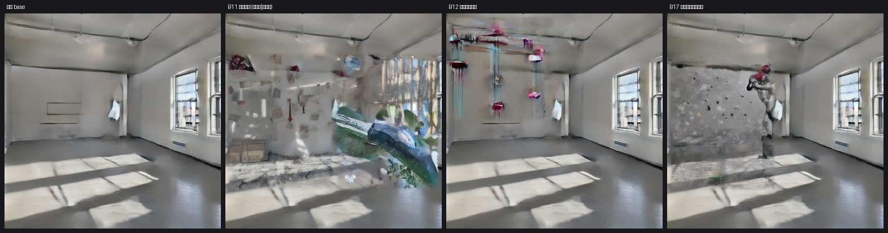

# **AI 绘画工作站 v6.0**

---

## 一、项目概述

**项目名称**：AI 绘画工作站 v6.0

**项目定位**：基于 Stable Diffusion 的专业级 AI 图像与视频生成工具，提供一站式 AI 创作体验。

**核心目标**：为用户提供直观、高效的 AI 图像和视频生成工具，支持文生图、图生图、局部重绘、人脸修复、视频生成等多种功能。

---

## 二、功能特性

### 2.1 核心功能

| 功能模块 | 功能描述 | 技术实现 |
|---------|---------|---------|
| **文生图 (Text2Img)** | 通过提示词生成图像 | StableDiffusionPipeline |
| **图生图 (Img2Img)** | 基于参考图生成新图像 | StableDiffusionImg2ImgPipeline |
| **局部重绘 (Inpaint)** | 对图像指定区域进行修复 | StableDiffusionInpaintPipeline |
| **视频生成 (AnimateDiff)** | 文生视频、图生视频、视频转绘 | AnimateDiff + Motion LoRA |
| **ControlNet** | 姿态/边缘/深度控制生成 | ControlNetModel + OpenPose/Canny/Depth |
| **IP-Adapter** | 角色一致性锁定 | IP-Adapter 模型 |
| **修图编辑器** | 图像调整、滤镜、画笔、裁剪 | PyQt6 绘图引擎 |
| **人脸修复 (ADetailer)** | 自动人脸检测与修复 | OpenCV + YOLO |
| **手部修复** | 自动手部检测与修复 | YOLOv8 手部检测 |

### 2.2 视频生成功能

| 生成模式 | 描述 |
|---------|------|
| **文生视频** | 直接用提示词生成视频，无需输入文件 |
| **图生视频** | 选择一张图片作为首帧，AI 延续动画 |
| **视频转绘** | 选择视频文件，AI 改变画风 |
| **提示词旅行** | 在不同帧使用不同提示词，制作剧情视频 |

### 2.3 扩展功能

- **多模型支持**：支持 SD 1.5 和 SDXL 模型，可识别加载 SD3 / Flux（部分功能）
- **多 LoRA 挂载**：支持同时加载多个 LoRA 插件，独立权重控制
- **Motion LoRA**：支持缩放、平移、旋转等运镜特效
- **采样器切换**：支持 Euler A、Euler、DPM++ 2M、DDIM、UniPC 等多种采样器
- **提示词模板**：内置多种风格提示词预设
- **AI 提示词改写**：自动将自然语言转换为专业提示词
- **X/Y 矩阵生成**：批量参数对比测试
- **Hires.fix**：高清修复放大
- **完整出图元数据**：每张图都写入 40+ 项生成参数（含模型 SHA256、LoRA、ControlNet、Hires、ADetailer、依赖版本），并附带 A1111 兼容参数串，见 2.4
- **水印**：支持文字 / 自定义图片水印，位置、透明度、大小可调，见 2.6
- **工作流引擎 + 节点编辑器**：简易模式的操作会自动编译成一张工作流图，
  高级用户可在画布上增删节点、连线、改参数并直接运行；30 个内置节点，
  见 2.5（菜单栏 → 🧩 工作流）
- **图像管理**：自动保存、历史记录、图片预览
- **视频管理**：视频预览、历史画廊、双击播放
- **v6.0 工作台**：统一媒体画廊（图片/视频切换）、底部胶片条单击回填参数、修前/修后对比滑条（文生图+图生图）、显存/内存常驻监控、设置中心（可改快捷键与默认值）、AI 回译对比（翻译→回译校验防幻觉）

### 2.4 出图元数据

每张输出图都会在 PNG 里写入完整元数据，方便复现、归档与排查。
实现集中在 `utils/image_metadata.py`（全项目唯一入口）。

| 类别 | 字段 |
|------|------|
| 提示词 | `prompt`（原始，含中文）、`prompt_final`（实际送模型的最终提示词）、`negative`、`negative_final`、`prompt_mode`、`clip_skip` |
| 模型 | `model`、`model_path`（真实磁盘路径）、`model_hash`（SHA256）、`architecture`、`vpred`、`zero_snr` |
| LoRA | `loras`（名称+权重）、`lora_count`、`lora_tags` |
| 条件控制 | `controlnet_type`、`controlnet_weight`、`pose_transfer_used`、`ip_adapter_variant`、`ip_adapter_weight` |
| 采样 | `sampler`、`scheduler`（调度器类名）、`steps`、`cfg`、`seed`、`width`、`height`、`size`、`batch_index`、`batch_total` |
| Hires.fix | `hires_enabled`、`hires_scale`、`hires_denoise`、`hires_upscaler`、`hires_size` |
| ADetailer | `adetailer_enabled`、`adetailer_face_strength`、`adetailer_hand`、`adetailer_hand_strength`、`adetailer_hand_blend` |
| 版本 | `version_app`、`version_diffusers`、`version_torch`、`version_transformers`、`version_python`、`version_cuda`、`version_gpu` |
| 其它 | `watermark`、`workflow`、`timestamp` |

- **模型哈希**按「路径+大小+修改时间」缓存到 `models_cache/file_hashes.json`，
  同一个底模只算一次（否则每张图都要重读 2~7GB，保存会卡好几秒）。
- 同时写入 A1111 兼容的 `parameters` 文本块，WebUI / Civitai 可直接识别。
- 任何一个字段取不到都会写成 `unknown`，**元数据采集失败绝不影响出图**。

### 2.5 工作流引擎与节点编辑器

简易模式与高级模式**共享同一个执行引擎**：你在界面上点的每一步，
都会被编译成一张工作流图；高级用户看到的、能改的就是这张图。

#### 两种模式的关系

```
界面操作                          自动生成的工作流图
文生图 → 选模型 → 提示词                  LoadCheckpoint
   → 开 LoRA            ──编译──▶        → LoadLoRA
   → 开 ControlNet                       → TextEncode / NegativeTextEncode
   → 开高清修复                           → Sampler → VAEDecode
   → 开 ADetailer                        → HiresFix → ADetailer → SaveImage
```

编译逻辑在 `workflow/builder.py`，它**复用 `_gt_prepare_context()`**——
也就是界面上那套参数解析规则（提示词解析/翻译、LoRA 标签、ControlNet 力度、
尺寸、种子…）只有一份。否则又是"两套规则、迟早不一致"。

#### 入口在哪（菜单栏 → 🧩 工作流）

| 菜单项 | 快捷键 | 作用 |
|--------|--------|------|
| 🧩 打开工作流编辑器… | `Ctrl+W` | 打开空的节点编辑器 |
| ✨ 用当前界面设置生成流程图 | — | 把当前设置编译成图并打开编辑器 |
| ▶️ **用工作流引擎生成** | `Ctrl+Shift+W` | 编译并**立即执行**（走 workflow 引擎） |
| 🩺 预检当前工作流 | — | 运行前预检：模型 / LoRA / VAE / ControlNet / 显存 / 输出目录 / 依赖 |
| 📂 打开工作流目录 | — | 打开 `workflows/`（保存的 JSON 都在这里） |

编辑器内工具栏：新建 / 打开 / 保存 / 另存为 · 从当前界面生成 / 载入界面设置 ·
校验 / **预检** (`Ctrl+P`) / 资源清单 / **运行** (`Ctrl+R`) /
**只跑选中节点** (`Ctrl+Shift+R`) / 取消 / 清空状态 / 删除选中 / 适应窗口 ·
显存策略下拉。

#### 参数直接在节点卡片上改

参数**内嵌在节点卡片里**（不用来回看右侧面板），用户视线不用移动：

```
┌─────────────────────────────┐
│ Sampler                     │
├─────────────────────────────┤
│ 步数      [ 28          ]   │
│ CFG       [ 7.000       ]   │
│ 种子      [ 随机        ]   │
│ 宽        [ 512         ]   │
│ 高        [ 768         ]   │
│ 采样器    [ Euler a   ▾ ]   │
└─────────────────────────────┘
```

- 短参数（数字 / 开关 / 下拉）在卡片内直接编辑，改完立即写回工作流数据。
- **长文本参数**（提示词）卡片内是单行框，完整多行编辑仍在右侧面板；
  两边**双向同步**，不会出现"改了这边那边没变"。
- 右侧面板保留：节点说明、**输入端口连到了哪里**、**资源声明**
  （显存峰值 / 是否支持 offload / 分块 / 依赖）。

#### 本地文件用下拉框选，不用手打文件名

模型 / LoRA / VAE / 参考图这类参数会**扫描本地已下载的文件**做成可编辑下拉框
（`ui/workflow_editor/param_sources.py`），从列表里选即可；也仍可直接粘贴绝对路径。

| 参数 | 下拉内容 | 本机实测 |
|------|---------|---------|
| `LoadCheckpoint.path` | 本地底模（各架构汇总） | 10 个 |
| `LoadLoRA.lora_1~3` | 本地 LoRA（含子目录） | 14 个 |
| `LoadVAE.path` | 本地 VAE | 3 个 |
| `LoadImage.path` | 最近生成的图片（最新优先） | 40 个 |

节点作者只需在 `ParamSpec` 上声明 `source="checkpoints"|"loras"|"vae"|"images"`，
界面自动出现下拉框。

#### 参考图/产出图直接在卡片里渲染

图生图、ControlNet、IP-Adapter 这类节点，选了参考图后**卡片里立刻显示缩略图**，
不用去猜路径填对没有；运行结束后每个节点还会把**自己产出的图**渲染回卡片，
一眼能看出哪一步出了问题（哪一步图糊了、哪一步颜色跑了）。

- 参考图：由 `LoadImage` 的路径参数驱动，选完立即出图；路径无效时卡片里显示原因
  （"文件不存在"），而不是静默空白。
- 产出图：执行器把每个节点的 IMAGE 输出一并返回（`res["images"]`），
  编辑器转成缩略图塞进对应节点。
- 缩略图一律压到 104px 并带 LRU 缓存，不会因为画布频繁重绘而反复解码大图。

#### 后处理节点（加噪 / 模糊 / 锐化 / 调色 / 色调分离）

`nodes/postprocess_nodes.py`，5 个纯 CPU/PIL 节点，显存占用为 0
（`ResourceRequirement(requires=())`），可以直接串在出图后面：

| 节点 | 参数 |
|------|------|
| `ImageNoise` | 噪点强度、类型（高斯/均匀/盐椒）、种子、单色噪点 |
| `ImageBlur` | 半径、类型（高斯/方框/径向） |
| `ImageSharpen` | 强度、半径、锐化百分比、阈值（USM） |
| `ColorAdjust` | 亮度、对比度、饱和度、锐度 |
| `ImagePosterize` | 保留位数、模式（色调分离/阈值/反相） |

实测效果对比（每个节点真的有效果，含径向模糊与阈值）：


保证：不改动上游图（返回新对象，`amount=0` / 全默认参数时与原图逐字节一致）、
尺寸不变、`ImageNoise` 固定种子可复现（`seed=-1` 为随机）。

#### 分块高清修复（TiledHiresFix）— 8GB 卡也能出 2K/4K

整图高清（`HiresFix`）是"latent 放大 → 一次性重绘"，显存吃紧；
放大到 2K 在 8GB 卡上非常容易爆显存或疯狂换页。
`TiledHiresFix` 走分块路线：

```
基础生成 → 放大图像 → 切成小块 → 逐块重绘细节 → 加权融合拼接 → （可选）ADetailer
```

参数（**你要求的 6 项全都有**）：

| 参数 | 说明 | 8GB 建议 |
|------|------|---------|
| `scale` | 放大倍率 1.0~4.0 | 2.0 |
| `tile_size` | 分块尺寸 | **640**（或 512） |
| `overlap` | 重叠像素 | **48**（32~64） |
| `denoise` | 重绘强度 | **0.35**（0.25~0.45） |
| `upscale_method` | 放大方式 Lanczos / Bicubic / Nearest | Lanczos |
| `blend` | 边缘融合：羽化 / 线性 / 硬切 | 羽化 |
| `color_correct` | 块间色彩对齐（消除色差接缝） | 开 |
| `vram_mode` | 显存模式：自动 / 省显存 / 平衡 / 高性能 | 自动 |
| `max_tiles` | 安全阀：预计块数超限直接报错，不跑到一半 OOM | 0 |

**铺块几何是严格保证的**（我自己重算复核过，8 种尺寸全过）：

| 图尺寸 | 块/重叠 | 块数 | 漏像素 | 越界 |
|--------|--------|-----|-------|------|
| 1024×1024 | 512 / 64 | 9 | 0 | 无 |
| 1920×1080 | 640 / 64 | 8 | 0 | 无 |
| 2048×2048 | 512 / 64 | 25 | 0 | 无 |
| 500×500 | 640 / 48 | 1 | 0 | 无 |
| 733×457 | 512 / 32 | 2 | 0 | 无 |

- **全覆盖**：每个像素至少被一块覆盖（`plan_tiles` + `verify_coverage` 双重校验，
  并对宽度 8~2999 做了穷举扫描，零失败）。
- **不出碎片**：块尺寸恒为 `min(tile, 图宽, 图高)`，最后一块**贴边**而不是留一条细缝。
- **融合是归一化的**：加权累加后除以权重和，所以"把原图切片再拼回来"能**逐像素还原**
  （实测三种融合模式 `maxdiff = 0`）；不存在没写到的黑边。
- **色彩对齐**有效：块间人为加 18 级亮度差时，平均偏差从 **45 → 17**。

> ⚠️ **`overlap` 是下界，不是精确值** —— 这一点必须知道，否则会算错块数和耗时。
> 为了让覆盖完整、又不产生"几乎完全重合的最后一块"，间距会被**均摊**，
> 实际重叠常常大于请求值：
>
> | 图尺寸 | tile / 请求 overlap | 实际采用的 overlap |
> |--------|--------------------|-------------------|
> | 1024×1024 | 512 / 64 | **256** |
> | 2048×2048 | 512 / 64 | **128** |
> | 1536×1536 | 512 / 64 | **171** |
>
> 也就是说在 1024² 这个尺寸下，把 overlap 从 64 调到 128 **不会有任何变化**。
> 出图元数据里同时写入 `tile_overlap`（请求值）和 `tile_overlap_effective`（实际值）
> 以便复现。

**实测显存与耗时**（RTX 5060 Laptop 8GB，真机跑，不是估算）：

| 场景 | 结果 |
|------|------|
| 512 底图 → `TiledHiresFix` **4x → 2048×2048**（tile 512 / overlap 64 / denoise 0.35 / 4 步） | ✅ 成功，13.3s，**25 块**，**峰值 2677 MB（占 8123 MB 的 33%）** |
| 同上 2x → 1024×1024 | ✅ 成功，6.5s，9 块，峰值 2676.8 MB |
| `TiledUpscale` 2x（纯放大，不用模型） | 与 Lanczos **完全一致**（maxdiff 0） |
| `denoise=0` 的 `TiledHiresFix` | 与 Lanczos **逐像素一致**（maxdiff 0），且完全不加载模型 |

> **一个必须说清的诚实结论**：分块在**低分辨率下并不是显存优化**。
> 1024² 时节点的激活值增量是 +610.6 MB（分块）vs +616.5 MB（整图），基本没差别；
> 上面那个 2677 MB 的峰值主要是 **CPU offload 下常驻显存里的权重**。
> 分块的收益随分辨率增长才体现出来：**2048² 时 +610.6 MB vs +1171.2 MB，且快一倍**。
> 所以：1024² 用整图或分块都行（分块更慢），**2048² 以上分块才真正划算**。

#### 高清与修脸的顺序由你决定

两种顺序对人脸效果不同，界面里可以直接选（`先高清后修脸` / `先修脸后高清`）：

| 顺序 | 链路 | 效果 |
|------|------|------|
| 先高清后修脸 | 基础图 → 高清 → ADetailer | 放大后再修脸，**脸更锐利清晰** |
| 先修脸后高清 | 基础图 → ADetailer → 高清 | 先修好脸再放大，**脸更自然**（放大时可能被二次柔化） |

实测两条链都能生成并通过校验：

```
先高清后修脸: … → VAEDecode → TiledHiresFix → ADetailer → SaveImage
先修脸后高清: … → VAEDecode → ADetailer → TiledHiresFix → SaveImage
```

**高清方式**可选 `自动 / 整图(快) / 分块(省显存)`：自动档在显存 <10GB 时**默认选分块**
（实测本机 8GB 自动档生成的就是 `TiledHiresFix`），因为整图放大 2x 在 8GB 上极易爆显存。

#### 区域提示词与局部重绘（主界面就能用）

复杂画面想分别控制"脸 / 衣服 / 背景"时用。**不需要懂工作流** ——
主界面「🎯 区域提示词」分组 → 点「🎯 编辑区域…」→ 在画布上**拖框** →
每个框写自己的提示词：

```
全局提示词：portrait, detailed clothing
├─ 脸部区域：detailed face, sharp eyes
├─ 衣服区域：intricate fabric, embroidery
└─ 背景区域：forest, soft light
```

支持的能力（逐条状态，不美化）：

| 能力 | 状态 |
|------|------|
| 矩形区域提示词 | ✅ 归一化坐标，越界自动夹取，反向坐标自动交换 |
| 蒙版区域提示词 | ✅ 导入黑白图（**白=生效**），任意尺寸自动缩放 |
| 区域权重 | ✅ 直接作为该区域重绘的 `strength` |
| 局部负面提示词 | ✅ 留空则用全局负面词 |
| 局部 ControlNet | ⚠️ **能跑，但语义是近似的**（见下） |
| 局部 ADetailer | ✅ 真的局部（只在区域包围盒内检测） |

**编辑器**：拖框新增 / 导入蒙版 / 每个区域独立设置提示词·负面词·权重·羽化 /
可选的局部 ControlNet·局部 ADetailer / 区域集存成 JSON 复用。

**实测证据**（`regional_preview.png`，自左至右）：



1. 底图 `empty room, white walls`
2. 左右两半两个区域（`a red apple` / `a blue banana`）→ **左右互不相同**
   （MAD 37.03），且各自与底图都不同（12.57 / 20.62）
3. 只开左上象限一个区域 → **右下象限 MAD = 0.00（逐像素完全没变）**
4. 经工作流执行器输出

**峰值显存 2678 MB / 8123 MB（33%）且与区域数量无关** —— 区域是逐个跑的，
任何时刻只有一次 inpaint 在飞。所以 `RegionalRedraw` 的显存声明是 2600 MB 量级，
而不是 2600×区域数（否则 8GB 卡会被显存策略直接判死）。

**工作流侧**：`RegionalPrompt`（定义区域）→ `RegionalRedraw`（逐个应用），
端口类型是新加的强类型 `REGIONS`（连错端口会在**运行前**报类型不匹配）。
简易模式里设了区域，编译出的工作流也会带上这两个节点，所以
"简易模式出的图"和"高级模式看到的图"仍然是同一件事。

```python
from core.regional import Region, apply_regions, validate_regions

regs = [Region(name="脸部", prompt="detailed face, sharp eyes", weight=0.55,
               shape="rect", rect=(0.3, 0.1, 0.7, 0.45)),
        Region(name="衣服", prompt="intricate fabric, embroidery", weight=0.45,
               shape="mask", mask_path="masks/clothes.png")]
print(validate_regions(regs, 512, 768))      # 运行前的中文问题清单
img, meta = apply_regions(ai, model, base, regs, steps=24, cfg=7.0, seed=-1)
print(meta["regions_applied"], meta["region_errors"])
```

**实现方式是"顺序蒙版重绘"**（区域精修），不是逐步注意力耦合
（A1111 Regional Prompter / Latent Couple 那种）。

- 好处：复用既有 inpaint 管线、可预测、8GB 上跑得动、能覆盖上面全部六项能力。
- 代价（**必须说清**）：区域是在底图**之后**逐个精修的，不是每一步去噪都参与，
  所以区域之间的全局协调性（光照/风格统一度）比注意力耦合法略低。
  接口留好了替换位置（换 `_region_sampler` 内核即可，签名不用动）。

**两处诚实的折扣**：

1. **局部 ControlNet 是近似语义**。仓库里只有 **txt2img** 的 ControlNet 管线
   （`StableDiffusionControlNetPipeline`，没有 `mask_image` 入参），没有
   ControlNet+Inpaint 的装配。所以现在走的是"CN 引导生成 + 按蒙版贴回"，
   **底图不参与该次采样**，区域内的承袭性比 inpaint 低。
   要变成"CN 引导的 inpaint"需要新写一个 `StableDiffusionControlNetInpaintPipeline`
   装配 —— 这是目前唯一没做的东西。取不到权重/类型不认识时**只警告并退回普通蒙版重绘**。
2. **局部 ADetailer 的检测范围限制在区域包围盒内**（裁框检测）。
   YOLO 检测器没有"只看蒙版形状"的入参，所以区域外的脸不会被本区域修到
   （符合预期），但"框内非蒙版区的脸不修"做不到。

> ⚠️ 修过一个**静默失效**的真 bug：区域配了局部 ADetailer 时，曾把**重绘前**的图
> 裁给 ADetailer 再贴回，导致该区域的提示词重绘被整体覆盖（区域差异从 43.6 掉到 1.1）。
> 现在 `tests/test_regional.py` 把调用点钉死了。

#### 模型架构适配层（节点只判断能力，不判断模型名）

节点里**不允许**写 `if arch == "sdxl": ...`。模型加载后产出一份统一能力描述，
节点只问"能不能做某事"：

```python
from workflow.adapters import capabilities_for, UnsupportedFeatureError

caps = capabilities_for("flux")          # 或 ai.capabilities（加载后）
caps.supports_controlnet                 # False
caps.require("controlnet")               # → UnsupportedFeatureError

if caps.supports_hires_fix:
    ...
else:
    raise UnsupportedFeatureError("高清修复", caps.architecture)
```

```python
ModelCapabilities(
    architecture="anima",
    supports_txt2img=True,
    supports_img2img=True,
    supports_inpaint=True,
    supports_controlnet=False,
    supports_ip_adapter=False,
    supports_lora=False,
    supports_hires_fix=False,
    supports_adetailer=False,
    recommended_precision="bf16",
)
```

实测各架构能力表（`prec` = 推荐精度）：

| 架构 | 精度 | 文生图 | 图生图 | 重绘 | ControlNet | IP-Adapter | LoRA | Hires | ADetailer |
|------|------|:---:|:---:|:---:|:---:|:---:|:---:|:---:|:---:|
| sd15 | fp16 | ✅ | ✅ | ✅ | ✅ | ✅ | ✅ | ✅ | ✅ |
| sd2.x | fp16 | ✅ | ✅ | ✅ | ✅ | ✅ | ✅ | ✅ | ✅ |
| sdxl | fp16 | ✅ | ✅ | ✅ | ✅ | ✅ | ✅ | ✅ | ✅ |
| anima | bf16 | ✅ | ✅ | ✅ | — | — | — | — | — |
| flux | bf16 | ✅ | ✅ | — | — | — | — | — | — |
| sd3 | bf16 | ✅ | ✅ | ✅ | — | — | ✅ | ✅ | ✅ |
| video | fp16 | ✅ | ✅ | — | — | ✅ | — | — | — |

**只有一份能力表**：`ModelCapabilities` 完全由既有 `AdapterCaps` 派生
（`AdapterCaps` 是唯一真相），不会出现"适配器说不支持、能力表说支持"这种两套说法。
测试里对 6 个架构逐一断言了两者一致。

配套：

- `ai.capabilities`：模型加载后由模型管理器给出；**未加载时返回 `None`**
  （不编造默认能力，否则会掩盖真正的问题）。
- `ctx.capabilities`：执行期挂在 `NodeContext` 上，节点可直接
  `ctx.capabilities.require("controlnet")`。
- `UnsupportedFeatureError` 是 `RuntimeError` 子类（老代码兼容），
  但 UI/预检可据此区分"功能不支持"（该提示换模型）与"运行出错"（该看堆栈）。
- 能力名有别名表（`"hires"` → `"hires_fix"`），旧写法不会立刻炸。

这样以后加 Flux / 视频模型，只需加一个 adapter 并填能力表，
**不用回头改 `start_generation()`、`model_manager.py` 和一堆节点里的 if/else**。
实测节点里按架构名硬分支的地方为 **0** 处。

> `LoadCheckpoint` 原来有个「采样器」参数，已经**删掉** —— 采样器属于
> `Sampler` 节点，两个地方都能设只会互相覆盖。老工作流里残留的
> `sampler` 参数会被忽略（打日志），不会报错。实测真跑出图元数据里
> `sampler` 仍是界面选的那个，说明切换功能没有丢。

#### 运行前预检（WorkflowPreflight）

点运行（或 `Ctrl+P`）时，**在真正加载模型之前**把所有能查的问题一次报完，
按严重程度分三档：

- **错误**：无法运行，必须处理
- **警告**：可以运行，但可能影响效果或速度
- **提示**：建议操作

```python
from workflow.preflight import run_preflight
res = run_preflight(wf, host=win, ai=win.ai)

res.ok                  # bool：无错误即可运行
res.errors / res.warnings / res.hints   # [PreflightIssue]（含 code / message / node_id / fix）
res.required_models     # 需要的底模/LoRA/组件清单
res.estimated_vram_mb   # 预计显存
res.estimated_time      # 预计耗时（秒，粗估）
print(res.to_text())    # 中文分档报告，UI 直接显示
```

检查项：

| # | 检查 | 判据 |
|---|------|------|
| 1 | 工作流结构 | 未注册节点 / 环 / 必填输入缺失 / 类型不匹配 |
| 2 | 节点输入完整 | 必填输入既没连线也没字面量 |
| 3 | 模型文件存在 | 按 `load_model` 的搜索规则找文件 |
| 4 | 模型架构匹配 | 真实探测架构；多架构混用给警告；节点能力 vs 架构 |
| 5 | VAE 兼容 | 文件存在 + 按体积/文件名粗判是否与底模同代 |
| 6 | ControlNet 匹配 | 类型是否被 `prepare_controlnet` 支持 + 权重是否已在本地 |
| 7 | LoRA 适用 | 探测 LoRA 架构，与底模比对（**实测能抓出 SDXL LoRA 配 SD1.5 底模**） |
| 8 | 显存是否满足 | 汇总节点声明 vs 设备总量，并说明会自动采取什么策略 |
| 9 | 输出目录可写 | 真写一个临时文件；**并检测配置目录是否被静默回退** |
| 10 | 依赖组件 | torch/diffusers/Pillow + 节点声明的可下载资产与外部工具 |

实测：整轮预检 **21ms**（9 项检查），不加载模型、不推理。任何单项检查异常都降级成
警告，**预检本身绝不阻断或崩溃**。

示例输出：

```
❌ 预检未通过（1 个错误）

❌ 错误（1）
  · [lora_x] LoRA「xxx.safetensors」是 sdxl 用的，但主模型是 sd15（sd1.5）
      → 换一个对应架构的 LoRA，或换底模

⚠️ 警告（1）
  · 当前显存 7.9GB，已自动启用 CPU Offload
      → 这是正常的省显存模式；显存更大时可切「高性能」预设提速

预计显存 15400 MB · 预计耗时约 8s · 平衡模式（8~16GB…）· 全 GPU · 分块≥1.0MP
```

#### 统一模型资源管理（工作流按资源 ID 依赖模型）

**问题**：工作流原来只存一个硬编码路径，于是换台电脑就失效、挪个目录就找不到、
用户也不知道到底缺哪些模型。

**做法**：工作流不存"我的硬盘上在哪"，而存**依赖的是哪个资源**
（`workflow/resource_store.py`）：

```json
{
  "resource_id": "checkpoint/sd15/abyssorangemix2_hard",
  "filename": "abyssorangemix2_Hard.safetensors",
  "model_type": "checkpoint",
  "architecture": "sd15",
  "sha256": "",
  "source": "local",
  "source_url": "",
  "local_path": null
}
```

- `resource_id` = `类型/架构/文件名主干`，**先取 basename 丢掉全部路径成分**
  —— 这是"换电脑/挪目录都不失效"的关键，所以 ID 里永远不含盘符和目录。
- `local_path` 默认写 `null`。运行的那一刻才在本机反查真实路径。
- `sha256` 默认空字符串：普通扫描**不算哈希**（10 个底模加起来几十 GB，
  扫一次就要几分钟）；只有显式要求校验时才用 `utils.image_metadata.file_sha256()`
  算，并复用它的磁盘缓存。

**运行时的闭环**（正是你描述的那条链路）：

```
检查资源 → 存在 → 继续执行
        → 缺失 → 显示资源卡片 → 用户下载 → 校验 → 重新预检
```

- **解析**：`resolve(ref)` 按 `resource_id → sha256 → filename → local_path` 依次反查，
  返回 `ok` / `found_elsewhere`（位置变了但找得到）/ `missing` /
  `arch_mismatch` / `sha_mismatch`。畸形引用**绝不抛异常**，降级为 `missing`。
- **报告**：`missing_report(refs)` 给出 `present / missing / mismatched /
  downloadable`，UI 直接拿它渲染"资源卡片"。
- **预检接入**：缺资源报**错误**并附可操作建议；资源"位置变了"只报**警告**
  （能跑）。实测缺底模时报 `resource_missing` + `model_missing` 两条，
  并告诉用户该把文件放哪。
- **界面**：编辑器工具栏 →「🗂 资源依赖」，列出名称/类型/架构/状态/大小/说明，
  支持「🔄 重新检测」和「📂 打开模型目录」。

**下载入口的边界（遵守项目既定策略）**：

| 资源类型 | 下载入口 |
|---------|---------|
| ControlNet / ADetailer / IP-Adapter / 插帧 / Flux 引擎（辅助组件） | ✅ 「下载」按钮，走既有 `extension_manager.download_extension()`，**不新增任何下载入口** |
| 底模 / LoRA / VAE | ❌ **不提供下载**，只告诉用户缺什么、放到哪个目录，放好后点「重新检测」 |

也就是说：模型仍然完全由用户自行下载，程序只是**知道**自己依赖哪些资源。

```python
from workflow import resource_store as RS

cat = RS.build_catalog()            # 扫描本地（实测 29 项 / 15ms，不算哈希）
r = RS.by_filename("mix2_Hard.safetensors")
ref = RS.to_ref(r)                  # → 写进工作流的引用（local_path=None）
res, status, detail = RS.resolve(ref)     # → "ok"

rep = RS.missing_report(RS.collect_refs(wf))   # 工作流的资源依赖体检
print(rep["summary"], rep["downloadable"])

RS.save_catalog()                   # 持久化到 models_cache/resources.json
```

`collect_refs(wf)` 对**老工作流**（只存了 `path`）也能工作：会自动按文件名
升级成带 `resource_id` 的引用，所以不用手工迁移已有流程。


#### 用代码调用（不经过界面）

```python
from workflow import builder
from workflow.executor import run_workflow

# 1) 把当前界面状态编译成图
wf = builder.build_from_ui(win)          # win = 主窗口（提供 ai / config）

# 2) 跑它（返回 dict：ok / states / outputs / cached / failed_node / error）
res = run_workflow(wf, host=win)
print(res["summary"] if "summary" in res else res["ok"], res["outputs"])

# 3) 只重跑某个节点（其余用缓存）
from workflow.executor import Executor, make_context
ex = Executor(make_context(host=win, ai=win.ai))
ex.run(wf, only=["saveImage_1"])
```

也可以完全脱离界面跑（`host=None`，输出落 `photo/`）：

```python
from workflow.schema import Workflow, Node
from workflow.executor import run_workflow

wf = Workflow(name="无头文生图")
wf.add(Node("model_1", "LoadCheckpoint", {},
            {"path": "meinamix_v12Final.safetensors"}))
wf.add(Node("prompt_1", "TextEncode", {}, {"text": "1girl, cat ears"}))
wf.add(Node("neg_1", "NegativeTextEncode", {}, {"text": "lowres"}))
wf.add(Node("sampler_1", "Sampler", {},
            {"steps": 28, "cfg": 7.0, "seed": 123, "width": 512, "height": 768}))
wf.add(Node("decode_1", "VAEDecode", {}))
wf.add(Node("save_1", "SaveImage", {}, {"filename_prefix": "wf_"}))
wf.connect("model_1", "model", "prompt_1", "model")
wf.connect("model_1", "model", "neg_1", "model")
wf.connect("model_1", "model", "sampler_1", "model")
wf.connect("prompt_1", "conditioning", "sampler_1", "positive")
wf.connect("neg_1", "conditioning", "sampler_1", "negative")
wf.connect("model_1", "model", "decode_1", "model")
wf.connect("sampler_1", "latent", "decode_1", "latent")
wf.connect("decode_1", "image", "save_1", "image")

res = run_workflow(wf)        # preset="auto" 会按显存自动选档
```

#### 目录结构

```
workflow/            执行引擎
├── schema.py            节点协议（端口类型 / NodeSpec / ResourceRequirement）
├── values.py            端口上流动的具体值（ModelRef / Conditioning / Latent…）
├── registry.py          节点注册表（@node 装饰器）
├── graph.py             拓扑排序 + 运行前校验
├── executor.py          执行器
├── memory_policy.py     能力配置驱动的显存策略
├── cache.py             节点级缓存（"只重跑某节点"的基础）
├── resource_manager.py  资源清单（只读本地，不联网）
├── adapters.py          模型族适配器（SD15/SDXL/Anima/SD3/Flux/Video）
├── serializers.py       JSON 保存/加载/版本迁移
├── preflight.py         运行前预检（错误/警告/提示三档）
├── resource_store.py    统一模型资源清单（resource_id 解析/缺失报告）
└── builder.py           界面状态 → 工作流图

nodes/               节点实现（30 个）
├── model_nodes.py       LoadCheckpoint / LoadVAE / LoadLoRA
├── text_nodes.py        TextEncode / NegativeTextEncode
├── sampling_nodes.py    Sampler / VAEEncode / VAEDecode
├── image_nodes.py       LoadImage / ImageResize / ImageCrop / MaskCreate / Inpaint / SaveImage
├── control_nodes.py     ControlNetPreprocess / ControlNetApply
├── adapter_nodes.py     IPAdapterApply
├── detailer_nodes.py    ADetailer
├── upscale_nodes.py     HiresFix / Upscale
├── tile_nodes.py        TiledHiresFix / TiledUpscale（分块高清）
├── postprocess_nodes.py ImageNoise / ImageBlur / ImageSharpen / ColorAdjust / ImagePosterize
├── regional_nodes.py    RegionalPrompt / RegionalRedraw（区域提示词）
└── video_nodes.py       VideoFrameBatch   （另有 model/text/sampling/control/adapter/detailer 等模块）

ui/workflow_editor/  节点编辑器
├── canvas.py            画布：节点/端口/连线，类型检查，状态着色
├── palette.py           节点库（从注册表自动生成，带搜索）
├── param_panel.py       参数面板（节点详情/端口状态/资源声明）
├── param_sources.py     本地文件下拉源（底模/LoRA/VAE/图片）
├── resource_panel.py    资源依赖面板（缺失资源补全）
└── region_editor.py     区域提示词编辑器（主界面入口）
└── window.py            编辑器窗口 + 运行线程 + 预检

workflows/           工作流 JSON（保存/加载）
```

#### 端口类型与连线规则

`MODEL` `VAE` `TEXT_COND` `IMAGE` `LATENT` `MASK` `CONTROL_IMAGE` `LORA`
`SCHEDULER` `NUMBER` `BOOLEAN` `METADATA`（另有 `ANY` 表示不校验的透传口）

- **类型不兼容直接拒绝**，不会自动转换。最常见的一条：
  `LATENT` 和 `IMAGE` 不互通，**必须显式经过 `VAEDecode` / `VAEEncode`**。
- 一个输入口只接一条线（再连会替换旧的）。
- 必填输入既没连线也没默认值 → 校验阶段就报错，不会跑到一半才崩。

#### 显存策略（能力配置，不是显卡名字）

执行器不再"看显卡型号"决定是否 offload，而是**汇总各节点的资源声明**
（`requires` / `estimated_vram_mb` / `supports_cpu_offload` / `supports_tiled`）
再叠加设备能力选档：

| 预设 | 适用 | 行为 |
|------|------|------|
| 节省显存 | 6~8GB | CPU offload + 分块，缓存小 |
| 平衡模式 | 8~16GB | 优先速度与稳定 |
| 高性能 | 16GB+ | bf16、不 offload、缓存更小、batch 4 |
| 自定义 | — | 手动指定 |

> 阈值按**名义容量**取值：标称 8GB 的卡实际报 7.93GiB，所以分界放在 7.0，
> 保证"8GB 卡"落在平衡档而不是节省档。

#### 工作流 JSON 格式

```json
{
  "schema_version": 1,
  "name": "示例流程",
  "nodes": [
    {"id": "model_1",  "type": "LoadCheckpoint", "inputs": {"path": "a.safetensors"}},
    {"id": "prompt_1", "type": "TextEncode",     "inputs": {"text": "portrait"}},
    {"id": "sampler_1","type": "Sampler",        "inputs": {"steps": 28, "cfg": 6.5, "seed": 123}}
  ],
  "links": [
    ["model_1", "model", "sampler_1", "model"],
    ["prompt_1", "conditioning", "sampler_1", "positive"]
  ]
}
```

- 节点参数写在 `"inputs"` 里即可（加载时会按节点声明自动归位到参数），
  这是对外的约定格式；内部会区分"连线"与"参数"。
- 连线也冗余存在 `links` 里，外部工具可直接读。
- 加载**不会**因为一个未知节点类型就整份作废：未知节点保留在图中待修复。
- `schema_version` 用于将来迁移；高于程序支持的版本会告警但尽力加载。
- 画布坐标存在 `metadata.ui_positions`，不污染节点参数。

#### 加一个新节点（这就是"加功能只需加节点"）

在 `nodes/` 下任意模块里写一个函数即可，**界面零改动**：

```python
from workflow.registry import node
from workflow.schema import DataType, ParamSpec, PortSpec, ResourceRequirement

@node("MyNode", category="图像",
      description="一句话说明",
      inputs={"image": PortSpec(DataType.IMAGE, "输入图")},
      outputs={"image": PortSpec(DataType.IMAGE, "输出图")},
      params={"strength": ParamSpec("float", default=0.5, label="强度",
                                    minimum=0.0, maximum=1.0, step=0.05)},
      resources=ResourceRequirement(requires=("cuda",), estimated_vram_mb=800,
                                    supports_cpu_offload=True, supports_tiled=True))
def run_my_node(ctx, node, inputs):
    img = inputs.get("image")          # 取输入
    v = float(node.params.get("strength", 0.5))
    ctx.check_cancel()                 # 长操作里检查取消
    ctx.status("处理中…")               # 用户可见进度
    return {"image": img}              # 键名必须与 outputs 一致
```

- 参数控件（滑块/下拉/勾选/文本框）由 `ParamSpec` **自动生成**，带上下限。
- `resources` 决定显存策略与资源清单，`asset:<key>` 会自动映射到扩展市场的下载入口。
- 重依赖（torch/diffusers）在函数**内部** import，避免拖慢界面启动。

#### 已实现与暂未做

**已实现**：图结构与校验、执行器（缓存 / 取消 / 逐节点状态 / 失败定位 /
只重跑某节点）、能力配置化显存策略、资源清单、模型族适配器、JSON 读写与版本号、
30 个节点、基础节点编辑器、简易模式自动生成图、**分块高清修复**、
**区域提示词与局部重绘（主界面可用）**、
**统一模型资源管理（resource_id）**、**运行前预检**、**模型架构适配层**。

**暂未做**（按优先级）：
1. 把 `start_generation()` 的旧生成路径**逐步**迁到节点（目前是并行通路，
   视频/批处理/XY 矩阵仍走原实现）；
2. 节点循环、参考图组合；
3. ControlNet 的 lineart / softedge / tile / segmentation 权重映射
   （`ControlNetPreprocess` 已能预处理这几种，但 `prepare_controlnet`
   目前只认 openpose / canny / depth，接 `ControlNetApply` 会明确报错）；
4. `LoadLoRA` 的每槽位资源引用（`lora_ref_1..3`）—— 目前 LoRA 的
   `resource_id` 是**按文件名推导**，底模才是显式存进工作流的；
5. 用户自定义节点 / 插件机制（**刻意最后做**：任意 Python 节点会让调试、
   显存管理与错误定位迅速失控）；
6. ComfyUI 工作流格式兼容。

### 2.6 水印

「输出设置 → 💧 水印」中启用：

| 选项 | 说明 |
|------|------|
| 文字 | 任意文本，带描边（深浅背景下都清晰） |
| 图片 | 选择 PNG/JPG（建议带透明通道），会按画面宽度自适应缩放 |
| 位置 | 右下 / 左下 / 右上 / 左上 / 居中 / 平铺 |
| 透明度 | 0.05 ~ 1.0 |
| 大小 | 0.3 ~ 3.0 倍 |

- 同时配置文字与图片时**图片优先**；图片读取失败自动退回文字，两者都无效则不加。
- 水印在**统一保存入口**施加：主出图、放大、大图都会加；
  **XY 参数矩阵是诊断图，故意不加**（加会干扰参数对比）。
- 水印是**烧进位图**的，导出后无法移除 —— 建议保留一份无水印原图。
- 水印失败只记 warning 并保存原图，绝不让出图失败。

---

## 三、技术架构

### 3.1 架构设计

```
┌─────────────────────────────────────────────────────────────┐
│                      UI 层 (PyQt6)                          │
│  ┌─────────────┐  ┌─────────────┐  ┌───────────────────┐   │
│  │ 主窗口      │  │ 修图编辑器  │  │ 图像/视频预览画廊  │   │
│  └──────┬──────┘  └──────┬──────┘  └────────┬──────────┘   │
└─────────┼────────────────┼───────────────────┼──────────────┘
          │                │                   │
          ▼                ▼                   ▼
┌─────────────────────────────────────────────────────────────┐
│                    业务逻辑层                               │
│  ┌─────────────┐  ┌─────────────┐  ┌───────────────────┐   │
│  │ Generation  │  │   Events    │  │  Shell Mixin      │   │
│  │   Mixin     │  │   Mixin     │  │ (v6 工作台骨架)    │   │
│  └──────┬──────┘  └──────┬──────┘  └────────┬──────────┘   │
└─────────┼────────────────┼───────────────────┼──────────────┘
          │                │                   │
          ▼                ▼                   ▼
┌─────────────────────────────────────────────────────────────┐
│              核心引擎层 (ModelManager + Loaders)            │
│  ┌─────────────────────────────────────────────────────┐   │
│  │  core/arch 指纹检测 arch_id → core/loaders 注册表    │   │
│  │  路由到 SD15 / SDXL / Anima / SingleFile Loader      │   │
│  │  - txt2img_pipe, img2img_pipe, inpaint_pipe         │   │
│  │  - controlnet_pipe, pose_detector, ip_adapter       │   │
│  │  - AnimateDiff Pipeline + Motion LoRA               │   │
│  └─────────────────────────────────────────────────────┘   │
└─────────────────────────────────────────────────────────────┘
          │
          ▼
┌─────────────────────────────────────────────────────────────┐
│                    资源层                                   │
│  ┌─────────┐  ┌─────────┐  ┌─────────┐  ┌───────────────┐   │
│  │ models  │  │ loras   │  │ video   │  │ 配置文件        │   │
│  └─────────┘  └─────────┘  └─────────┘  └───────────────┘   │
└─────────────────────────────────────────────────────────────┘
```

### 3.2 核心技术栈

| 分类 | 技术 | 版本 | 用途 |
|-----|------|------|------|
| **UI 框架** | PyQt6 | ≥6.7 | 主界面、对话框 |
| **界面主题** | QDarkStyleSheet | - | 深色主题（`ui/theme.py` 接入） |
| **视频播放** | QtMultimedia | 6.x | 视频预览播放 |
| **绘图引擎** | PyQt6 | 6.x | 修图编辑器 |
| **图像处理** | PIL/Pillow | 10.x | 图像加载、处理、保存 |
| **深度学习** | PyTorch | 2.11（CUDA 12.8 单独安装） | GPU 加速推理 |
| **扩散模型** | Diffusers | 0.40.x | Stable Diffusion 管线 |
| **文本编码** | Transformers | 5.16.x | CLIP / T5 文本编码器 |
| **视频扩散** | AnimateDiff | - | 视频生成管线 |
| **控制网络** | ControlNet | - | 姿态/深度控制 |
| **提示词编码** | Compel | ≥2.0 | 高级提示词处理（SD1.5/SDXL） |
| **人脸检测** | OpenCV + YOLO | 4.x / 8.x | ADetailer 人脸/手部检测 |

### 3.3 显存优化策略

由 `utils/vram_manager.py` 按 GPU 显存总量自动分级：

| 显存 | 策略 |
|------|------|
| 充足（SD1.5 ≥6GB / SDXL ≥16GB） | 🚀 全速模式：全量驻留 GPU |
| 中等（SD1.5 ≥4GB / SDXL ≥11GB） | ⚡ 标准模式：驻留 + VAE/Attention 切片 |
| 偏低（SD1.5 ≥2.5GB / SDXL ≥5GB） | 💾 节能模式：Model CPU Offload |
| 极低 | 🐢 极限模式：Sequential CPU Offload |

通用优化：**VAE Tiling/Slicing**（分块解码，支持大图）、**Attention Slicing**、**xFormers**（装了才启用）。

### 3.4 日志设施

全项目统一使用 Python `logging`（不再有裸 `print`）：

- 初始化入口：`utils/system_utils.py::setup_logging()`（幂等，含滚动文件 + 控制台双输出）
- 日志文件：`logs/app.log`（RotatingFileHandler，单文件 5MB × 3 备份，UTF-8）
- 各模块约定：`logger = logging.getLogger(__name__)`，按 ❌=error / ⚠️=warning / 调试标记=debug 分级

---

## 四、文件结构

```
ai  make photo/
├── main.py                    # 主入口，PyQt6 主窗口（Mixin 组合）
├── requirements.txt           # 依赖清单（torch 需按注释单独安装 CUDA 版）
├── requirements-lock.txt      # 本机完整冻结环境（pip freeze）
├── app_config.json            # 应用配置（运行时自动生成/更新）
├── aiUsemono.md               # 使用说明
├── 结构.txt                   # 项目结构图
│
├── core/                      # 核心模块
│   ├── arch/                  # 架构识别（signatures 指纹 + registry 能力声明）
│   │   ├── base.py            #   ArchInfo/Caps/build_arch_profile
│   │   ├── registry.py        #   架构注册表（sd15/sd21/sdxl/sd3/flux/anima…）
│   │   └── signatures.py      #   权重 key 指纹检测
│   ├── loaders/               # 模型加载器（每架构一个类，统一 build/apply_vram/derive_pipes/post_load 分层）
│   │   ├── base.py            #   BaseLoader + LoadContext/LoadResult + 共享 derive_from_components
│   │   ├── sd15.py            #   SD15Loader（sd15 + sd21）
│   │   ├── sdxl.py            #   SDXLLoader（含 Pony/NoobAI 等 XL 衍生）
│   │   ├── anima.py           #   AnimaLoader（ModularPipeline + 权重前缀剥离）
│   │   ├── flux.py            #   FluxLoader（未注册，半成品）
│   │   └── single_file.py     #   SingleFileLoader（sd3/flux 兜底）
│   ├── config_manager.py      # 配置管理（AppConfig dataclass + 快捷键表）
│   ├── model_diagnostics.py   # 模型诊断（文件元数据 + 已加载管线运行时报告）
│   ├── model_manager.py       # 模型加载管理（单例 ModelManager，经 loaders 路由）
│   ├── presets.py             # 提示词预设
│   └── translation_service.py # 翻译服务（词典/AI/自动）
│
├── ui/                        # 界面模块（v6.0 三栏工作台）
│   ├── shell.py               # ShellMixin —— 默认界面骨架（导航栏/中央区/参数面板/胶片条/状态栏）
│   ├── nav.py                 # 左侧导航轨（文生图/图生图/动画/画廊）
│   ├── core_panel.py          # 生成核心区（全局单例：模型/prompt/参数/翻译模式/诊断按钮）
│   ├── shared_groups.py       # 共享折叠分组（LoRA/ControlNet/高级/X-Y）
│   ├── contracts.py           # 控件契约 + 自检降级（关键缺失禁用生成入口）
│   ├── param_snapshot.py      # 参数快照/安全设值（_safe_set_*）
│   ├── settings_dialog.py     # 设置对话框（快捷键改键 + 组件默认值）
│   ├── pages/                 # 四个页面（PageBase 派生，单页失败不影响其他页）
│   │   ├── txt2img_page.py    #   文生图（预览区 + 修前/修后对比滑条 + 日志）
│   │   ├── img2img_page.py    #   图生图（参考图/IP-Adapter/Pose Transfer）
│   │   ├── video_page.py      #   动画（AnimateDiff/运镜/配音）
│   │   └── gallery_page.py    #   画廊页（统一图片+动画）
│   ├── components/
│   │   ├── filmstrip.py       # 底部胶片条（单击回填参数/右键菜单/悬浮预览）
│   │   └── collapsible.py     # 可折叠分组容器
│   ├── gallery_panel.py       # 画廊面板（排序过滤/收藏/元数据浮窗/悬浮大图）
│   ├── theme.py               # QDarkStyleSheet 主题接入
│   ├── widgets.py             # 自定义控件（FloatSlider/GpuCanvas/CompareCanvas 等）
│   ├── ui_builder.py          # 旧版 UI（AI_STUDIO_UI=old 回退用，不再演进）
│   ├── design_tokens.py       # 旧版样式令牌（回退用）
│   ├── extension_market.py    # 扩展市场
│   ├── preset_manager.py      # 预设管理（含工具提示 TooltipMixin）
│   ├── disclaimer.py          # 免责声明
│   ├── splash.py              # 启动画面
│   ├── tooltips.py            # 工具提示文案
│   └── video_panel_mixin.py   # 视频面板业务（VideoPanelMixin）
│
├── utils/                     # 工具模块
│   ├── app_events.py          # 事件处理（EventMixin）
│   ├── app_generation.py      # 生成流程（GenerationMixin）
│   ├── app_utils.py           # 应用工具函数（动态提示词解析等）
│   ├── chattts_patch.py       # ChatTTS 兼容补丁
│   ├── extension_manager.py   # 扩展管理
│   ├── gpu_init.py            # GPU 加速初始化
│   ├── image_processor.py     # 图像处理 / ADetailer 流程
│   ├── model_downloader.py    # 模型下载
│   ├── model_scanner.py       # 模型扫描
│   ├── paths.py               # 统一路径管理（所有目录常量）
│   ├── prompt_enhancer.py     # Qwen 智能改写
│   ├── rife_interpolate.py    # RIFE 帧插值
│   ├── sovits_tts.py          # GPT-SoVITS 配音
│   ├── tiling.py              # 分块铺排 / 权重图 / 归一化融合（纯 PIL+numpy）
│   ├── system_utils.py        # 系统工具 / 日志设施
│   ├── tiled_diffusion.py     # 分块扩散
│   ├── tts_engine.py          # ChatTTS 配音
│   ├── video_gen.py           # 视频生成服务（AnimateDiff）
│   └── vram_manager.py        # 显存管理（按容量分级策略）
│
├── photo_turn/                # 修图编辑器模块（自包含）
│   ├── components.py
│   ├── mixin_ai.py
│   ├── mixin_filters.py
│   ├── mixin_history.py
│   ├── mixin_tools.py
│   └── pro_editor_qt.py
│
├── scripts/                   # 维护脚本
│   ├── download_gemma.py      # 模型下载
│   ├── download_ref_voice.py  # 参考音频下载
│   ├── download_sovits.py     # SoVITS 下载
│   └── codemod_unify_logging.py # 日志统一迁移脚本（一次性工具）
│
├── tests/                     # 手动测试脚本（纯脚本非 pytest，venv python 直接跑）
│   ├── test_real_startup.py   #   真实启动路径（setup_ui + 配置还原 + 页面切换）
│   ├── test_ui_contract.py    #   控件契约自检与分级降级
│   ├── test_v6_features.py    #   v6 新功能（对比滑条/资源监控/悬浮预览/回填/回译/诊断）
│   ├── test_settings.py       #   设置对话框（改键重建/默认值读写回环）
│   ├── test_loaders.py        #   加载器注册表路由与派生管线
│   ├── test_gallery_unified.py#   统一画廊（图片+动画/胶片条/过滤）
│   ├── test_theme.py / test_nav.py / test_collapsible.py  # 主题/导航/折叠组
│   ├── diag_real_click.py     #   真实窗口诊断（面板溢出/回填链路实测）
│   └── test_translate.py / test_tts.py / smoke_photo_turn.py 等  # 翻译/TTS/修图冒烟
│
├── models/                    # AI 模型存储
│   ├── sd15/  sdxl/  sd3/  flux/   # 各系列底模
│   ├── adetailer/             # 面部/手部修复模型（YOLO）
│   ├── ip_adapter/            # IP-Adapter 模型
│   ├── motion_adapter/        # AnimateDiff 运动模块
│   ├── motion_lora/           # Motion LoRA（pan-left/tilt-up/zoom-in/zoom-out）
│   └── tts/                   # TTS 模型
│
├── loras/                     # LoRA 权重（sd1.5/ sdxl/）
├── controlnets/               # ControlNet 模型（本地缓存）
├── tools/rife/                # RIFE 帧插值可执行工具
├── third_party/               # 第三方源码（GPT-SoVITS 等）
├── assets/voices/             # 参考音频
├── weights/                   # 预训练权重（人脸检测级联等）
├── data/                      # 运行时数据（词典、收藏等）
│   ├── dictionaries/          # 分类词典
│   └── zh_to_en_dict.json     # 翻译词典
├── models_cache/              # HF/Torch 统一缓存（HF_HOME 等指向此处）
├── photo/                     # 出图输出（videos/ 子目录存放视频）
├── output/                    # 其他输出（如 TTS 音频）
└── logs/                      # 日志（app.log，滚动切割）
```

---

## 五、安装与运行

### 5.1 环境要求

- **操作系统**：Windows 10/11 (推荐)
- **Python 版本**：3.10.x / 3.12.x
- **GPU 要求**：NVIDIA GPU（推荐 8GB+ 显存）（没有 GPU 也可以使用 CPU）
- **CUDA 版本**：11.8+

### 5.2 安装步骤

```bash
# 1. 克隆或下载项目
git clone <repository_url>
cd "ai  make photo"

# 2. 创建虚拟环境
python -m venv venv
venv\Scripts\activate

# 3. 安装 PyTorch（CUDA 12.8，务必单独安装，不要用 requirements.txt 装）
pip install torch torchvision torchaudio --index-url https://download.pytorch.org/whl/cu128

# 4. 安装其余依赖
pip install -r requirements.txt

# 5. 下载模型文件
# 最简单的做法：把下载到的模型统一丢进 models/puton/ 即可，
# 程序启动时会自动识别架构并移动到对应目录，并弹窗告知结果。
# 也可以手动放置（见 5.3 表格）：
# 将 SD 模型(.safetensors)放入 models/sd15/ 或 models/sdxl/ 等对应目录
# 将 LoRA 文件放入 loras/sd1.5/ 或 loras/sdxl/ 目录
# 将 Motion LoRA 文件放入 models/motion_lora/ 目录

# 6. 运行应用
python main.py
```

### 5.3 模型准备

> **本项目不预置任何模型，也不在运行流程中静默下载模型。**
> 底模 / LoRA / ControlNet 等请自行下载后放入下表目录。
> 只有「辅助功能」会在你**明确点击并确认**后下载（见 5.4）。

**不用自己判断架构**：把下载到的模型文件直接丢进 `models/puton/`
（投递箱）即可。程序每次启动会读取文件头判断它是 SD1.5 / SDXL /
Flux / SD3 / Anima / LoRA，自动移动到下表中正确的目录，并弹窗告诉你
每个文件去了哪里。

- 只读文件头，**不加载权重、不联网、不上传**；
- 识别不了的文件（或 ControlNet/VAE 这类非底模）**原样留在投递箱**
  并说明原因，绝不乱猜、绝不删除；
- 同名文件**不会覆盖**：大小相同视为重复跳过，否则自动加 `_1` 后缀；
- 正在下载的中间文件（`.part` / `.tmp` / `.crdownload` / 0 字节）会被忽略。

| 文件类型 | 放置位置 | 说明 |
|---------|---------|------|
| **任何底模 / LoRA（推荐）** | **`models/puton/`** | **丢进来即可，启动时自动归位** |
| SD 底模 | `models/sd15/*.safetensors` | SD 1.5 模型 |
| SDXL 底模 | `models/sdxl/*.safetensors` | SDXL 模型 |
| Flux / SD3 底模 | `models/flux/`、`models/sd3/` | 还需先装引擎组件，见 5.5 |
| LoRA 插件 | `loras/sd1.5/*.safetensors` | SD 1.5 专用 |
| LoRA 插件 | `loras/sdxl/*.safetensors` | SDXL 专用 |
| LoRA（判不出底模） | `loras/_unknown_dit/` | 投递箱无法确定架构时的落点 |
| Motion LoRA | `models/motion_lora/*/` | 运镜特效模型 |
| ADetailer 模型 | `models/adetailer/*.pt` | 人脸/手部检测模型 |
| IP-Adapter | `models/ip_adapter/` | 图生视频用（`ip-adapter_sd15.safetensors` + `image_encoder/`） |
| ChatTTS | `models/tts/ChatTTS/` | 配音用 |

> **LoRA 按架构分目录**：`loras/sd1.5/`、`loras/sdxl/`、`loras/flux/`、
> `loras/sd3/`、`loras/anima/`；判不出底模的进 `loras/_unknown_dit/`。
> 投递箱会自动放到正确子目录，不用你判断。
| ControlNet | `controlnets/<type>/` | 需含 `config.json` |

启动时会扫描缺失项并写进日志（`print_scan_report()`），**只扫描不下载**。
命令行自查与手动获取：

```bash
python -m utils.model_downloader scan             # 查看缺什么
python -m utils.model_downloader install <key>    # 手动下载单项（需自行执行）
```

### 5.4 联网行为说明

| 行为 | 何时发生 | 说明 |
|------|---------|------|
| 启动扫描 | 每次启动 | 只读本地目录，**不联网** |
| 扩展市场 | 你点「⬇️ 下载」 | 辅助功能（ControlNet / RIFE / ChatTTS / GPT-SoVITS / Qwen 等） |
| 提示词智能改写 / 识图 | 你点按钮或勾选「生成前自动改写」 | 缺 Qwen 档位时**先弹窗告知体积与来源**，确认后才从 ModelScope 下载；也可自行放入 `models_cache/modelscope` |
| 图生视频 | 切到该模式且缺 IP-Adapter | **先弹窗确认**，不静默下载 |
| 配音（ChatTTS） | 勾选配音且缺模型 | **先弹窗确认**，不静默下载 |
| ControlNet / OpenPose / 深度 | 首次启用且本地无模型 | 仍会联网获取；可自行放入 `controlnets/` 后离线使用 |
| 翻译 | 默认「词典优先 + AI 兜底」模式 | 未命中词典时会请求 Google 翻译（可切「纯词典」完全离线） |

### 5.5 新架构引擎（Flux / SD3）

这些架构**不能只靠一个 checkpoint 跑起来**，还需要配套的文本编码器 / VAE
等「引擎组件」。本项目把它拆成两部分，且**当前尚未接通**（放上模型也会明确
提示，不会静默下载）：

| 部分 | 体积 | 来源 |
|------|------|------|
| 引擎组件（T5-XXL / CLIP-L / VAE / tokenizer） | 约 10GB | **扩展市场 → 新架构引擎** |
| transformer 主权重 | 约 24GB（bf16） | **你自行下载**，放进 `models/flux/` 或 `models/puton/` |

检测到 Flux 模型但组件缺失时，启动会**单独弹窗**告知，并提供「去扩展市场下载」
按钮 —— 不下载引擎就无法使用 Flux 生成。

#### ⚠️ 许可证差异（选之前务必看清）

| 变体 | 许可证 | 能否商用 |
|------|--------|---------|
| **FLUX.1-schnell** | Apache-2.0 | ✅ **可商用**，无附加限制（推荐） |
| FLUX.1 [dev] | FLUX.1 [dev] Non-Commercial License v1.1.1 | ❌ **不可商用** |

FLUX.1 [dev] 的非商用许可明确禁止「营利性活动」以及「直接面向终端用户、
或对终端用户产生影响」的使用；商用需另行向 Black Forest Labs 申请授权。
两者的**生成图片**都可商用（BFL 声明不对 Outputs 主张权利），受限的是
「使用模型」这件事本身。

本项目为「开源 + 打赏」形态：**schnell 无争议；用 dev 权重请自行确认你的
使用方式落在非商用范围内，风险自负。** 详见
[LICENSE-FLUX1-dev](https://github.com/black-forest-labs/flux/blob/main/model_licenses/LICENSE-FLUX1-dev)
与 [LICENSE-FLUX1-schnell](https://github.com/black-forest-labs/flux/blob/main/model_licenses/LICENSE-FLUX1-schnell)。


---

## 六、使用说明

### 6.1 主界面布局（v6.0 三栏工作台）

```
┌──────────────────────────────────────────────────────────────┐
│  [文件] [工具] [内存] [关于] [设置]                            │
├────┬──────────────────────────────────────────┬──────────────┤
│ 导 │                                          │ 右侧参数面板  │
│ 航 │           中央工作区                      │ (整体可滚动)  │
│ 轨 │  ┌────────────────────────────────────┐  │ ┌──────────┐ │
│ 🎨 │  │  预览画布（普通/修前修后对比二合一） │  │ │生成核心区 │ │
│ 🖼 │  ├────────────────────────────────────┤  │ │(全局单例) │ │
│ 🎬 │  │  编辑/另存/转图生图/转重绘/⚖️对比   │  │ ├──────────┤ │
│ 🖻 │  ├────────────────────────────────────┤  │ │页面专属区 │ │
│    │  │  生成日志                          │  │ ├──────────┤ │
│    │  └────────────────────────────────────┘  │ │共享折叠组 │ │
│    ├──────────────────────────────────────────┤ │(LoRA/CN/  │
│    │  底部常驻胶片条（单击回填参数/右键菜单）   │ │高级/X-Y)  │ │
├────┴──────────────────────────────────────────┤ ├──────────┤ │
│ 状态栏：状态 | 显存/内存常驻监控 | 扩展计数      │ │生成/停止  │ │
└───────────────────────────────────────────────┴─┴──────────┴─┘
```

- **导航轨**：文生图 / 图生图 / 动画 / 画廊 四页，页面独立构建，单页失败不影响其他页（契约自检，关键控件缺失时禁用生成入口）
- **生成核心区全局唯一**：模型/prompt/尺寸/步数/CFG/采样器/生成按钮只有一份，切页不重造，业务层零感知
- **胶片条**：跟随画廊过滤，单击 = 全量回填该图参数 + 预览（prompt/steps/CFG/seed/尺寸/采样器/模型），右键 = 套用参数/查看元数据/收藏/删除
- **⚖️ 对比滑条**：开 Hires.fix/ADetailer 生成后对比精修前后；图生图加载参考图生成后对比参考图与结果
- **统一画廊**：图片与动画同墙展示（动画带首帧缩略图+时长角标），顶栏搜索/类型过滤/排序，悬浮 0.5s 显示大图
- **🌐 翻译模式右侧「🔁 对比」**：中→英→中回译对照，检查 AI 翻译幻觉（点对比才载入 Qwen，用完即卸不占生图显存）

### 6.2 动画界面操作

1. **选择生成模式**：文生视频、图生视频、视频转绘、提示词旅行
2. **输入提示词**：设置正面和负面提示词
3. **配置参数**：帧数、FPS、分辨率、采样器等
4. **添加运镜特效**：选择 Motion LoRA 并调整强度
5. **点击生成**：视频生成完成后自动播放并加入画廊

### 6.3 快捷键（默认键位，均可在 设置→偏好设置→快捷键 中修改）

| 快捷键 | 功能 |
|-------|------|
| `Ctrl+Enter` | 触发生成 |
| `Esc` | 中断生成 |
| `Ctrl+1` / `Ctrl+2` / `Ctrl+3` / `Ctrl+4` | 切换 文生图 / 图生图 / 动画 / 画廊 |
| `Ctrl+E` | 扩展市场 |
| `Ctrl+,` | 偏好设置 |

改键位：菜单「⚙️ 设置 → 偏好设置 → ⌨️ 快捷键」，点输入框按新键位，清空即禁用，确定后立即生效。修图编辑器内另有 `B` 画笔 / `E` 橡皮 / `M` 遮罩 / `G` 网格等（见 7.4）。

### 6.4 视频参数说明

| 参数 | 范围 | 说明 |
|------|------|------|
| 帧数 | 8 ~ 80 | 视频总帧数 |
| FPS | 4 ~ 30 | 每秒帧数，建议 8-12 |
| 步数 | 10 ~ 100 | 每帧生成步数 |
| CFG | 1.0 ~ 20.0 | 提示词引导强度 |
| 运镜强度 | 0.0 ~ 2.0 | Motion LoRA 强度 |

---

## 七、核心模块详解

### 7.1 ModelManager（模型管理器）

**职责**：管理 Stable Diffusion 模型的加载、优化、推理流程

**核心方法**：

| 方法 | 功能 |
|------|------|
| `load_model()` | 加载指定 SD 模型 |
| `apply_multiple_loras()` | 挂载多个 LoRA 插件 |
| `prepare_controlnet()` | 配置 ControlNet |
| `encode_prompt()` | 使用 Compel 编码提示词 |
| `switch_sampler()` | 切换采样器 |
| `apply_optimizations()` | 应用显存优化 |

**设计模式**：单例模式（SingletonMeta）

**加载器路由**：`load_model()` 经 `core/loaders/registry.py` 注册表按 `core/arch/` 检测出的 arch_id 分发到专用 Loader——sd15/sd21 → `SD15Loader`，sdxl → `SDXLLoader`，anima → `AnimaLoader`，sd3/flux → `SingleFileLoader` 兜底。

### 7.2 AIDesktopApp（主窗口）

**职责**：整合所有 UI 组件和业务逻辑

**混入类架构**：

| Mixin | 功能 |
|-------|------|
| `ShellMixin`（`ui/shell.py`） | v6.0 默认 UI：三栏工作台、页面路由、契约自检 |
| `UIBuilderMixin`（`ui/ui_builder.py`） | 旧版 UI 回退（环境变量 `AI_STUDIO_UI=old` 启用） |
| `EventMixin` | 事件处理和信号 |
| `GenerationMixin` | 图像和视频生成逻辑 |
| `ParamSnapshotMixin` | 参数快照（胶片条回填 / 元数据复用） |
| `PresetManagerMixin` / `TooltipMixin` | 参数预设与提示 |
| `VideoPanelMixin` | 视频面板扩展逻辑 |

### 7.3 VideoGenerator（视频生成器）

**职责**：处理视频生成流程

**核心方法**：

| 方法 | 功能 |
|------|------|
| `generate()` | 生成视频（支持多种模式） |
| `apply_motion_lora()` | 应用运镜特效 |
| `apply_frame_interpolation()` | 帧插值提升流畅度 |

### 7.4 ProImageEditor（修图编辑器）

**职责**：提供专业级图像编辑功能

**工具功能**：

- **画布**：OpenGL 加速，滚轮缩放（光标锚点）、中键平移、`Ctrl+0` 适配窗口、三分构图网格
- **画布光标**：绘制类工具显示画笔光标圈（直径随缩放同步，白色外圈 + 笔刷色内圈）；状态栏实时显示光标坐标、hex 色值、图像尺寸与缩放百分比
- **绘图工具**：画笔（大小 `[`/`]` 微调 + 不透明度 + 硬度柔边）、橡皮擦、AI 遮罩画笔；`Shift`+单击从上一笔末端拉直线（PS 同款）
- **遮罩操作**：清除 / 反转 / 羽化（可调半径）/ 扩边 / 收缩（配合局部重绘工作流）；红色叠加预览可临时开关
- **取色**：吸管工具 + 调色板
- **对比**：按住「👁 对比原图」快速查看编辑前后差异
- **选择工具**：裁剪（拖拽实时选区预览，支持比例约束：自由 / 1:1 / 4:3 / 3:4 / 16:9 / 9:16）
- **文字工具**：添加、编辑文字（中文字体优先回退链，按文字亮度自动黑/白描边，描边宽度 0–8）
- **变换工具**：水平/垂直翻转、±90°/任意角度旋转、等比缩放到长边（512–2048）
- **调整工具**：亮度、对比度、饱和度、曝光、色相、锐化、色温
- **滤镜工具**：18 种预设滤镜（含素描、卡通、晕影、像素化等）；「👁 预览」先看效果不入历史（▶ 应用提交 / `Esc` 取消），选「无」还原到叠加前
- **快捷键**：`B` 画笔 / `E` 橡皮 / `M` 遮罩 / `G` 构图网格（输入框聚焦时不触发）
- **导出**：编辑器内「另存为」直接导出；「保存并返回」自动归档到 `photo/` 画廊（`pro_edited_HHMMSS.png`）
- **历史**：撤销/重做 15 步，状态栏显示剩余步数；有未保存改动时关闭编辑器会弹确认（保存并关闭 / 直接关闭 / 取消）

---

## 八、配置与扩展

### 8.1 配置文件 (`app_config.json`)

配置由 `core/config_manager.py` 的 `AppConfig` dataclass 定义，关闭应用时自动保存，加载时高容错（忽略废弃字段、补全缺失字段）。主要字段：

| 字段 | 说明 |
|------|------|
| `default_steps` / `default_cfg` / `default_sampler` | 默认采样参数 |
| `default_width` / `default_height` / `default_batch` | 默认尺寸与批数 |
| `default_strength` / `default_lora_weight` | 默认图生图强度 / LoRA 权重 |
| `device_preference` | 设备偏好（自动 / CUDA:x / CPU） |
| `use_adetailer` / `adetailer_strength` | 人脸修复开关与强度 |
| `use_ad_hand` / `ad_hand_strength` / `ad_hand_blend` | 手部修复参数 |
| `use_hires` / `hires_denoise` | 高清修复开关与重绘幅度 |
| `output_format` / `output_dir` | 输出格式与目录 |
| `last_prompt` / `last_neg` | 上次使用的提示词 |
| `recent_models` / `recent_prompts` | 历史记录 |
| `shortcuts` | 快捷键键位表（设置界面→偏好设置→快捷键 中编辑） |
| `default_trans_mode` | 默认翻译模式（0=关 / 1=词典 / 2=AI） |

### 8.2 扩展开发

**添加新滤镜**：在 `photo_turn/mixin_filters.py` 中添加新的滤镜方法

**添加新工具**：在 `photo_turn/mixin_tools.py` 中添加新的工具类

**添加新模型支持**：在 `core/loaders/` 参考 `anima.py` / `sd15.py` 新建 Loader 类并在 `registry.py` 注册（arch 检测规则在 `core/arch/signatures.py` 补充）

**添加新页面**：在 `ui/pages/` 新建页类并在 `ui/nav.py` 登记导航项；页面专属控件放页面内，生成核心控件（模型/prompt/尺寸等）保持全局唯一

**添加新运镜特效**：在 `models/motion_lora/` 目录添加对应模型

---

## 九、已知限制与说明

### 9.1 模型识别

| 限制 | 说明 |
|------|------|
| 模型类型靠文件名/体积推断 | SDXL 以文件名关键词（xl/pony 等）或体积 4.2~8GB 判定，冷僻命名可能误判 |
| SD3 / Flux 仅部分支持 | 可识别并加载文生图/图生图，局部重绘回退到主 Pipeline，功能不完整 |

### 9.2 网络依赖

| 限制 | 说明 |
|------|------|
| 默认使用 hf-mirror 镜像 | `main.py` 中 `HF_ENDPOINT=https://hf-mirror.com`，海外环境可手动移除 |
| ControlNet / OpenPose 首次需联网 | 也可手动下载到 `controlnets/` 对应目录后离线加载 |

### 9.3 运行时

| 限制 | 说明 |
|------|------|
| 视频无法播放 | QtMultimedia 缺少解码支持时，确保系统可用 FFmpeg |
| 后台生成线程 | 生成在后台线程执行，关闭应用前请先等待或中断当前任务 |

---

## 十、注意事项

1. **首次运行**：首次加载模型会自动下载必要的依赖文件，可能需要较长时间
2. **显存要求**：建议使用 8GB+ 显存的 GPU，否则可能无法加载大型模型
3. **模型文件**：模型文件较大（通常 2GB-8GB），请确保有足够的磁盘空间
4. **网络环境**：首次运行需要联网下载部分依赖，建议在网络稳定的环境下运行
5. **模型格式**：推荐使用 `.safetensors` 格式的模型文件，安全性更高
6. **视频生成**：视频生成比图像生成耗时更长，请耐心等待

---

**版本**：v6.0  
**更新日期**：2026-09-20

---

## 十一、许可与合规（重要）

本项目以 **AGPL-3.0** 发布，完整许可见 `LICENSE`。

之所以是 AGPL 而不是 MIT：项目依赖/集成了两个 **AGPL-3.0** 组件——
`ultralytics`（ADetailer 的 YOLOv8 检测）与 ChatTTS（中文配音）。
这两个是强 copyleft，与本项目结合后整体须以 AGPL-3.0 发布。

> **接受捐赠（打赏）通常不构成商业分发**，因此"开源 + 打赏"与 AGPL 兼容。
> 但一旦提供付费功能 / 企业版 / 云端服务，AGPL 第 13 条要求你向网络用户
> 提供完整源码。

**如果你希望改用宽松许可（MIT / Apache-2.0）以便闭源或商用**，
需要先移除 AGPL 组件，替换方案见 `THIRD_PARTY_NOTICES.md` 第四节，简要版：

| 替换对象 | 建议方案 | 许可 |
|---|---|---|
| `ultralytics` YOLOv8 检测 | OpenCV 自带 `cv2.FaceDetectorYN`（YuNet） | Apache-2.0 |
| ChatTTS | GPT-SoVITS（项目已内置）或系统 TTS | MIT |
| NLLB-200（扩展市场条目） | 移除（CC-BY-NC-4.0 **禁止商用**） | — |
| PyQt6 | PySide6（LGPL）或购买 PyQt6 商业许可 | LGPL / 商业 |

**各依赖与模型权重的完整许可清单**（含底模的 CreativeML Open RAIL-M
使用限制、RIFE/Real-ESRGAN 的 MIT/BSD、FFmpeg 的 LGPL 等）：
见 [`THIRD_PARTY_NOTICES.md`](THIRD_PARTY_NOTICES.md)。

> ⚠️ 本项目**不预置任何模型权重**（`.gitignore` 已排除 `models/*`、`tools/`），
> 由用户自行下载。这显著降低了"再分发 AGPL 权重与受限底模"的风险，
> 请继续保持这一做法。

